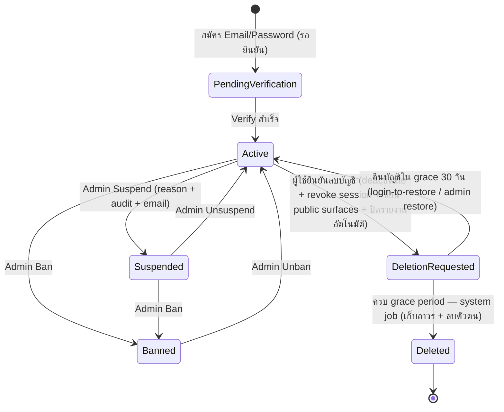
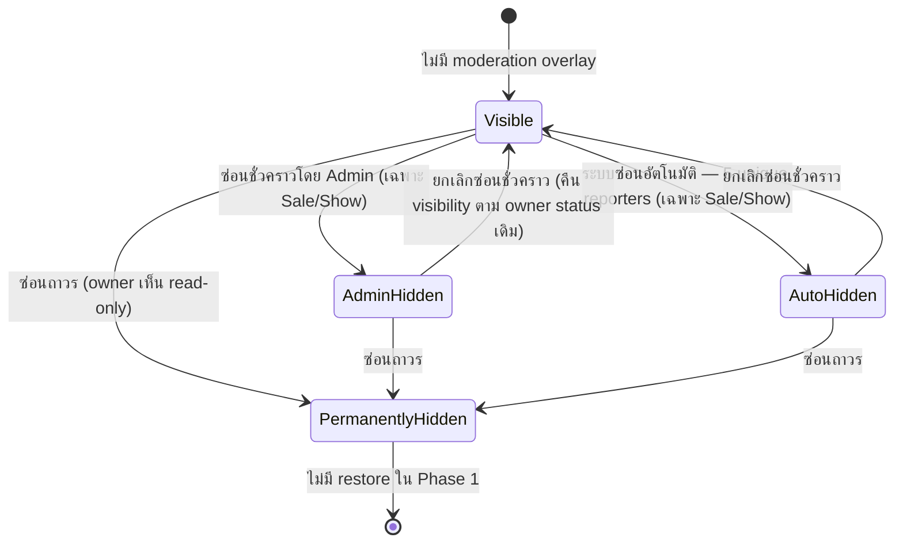
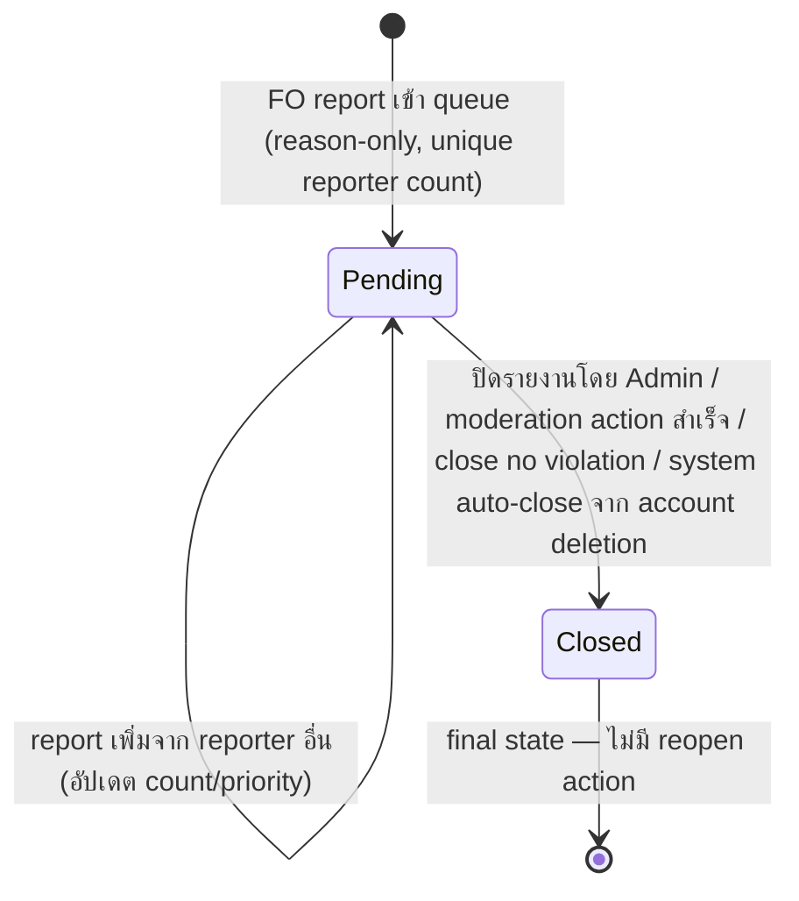
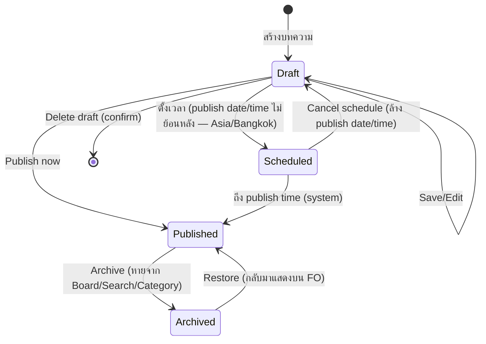

# Feature Specification & RTM Matrix — TukDaeng Back Office

| Field | Detail |
| --- | --- |
| Document | TukDaeng Back Office — Feature Specification & RTM Matrix |
| Version | `BO-FSPEC-v1.0` |
| Date | 2026-11-17 |
| Status | Draft — รอ review |
| Canonical Source | Module specs `00`–`17` + `BO_MASTER_BASELINE.md` (legacy `BO_PRD.md`, `BO_Spec.md`, `BO_Spec_Completion_Addendum.md` superseded ตาม DOC-010) |

## 1. ตารางรายการฟีเจอร์หลักและเกณฑ์การตรวจรับมาตรฐาน (Master Feature Matrix & Standard Acceptance)
> ระบุรายการฟีเจอร์ที่ต้องส่งมอบทั้งหมดพร้อมเกณฑ์การตรวจรับมาตรฐาน (Standard Acceptance) ให้ชัดเจน Worker จะสกัดตารางนี้เข้า `app_features` และคำนวณ `% ความก้าวหน้า` (`0% - 100%`) เมื่อผ่านการตรวจรับ `AI Review (Approved)` ผ่านรูปภาพหลักฐานและเกณฑ์มาตรฐาน

| รหัสฟีเจอร์ | ชื่อฟีเจอร์ (Feature Name) | ขอบเขตการทำงาน (Description) | เกณฑ์การตรวจรับมาตรฐาน (Standard Acceptance Checklist) | ความสำคัญ |
| :---: | :--- | :--- | :--- | :---: |
| **F-01** | ระบบยืนยันตัวตนและ Session ของ BO (Authentication & Session) | Login ด้วย Email + Password → BO เท่านั้น (ไม่มี OTP/MFA/2FA ใน current phase), failed-login lockout, session timeout, Forgot/Reset Password, My Account (Change Password, Active Sessions, Logout All Devices) | 1. แสดง Login form (split layout desktop / single column ≤1180px) พร้อม password visibility toggle และ "ลืมรหัสผ่าน?" link; invalid credentials แสดง generic error; login สำเร็จเปิด Dashboard พร้อม audit 2. Failed login ครบ 5 ครั้ง lock 15 นาทีพร้อม lockout message; session idle 8 ชม. / max 24 ชม. หมดอายุกลับ Login พร้อม session-expired message และ protected content ไม่ render 3. Forgot Password ตอบ generic response เสมอไม่เปิดเผย account existence; reset token อายุ 30 นาทีใช้ครั้งเดียว; reset สำเร็จ revoke ทุก session และกลับ Login form เปล่า | สูง |
| **F-02** | จัดการบัญชี Admin และ Invitation Lifecycle | Admin Account list/detail (status: Invited/Active/Locked/Suspended/Archived), Invite Admin, one-time invitation อายุ 72 ชม., activation ด้วย initial password, Resend/Cancel/Reissue, Suspend/Reactivate/Unlock/Archive, Change Role พร้อม safeguard | 1. Invite Admin สร้าง account `Invited` + invitation `Pending` (อายุ 72 ชม.) + audit `ADMIN_INVITATION_CREATE` + delivery log `DLV-ACCT-*` แบบ atomic; activation ผ่าน one-time link ตั้ง initial password ≥12 ตัวตาม policy แล้วเปลี่ยนเป็น `Active` 2. Admin Account List แสดง 7 columns พร้อม Master badge, filter/sort/pagination 10/page; Resend มี cooldown 60 วินาทีและ quota 5 issuances/24 ชม.; Cancel/Reissue แสดงตาม invitation state เท่านั้น 3. Suspend/Reactivate/Unlock/Archive/Change Role ต้องมี confirmation + reason selector (required) + impact note + audit; self/master/last-active-admin protection block action (ไม่แสดงใน DOM และ reject ที่ service layer) | สูง |
| **F-03** | Roles & Permissions | 8 System Role templates + Custom Role (`from_scratch` เท่านั้น), permission matrix ต่อ module/action, permission level 5 ระดับ, role assignment `role_id` contract | 1. Role List/Detail แสดง 8 System Roles พร้อม permission matrix; Create/Edit Custom Role ใช้ checkbox เลือก action จาก Phase 1 permission catalog; System Role ห้ามลบ/เปลี่ยนชื่อ/เปลี่ยน baseline 2. Permission enforce ที่ route, API และ service layer — direct URL ที่ไม่มีสิทธิ์แสดง access denied และ module ที่ไม่มีสิทธิ์ไม่แสดงใน navigation 3. Change Role ผ่าน safeguard ครบ (self-change, master admin, last Super Admin, last role-manager) พร้อม before/after permission diff และ audit `ADMIN_ACCOUNT_ROLE_CHANGE`; กรณีไม่ผ่านแสดง policy-blocked state ไม่เกิด mutation | สูง |
| **F-04** | Dashboard | หน้าแรกหลัง login: 6 KPI summary cards, Work Queue, Recent Activity + category filter, Dashboard Panels (Asset Status, Latest Articles, Top Searched Brands), direct navigation, `Last updated` | 1. แสดง KPI ครบ 6 cards ตามลำดับ (New Users, Active Users Today, New Assets, Reported Items, Articles, Watch Alert) พร้อม detail chips; header มี breadcrumb + `Last updated` GMT+7 และไม่มี Date Range/Refresh/Export/global search 2. Work Queue แสดง rows ตามลำดับและ priority color ที่กำหนด; Recent Activity มี filter `ทั้งหมด`/`Report`/`Content`/`System` ที่ทำงานจริง; ทุก card/row/panel คลิกไป module/submodule ปลายทางถูกต้องโดยไม่เปิด modal กลาง 3. Responsive: mobile (≤760px) 1 column คงลำดับ section; tablet/desktop แถว Work Queue + Recent Activity สูงเท่ากัน; initial load ≤3 วินาทีหลัง auth; partial load error ไม่ทำให้ทั้งหน้าใช้งานไม่ได้ | ปานกลาง |
| **F-05** | User Management (User Accounts + Reported Users) | User List (registered users เท่านั้น) + summary cards + search/filter/sort/pagination, User Detail ครบ sections, account actions (Send Password Reset, Suspend/Ban, Unsuspend/Unban), Reported Users queue + Report Detail | 1. User List แสดงเฉพาะ account ที่มี record (ไม่รวม guest), summary cards 4 ใบ, filter สถานะบัญชี/วิธีเข้าสู่ระบบ, sort 4 แบบ, pagination 10 users/page คงค่า search/filter/sort ระหว่างเปลี่ยนหน้า และไม่มี delete/archive/export action 2. User Detail แสดงครบ Account Summary, Link Profile, Contact/Auth (mask ตามสิทธิ์ ไม่มี row ว่าง), Assets Summary, Reports, Account Status History; Send Password Reset แสดงเฉพาะบัญชี Email/Password ที่ Active; Suspend/Ban/Unsuspend/Unban ต้องมี confirmation + reason + FO impact + audit และส่ง account-status email 3. Reported Users queue (ไม่มี summary cards) แสดง Report ID/Reported User/Account Status/Report Status/Reason/Reporter Count/Priority/Sources พร้อม search/filter/sort/pagination 10 reports/page; Report Detail มี Reporter History + Admin Action History และลิงก์ display name เปิด User Detail; Close Report เปลี่ยนเป็น `Closed` พร้อม audit โดยไม่เปลี่ยนสถานะบัญชี | สูง |
| **F-06** | Asset Management (Asset List + Asset Detail + Moderation) | Asset List/detail พร้อม owner-controlled status (`Sale`/`Show`/`Hide`/`Sold`) + moderation overlay (`Admin Hidden`/`Auto Hidden`/`Permanently Hidden`) + `ลบโดยเจ้าของ`, sensitive data masking, actions ซ่อนชั่วคราว/ยกเลิกซ่อน/ซ่อนถาวร | 1. Asset List แสดง summary cards (Asset Status, Top Asset Brands), search, filter (รวมตัวเลือก `ซ่อนชั่วคราว` ที่รวม Admin/Auto Hidden), sort, pagination 10/page และ row action ตาม current state 2. Asset Detail แสดง core fields, commerce fields, sensitive fields (Purchase Price, Purchase Date, Purchase From, Proof of Payment, Sold History) แบบ masked/summarized read-only และ History section 3. ซ่อนชั่วคราวทำได้เฉพาะ `Sale`/`Show` และคง owner status เดิม; ยกเลิกซ่อนได้เฉพาะ `Admin Hidden`/`Auto Hidden`; ซ่อนถาวรทำให้ owner เห็น read-only และไม่นับใน portfolio value; Admin เปลี่ยน owner-controlled status โดยตรงไม่ได้; ทุก action มี confirmation + reason + before/after + audit และ sync ไป FO surfaces | สูง |
| **F-07** | Reported Assets (Post/Asset Report Queue) | Queue report case เดียวครอบ asset-linked (`AST-`) และ post-only (`POST-`), Asset Report Detail 3 sections, unique reporter counting, threshold rules 1/3/5 reporters พร้อม auto-hide | 1. Reported Assets queue แสดง report case จาก report source of truth (ไม่ infer จาก asset row) พร้อม Report ID/Asset/Status/Report Status/Reason/Reporters/Priority, search, filter (Pending/Closed + Priority), sort และ pagination 10 reports/page 2. Threshold ทำงานตาม rule: 1 reporter = `Pending`, 3 = review priority, 5 reporters + asset `Sale`/`Show` = ระบบซ่อนชั่วคราว (`Auto Hidden`) อัตโนมัติพร้อม audit; asset ที่เปลี่ยนเป็น `Hide`/`Sold` ก่อน admin action ต้องห้ามซ่อนชั่วคราวและแสดง current status ล่าสุด 3. Asset Report Detail ครบ Reported Asset reference (+ View Asset read-only modal), Reporter History (reason-only ตาม `PM_REASONS` 9 เหตุผล), Admin Action History; ปิดรายงานได้เฉพาะเมื่อ `Pending` และไม่อยู่ใน temp-hidden state; `Closed` เป็น final ไม่มี reopen | สูง |
| **F-08** | Reported Comments (Comment Report Queue + Moderation) | Queue report case ของ comment/reply (anchor `post_id`, `asset_id` derived), Comment Report Detail 4 sections, comment status contract (`Visible`/`Hidden`/`Removed`/`User Deleted`), moderation actions + author email notification | 1. Reported Comments queue แสดง Report ID/Comment excerpt/Asset (หรือ `POST-` ref + ผู้โพสต์เมื่อ post-only)/Report Status/Reason/Reporters/Priority พร้อม search/filter/sort/pagination 10 reports/page 2. Comment Report Detail ครบ 4 sections: Reported Comment reference (+ View Asset/post context read-only modal), Comment Detail (+ View all comments modal), Reporter History, Admin Action History 3. Hide comment เฉพาะ `Visible` (report ยัง `Pending`); Restore เฉพาะ `Hidden` (ปิด report อัตโนมัติ); Remove ได้จาก `Visible`/`Hidden` (ปิด report, กู้คืนไม่ได้); Close no violation ปิด report โดยไม่เปลี่ยน comment status; ทุก action มี confirmation + reason + audit + ส่งอีเมล author (ยกเว้น Close no violation) | สูง |
| **F-09** | Content Management (Articles + Categories) | Articles list/detail/editor พร้อม block builder, draft/publish/schedule/archive lifecycle, Preview as FO, Categories CRUD + reorder + active status, Board Main placement จาก Published Articles | 1. Articles list มี primary action `สร้างบทความ`, search/filter (status + category)/sort/pagination 10 articles/page; row action แสดงตาม status (Delete draft, Cancel schedule, Archive, Restore) 2. Article editor บังคับ title + slug unique + active category + cover image (JPG/PNG/WebP ≤5MB); block builder รองรับ 10 block types พร้อม add/move up/down/delete และต้องมี ≥1 block ที่ไม่ใช่ Divider; inline parsing `**bold**`/`_italic_`/`~~strike~~`; hyperlink ต้องเป็น safe URL; Scheduled ต้องใส่ publish date/time (Asia/Bangkok) ไม่ย้อนหลัง 3. Preview as FO แสดง board card + phone-style preview ด้วย form values ก่อน save; Categories มี list/detail/create-edit modal + reorder modal + active status; article `Published` เข้า Board Main placement อัตโนมัติตาม eligibility pool | ปานกลาง |
| **F-10** | Market Data (Read-only Catalog + Sync History) | Market Data Dashboard (4 summary cards + Latest Sync Status strip + Recently Updated Brands), Brands & Models drill-down Brand → Model → Reference drawer (spec grid, USD price card, chart), Sync History + detail — read-only ทั้งหมดใน Phase 1 | 1. Dashboard แสดง 4 summary cards (Total Brands, Total Models, Total References, Last Sync) + conditional status strip เมื่อมี sync กำลังทำงาน/ผิดพลาด และตาราง Recently Updated Brands ที่คลิกไป Brand detail ได้ 2. Brands & Models ค้นหา brand/model/reference ได้และ drill-down 3 ระดับจนถึง Reference detail drawer (spec grid, USD price + currency ชัดเจน, chart, source note); ปุ่มกลับแต่ละระดับกลับ context เดิม 3. Sync History แสดง summary cards + table (job/scope/status/time/result/issue) + detail (Job ID, endpoint, criteria, error code, retry, rate-limit, cache impact); failed sync ต้องระบุว่าไม่ replace cache เดิม; add/edit/delete/import/export/override/status change แสดง modal `Read-only in Phase 1` | ปานกลาง |
| **F-11** | Option Master (+ Suggestion Queue) | Option Group List + Option Detail, option/group CRUD + deactivate/reactivate/delete + reorder (drag-and-drop + up/down fallback), Group Audit Log view, Suggestion Queue (promote/map alias/ignore) สำหรับค่า `ระบุเอง` จาก FO | 1. Option Group List แสดง table + summary + filter/search/sort/pagination + row action menu; Option Detail มี Add Option entry; Add/Edit Option modal ล็อก Group Key/Option Key หลังสร้างพร้อม validation และ confirmation 2. Deactivate/Reactivate ผ่าน reason selector + safeguard (ต้องมี ≥1 active option เหลือในกลุ่ม; group deactivate ห้ามเมื่อมี asset ใช้); Delete option/group เป็น destructive ต้อง type-to-confirm และไม่มี asset ใช้; Reorder modal รองรับ drag-and-drop + up/down fallback; Group Audit Log view เป็น read-only พร้อม action/timestamp/actor/reason/diff 3. Suggestion Queue เปิดจาก page action + pending badge แสดง combined queue ทุก supported group; Promote สร้าง option จริง (+ `OPTION_SUGGESTION_PROMOTE` audit), Map alias สร้าง `spec_option_aliases`, Ignore บังคับ note; resolved แล้วไม่กลับเป็น pending | ปานกลาง |
| **F-12** | Market Demand (Overview + Search Insights + Watch Alert — Read-only) | Demand Overview (KPI tiles, trigger trend chart, Top Brands/Models/References drill-down, frequently triggered), Search Insights (popular keyword/filter/combination, no-result, trend, search funnel, avg results, free-text demand signal), Watch Alert List + Alert Detail 6 sections — read-only ทั้งหมด ไม่มี admin action/export | 1. Demand Overview แสดง aggregate KPI tiles, trigger trend chart, Top Criteria progress bars พร้อม drill-down 3 ระดับ และ frequently triggered list — ไม่มี mutation 2. Search Insights แสดง popular keyword, popular filter selection/combination, no-result search, search trend, search funnel 4 ขั้น (Search Submit → Result Click → Asset Detail → Watch Alert) และ average results per search แบบ aggregate เท่านั้น ไม่มี user-identifying data 3. Watch Alert List read-only (ไม่มี action menu) มี filter Status/Notification/Trigger history/Match status/Last Triggered date range + sort + pagination 10/page + mobile card + filter state persistence; row click เปิด Alert Detail ครบ 6 sections พร้อม Detail Head badges, Asset ID link ไป Asset Detail, delivery status badges, soft-delete notice และ inactive market data warning | ปานกลาง |
| **F-13** | Help & Support (Policy & Versioning + Support Center) | Settings > Policy & Versioning: list 2 policy types (Terms of Use, Privacy Policy), Policy Detail TH/EN tabs, Policy Editor bilingual, publish/archive/restore version lifecycle; Settings > Support Center: channel form 5 ประเภท + business hours + availability TH/EN + preview | 1. Policy List แสดง 2 policies (ไม่มี search/filter/pagination/summary cards) พร้อม badge `Published` + `Draft {version}` เมื่อมี draft; Policy Detail แสดง language tabs TH/EN + published content + metadata tiles + actions (Create Draft / Edit Draft / Version History) 2. Policy Editor มี contenteditable canvas TH/EN + formatting toolbar (allowed tags P/H2/H3/UL/OL/LI/A/STRONG/EM/BR) + change summary required + Save Draft/Preview/Publish; Publish ผ่าน confirmation modal แล้วเวอร์ชันเดิม → `Archived` อัตโนมัติ (มี Published เพียง 1 + Draft ≤1 ต่อ type); Version History + View/Restore modal (restore สร้าง Draft ใหม่ไม่แตะต้นทาง) 3. Support Center form มี channel list 5 ประเภท (LINE/Phone/Email/Facebook/Website) พร้อม Active toggle + value + description TH/EN + business hours + availability TH/EN + required validation + disabled state เมื่อ inactive; Preview modal แสดง phone-frame FO Help พร้อม TH/EN toggle และ live form data | สูง |
| **F-14** | Account Deletion | Request queue (search/filter/sort/pagination), Request Detail (User Context, Deletion Timeline, Dependency Summary, Deletion Plan, History & Actions), grace period 30 วัน, Restore/Reject Restore modals, system auto-delete + lifecycle email 5 จุด | 1. Queue แสดง Request ID/User(link User Detail)/Assets/Request Status pill/Account Status pill/Grace countdown pill/Requested At พร้อม filter request status + grace period state + sort + pagination 10/page; Request Detail ครบ 5 sections และ Detail Head มี Serious flag เมื่อมีรายงานร้ายแรง 2. ปุ่ม `คืนบัญชี`/`ปฏิเสธคืนบัญชี` แสดงตลอด grace period พร้อม modal ที่มี reason selector (required) + note + impact note + email note + email preview (live ตาม reason) + result + audit; restore sync account กลับ `Active` + เขียน Account Status History; reject ไม่เริ่มนับ grace ใหม่และปฏิเสธซ้ำได้ 3. ครบ 30 วัน system job ลบบัญชีอัตโนมัติ (เก็บถาวร + ลบตัวตนในขั้นเดียว) พร้อม audit `ACCOUNT_DELETION_AUTO_DELETE`; lifecycle email 5 จุดส่งไป registered email พร้อม delivery log `DLV-DEL-<req>-<event>` ที่ trace จาก History & Actions ไป Settings > Delivery Logs | สูง |
| **F-15** | Audit Log | Immutable audit event store ครอบคลุมทุก module, list + search/filter (module, risk, date range)/sort/pagination, Audit Detail drawer พร้อม before/after diff + reference jump, export policy | 1. Audit Log list มี search ช่องเดียว (Event ID, Actor, Action, Reference), filter module + risk level + date range (from ≤ to clamp), sort ล่าสุด/เก่าสุด, reset, pagination 10/page และ filter state persistence เฉพาะ scope ภายใน module 2. Row click เปิด right sidebar drawer read-only แสดง Event Summary (เวลา Asia/Bangkok + module/risk/result tags + actor + reference), Reference pill ที่ jump ไป entity detail ตาม prefix (ADM/DEL/AST/ART/RCO/U-) และ Before/After diff เฉพาะเมื่อค่าต่างกัน 3. Audit record ห้ามแก้ไข/ลบจาก UI; audit ต้องเขียนสำเร็จก่อนหรือพร้อม mutation (fail → block หรือ reliable retry); payload ห้ามมี password/password hash/OTP/raw token/session token/secret; retention ≥1 ปี | สูง |
| **F-16** | Admin Settings (+ Delivery Logs) | My Account self-only (Profile/Edit Name, Change Password, Active Sessions, Logout All Devices), Security/System defaults, Retention/Export policy, Feature flags, Integration metadata, Settings > Delivery Logs read-only | 1. My Account เปิดจาก profile footer (ไม่เพิ่ม Settings submenu); Change Password ใช้ current/new/confirm พร้อม complexity ≥12 ตัว — wrong-current ไม่ audit ต่อครั้ง ครบ 5 ครั้งสร้าง `ADMIN_PASSWORD_CHANGE` Failed `RATE_LIMITED`; Active Sessions แสดงเฉพาะ session ตัวเอง (masked) และ Logout All Devices revoke ทุก session แบบ all-or-nothing แล้วกลับ Login form เปล่า 2. Settings sections (security, system defaults, retention/export policy, feature flags, integration metadata) บันทึกผ่าน permission + confirmation เมื่อจำเป็น + change history ที่ link ไป Audit Log 3. Delivery Logs เป็น read-only list พร้อม search/filter (status Sent/Retry, channel Email/Push)/sort/pagination 10/page + detail modal ไม่มี action footer; Phase 1 ไม่มี retry/export action ใน UI (retry เป็น provider/outbox state) | สูง |

### ขอบเขตอนาคต (Future Scope — Phase 2 / Postponed)

> รายการด้านล่าง **ไม่อยู่ใน Phase 1 matrix** และต้องไม่ปะปนเข้ากับ acceptance checklist ด้านบน ต้องทำ prototype เสร็จก่อนจึงปรับเป็น Phase 1 ตาม `BO_MASTER_BASELINE.md` §5–§6

| รหัส | ฟีเจอร์อนาคต | Phase | ขอบเขตตาม spec |
| :---: | :--- | :---: | :--- |
| **FUT-01** | Directory | Postponed | `07_DIRECTORY_MODULE.md` — รอ FO directory detail routes และ taxonomy approval; ห้ามเปิด BO Directory menu/route/CRUD ใน Phase 1 |
| **FUT-02** | Notifications — Broadcast & System Templates | 2 | `14_NOTIFICATIONS_MODULE.md` — broadcast create/schedule/send, target audience, system trigger enable/disable, template title/body, notification report metrics (Delivery Logs อยู่ใน Phase 1 แล้วใต้ Settings) |
| **FUT-03** | Reports & Analytics | 2 | `15_REPORTS_ANALYTICS_MODULE.md` — exportable reports ข้าม user/asset/chat/board/comment/search/watch alert/notification/account deletion + export jobs |
| **FUT-04** | Chat moderation workflow | 2 | Remove/hide chat message, reported chat queue (ไม่มีใน Phase 1 prototype) |
| **FUT-05** | Advanced moderation + external integrations | 3 | Automated compliance tools, AI moderation, advanced dispute workflow, CRM/external compliance integration |

---

## 2. [มิติที่ 2] ลำดับสถานะและเวิร์กโฟลว์ (State Machine & Workflow Transitions)
> อธิบายการเปลี่ยนสถานะของงาน เงื่อนไขการล็อกสถานะ และผลกระทบเมื่อสถานะเปลี่ยน

### 2.1 สถานะบัญชีผู้ใช้ FO และคำขอลบบัญชี (User Account + Account Deletion Lifecycle)

```mermaid
stateDiagram-v2
    [*] --> PendingReq : FO confirm Delete Account (รอดำเนินการ)
    PendingReq --> Restored : คืนบัญชีแล้ว (user sign-in / admin + reason + email)
    PendingReq --> Rejected : แอดมินปฏิเสธคืนบัญชี (reason; ไม่เริ่มนับ grace ใหม่; ปฏิเสธซ้ำได้)
    Rejected --> Restored : แอดมินคืนบัญชีภายหลัง (ยังอยู่ใน grace)
    PendingReq --> DeletedIdentity : ครบ grace 30 วัน — ลบตัวตนแล้ว (system job)
    Rejected --> DeletedIdentity : ครบ grace เดิม — system job
    Restored --> [*]
    DeletedIdentity --> [*]
```

### 2.2 สถานะสินทรัพย์และ Moderation Overlay (Asset Lifecycle)

Owner-controlled status (Admin เปลี่ยนตรงจาก BO ไม่ได้):

```mermaid
stateDiagram-v2
    [*] --> Sale : owner publish (marketplace)
    [*] --> Show : owner publish (collection)
    [*] --> Hide : owner publish (owner-only)
    Sale --> Show : owner
    Show --> Sale : owner
    Sale --> Hide : owner
    Hide --> Sale : owner
    Show --> Hide : owner
    Hide --> Show : owner
    Sale --> Sold : owner mark sold (แก้จาก FO ไม่ได้; เห็นใน Sold tab)
    Sale --> OwnerDeleted : ลบโดยเจ้าของ (BO เก็บ record ตาม retention)
    Show --> OwnerDeleted : ลบโดยเจ้าของ
    Hide --> OwnerDeleted : ลบโดยเจ้าของ
    Sold --> [*]
    OwnerDeleted --> [*]
```

Moderation state (overlay บน owner status — ไม่เปลี่ยนค่า owner status เดิม):

### 2.3 Report Case และ Comment Moderation

Report case lifecycle (ใช้ร่วมกันใน Reported Users / Reported Assets / Reported Comments):

Comment status (overlay บน comment record — แยกจาก report status):

```mermaid
stateDiagram-v2
    [*] --> Visible : comment ปกติ (รวม comment ใน report ที่ยัง Pending)
    Visible --> Hidden : Hide comment (report ยัง Pending; ส่งอีเมล author)
    Hidden --> Visible : Restore comment (ปิด report อัตโนมัติ; ส่งอีเมล author)
    Visible --> Removed : Remove comment (ปิด report; กู้คืนไม่ได้; ส่งอีเมล author)
    Hidden --> Removed : Remove comment
    Visible --> UserDeleted : user ลบ comment เอง
    Removed --> [*]
    UserDeleted --> [*]
```

### 2.4 Content และ Policy Version Lifecycle

Article status lifecycle:

Policy version lifecycle (ต่อ policy type — Terms of Use / Privacy Policy):

```mermaid
stateDiagram-v2
    [*] --> Draft : Create Draft (มี Draft ≤1 ต่อ type)
    Draft --> Published : Publish (Draft → Published; เวอร์ชัน Published เดิม → Archived อัตโนมัติ; มี Published เพียง 1)
    Published --> Archived : superseded โดยเวอร์ชันใหม่
    Archived --> Draft : Restore (สร้าง Draft ใหม่จากเนื้อหาเวอร์ชันที่เลือก — ไม่เปลี่ยนสถานะต้นทาง)
```

### 2.5 บัญชี Admin และ Invitation Lifecycle

Admin account status:

```mermaid
stateDiagram-v2
    [*] --> Invited : Invite Admin (สร้าง account + invitation Pending; login ยังไม่ได้)
    Invited --> Active : activation สำเร็จ (consume one-time token + ตั้ง initial password)
    Active --> Locked : failed login ครบ 5 ครั้ง / security action
    Locked --> Active : Unlock โดยแอดมิน / ครบ lockout 15 นาที / reset password สำเร็จ
    Active --> Suspended : Admin Suspend (reason + audit; session ถูกยกเลิก)
    Suspended --> Active : Reactivate
    Suspended --> Archived : Archive (เก็บ audit history)
    Locked --> Archived : Archive
    Archived --> [*]
```

Invitation status (state machine แยกจาก account — `Pending` ได้สูงสุด 1 record ต่อ account):

```mermaid
stateDiagram-v2
    [*] --> Pending : ออก invitation (อายุ 72 ชม.; revision 1)
    Pending --> Used : activate สำเร็จ (terminal — account → Active ใน transaction เดียวกัน)
    Pending --> Expired : server time ≥ expires_at (terminal — Reissue ได้)
    Pending --> Cancelled : แอดมินยกเลิก (terminal — account คง Invited; Reissue ได้)
    Pending --> Superseded : issuance ใหม่จาก Resend/Reissue (terminal)
    Used --> [*]
    Expired --> [*]
    Cancelled --> [*]
    Superseded --> [*]
```

- **กฎการควบคุมสถานะ (State Transition & Lock Rules):**
  - Admin ห้ามเปลี่ยน owner-controlled status ของ asset (`Sale`/`Show`/`Hide`/`Sold`) โดยตรงจาก BO — เปลี่ยนได้เฉพาะ moderation overlay (`Admin Hidden`/`Auto Hidden`/`Permanently Hidden`) และ overlay ไม่แตะค่า owner status เดิม
  - Report case `Closed` เป็น final state ทุก queue (users/assets/comments) — ไม่มี reopen action ใน Phase 1
  - `Permanently Hidden`, `ลบโดยเจ้าของ`, comment `Removed`, `User Deleted` และ account `Anonymized`/`Deleted` เป็น terminal — ไม่มี restore path; หลังลบบัญชีอัตโนมัติแล้วปุ่มคืนบัญชี/ปฏิเสธต้องไม่แสดง
  - Policy: มี `Published` เพียง 1 เวอร์ชันและ `Draft` ≤1 เวอร์ชันต่อ policy type; publish draft ต้อง archive เวอร์ชันเดิมอัตโนมัติใน transaction เดียวกัน; restore archived สร้าง Draft ใหม่เสมอ ไม่ mutate ต้นทาง
  - Article ที่ `Published`/`Archived` เมื่อเปิดแก้ไขต้องคง lifecycle status เดิม — การเปลี่ยนสถานะทำผ่าน status action confirmation flow เท่านั้น
  - Stable identifier ล็อกหลังสร้างและห้าม reuse: Report ID (`RPU-`/`RPO-`/`RCO-`), post ref (`AST-`/`POST-` frozen ตอน intake), Policy ID (`POL-TOU`/`POL-PP`), Option Key/Group Key, Admin ID, Delivery ID
  - Invitation `Pending` ต้อง unique ต่อ target account (unique partial constraint หรือ serialization เทียบเท่า); activation ต้อง compare-and-consume `Pending → Used` + `Invited → Active` ใน transaction เดียวกัน; terminal invitation กลับเป็น `Pending` ไม่ได้ — Reissue สร้าง revision ใหม่เท่านั้น
  - Mutation สำคัญต้องเขียน audit สำเร็จก่อนหรือพร้อมกัน — audit write fail ต้อง block action หรือเข้า reliable retry; audit record ห้ามแก้/ลบจาก UI (redact ผ่าน redaction event แยก)
  - Option deactivate ต้องเหลือ ≥1 active option ในกลุ่ม; delete option/group ต้องไม่มี asset ใช้ (`used_in_assets=false`) และ type-to-confirm; suggestion ที่ `promoted`/`mapped` ไม่กลับเป็น `pending`
  - การปฏิเสธคืนบัญชีไม่เริ่มนับ grace period ใหม่ — ใช้วันครบกำหนดเดิม `deactivated_at + 30 days` เสมอ; self-restore ถูก block เฉพาะคำขอที่ถูกปฏิเสธ (sign-in เจอ support state)
  - Role change ต้องผ่าน safeguard self-change / master admin / last Super Admin / last role-manager ที่ route, API, service และ persistence layer ก่อน mutate
  - Watch Alert match เฉพาะ asset status `Sale` ผ่าน moderation/visibility/block rule; หลัง backfill relation id จาก promote/map alias ต้อง re-run match evaluation และ dedup ด้วย (`alert_id`, `asset_id`) — ห้าม notify asset เดิมซ้ำใน alert เดียวกัน

---

## 3. [มิติที่ 4] การเชื่อมต่อระบบภายนอกและ Webhook รายฟีเจอร์ (Integration Complexity)
- **การเชื่อมต่อ 3rd-Party APIs / AI / Cloud Storage / MCP:**
  - **The Watch API (`thewatchapi`)** — external provider เดียวของ Market Data: รองรับ brand/model/reference list-search, watch detail และ brand/model/reference price history; เรียกผ่าน TukDaeng backend เท่านั้น (FO client ห้ามเรียกตรง; BO/FO อ่านจาก internal API/cache); API token เก็บใน backend secret/config; sync jobs บันทึก Sync History พร้อม endpoint, params, parent entity, provider error code/message, retry count, rate-limit metadata และ cache invalidation result; failed sync ไม่ replace cache เดิม — FO fallback ใช้ cached data ล่าสุด; manual sync trigger เฉพาะ operations permission + audit + rate-limit guard
  - **Provider price (USD → THB)** — ต้องเก็บ conversion metadata ครบ (`source_currency`, `source_price`, `converted_price_thb`, `fx_rate`, `fx_rate_date`, `provider_updated_at`, `synced_at`) ก่อนใช้แสดง/คำนวณเป็น THB บน FO
  - **Email provider (transactional)** — ใช้ส่ง Admin invitation, Forgot/Reset Password, account-status email (suspend/ban/restore), Account Deletion lifecycle email 5 จุด และ author notification email ของ comment moderation ผ่าน transactional outbox (`delivery_outbox`); recipient รองรับ email จาก Email/Password, Google และ Apple private relay
  - **Push notification provider** — Watch Alert delivery ไปยัง FO destination `Watch Alert Result List` (ห้ามใช้ Asset Detail เป็น destination); provider เช่น FCM เป็น implementation dependency — Phase 1 BO ดู status ผ่าน Settings > Delivery Logs แบบ read-only
  - **ไม่มี AI / Cloud Storage / MCP / CRM integration ใน Phase 1** — เป็น Phase 3 scope ตาม baseline; image upload ของ article editor เป็น feature ภายใน ไม่ใช่ 3rd-party contract ที่ spec กำหนด
  - **รูปแบบ Auth:** BO session = JWT + refresh token หรือ secure session model เทียบเท่า (idle 8 ชม. / max 24 ชม.); invitation token สร้างด้วย CSPRNG ≥256 bits ส่งผ่าน HTTPS link เท่านั้นและเก็บ keyed HMAC-SHA-256 + key rotation metadata (secret/pepper อยู่ secret manager); reset token อายุ 30 นาที one-time; production พิจารณา IP whitelist option
  - **การจัดการ Timeout/Failure:** sync job เก็บ retry count + rate-limit metadata ที่ provider ส่งมา; delivery retry ใช้ exponential/backoff — invalid token mark failed/skipped, destination invalid ไม่ retry จนกว่าแก้; provider failure ไม่ rollback mutation ที่ commit แล้ว (คง account `Invited` / account status เดิม); อีเมล "ลบตัวตนแล้ว" ต้องส่งก่อน anonymize — ถ้าส่งไม่สำเร็จต้อง retry ก่อน anonymize หรือตาม product policy; auto-delete job failed คง status/mark failed + audit และลบในรอบถัดไป
- **การรับ-ส่ง Webhook และการป้องกันข้อมูลซ้ำ (Idempotency):**
  - Phase 1 **ไม่มี inbound webhook contract** ใน spec — integration เป็น pull-based provider sync job (The Watch API) + transactional outbox สำหรับ email/push; FO sync เป็น async/state propagation ไม่ใช่ webhook
  - **Idempotency ที่ mutation boundary:** ทุก admin mutation รับ `idempotency_key` + `correlation_id` + expected revision fields; durable operation ledger (`admin_invitation_operations`) เก็บ request fingerprint — key เดิมกับ payload ต่างกันต้อง reject; exact retry ด้วย key เดิมคืนผลเดิมโดยไม่สร้าง audit/delivery ซ้ำ; concurrent submit มีผู้ชนะหนึ่งคำขอเท่านั้น (safe `used/stale` result สำหรับคำขออื่น)
  - **Supersede semantics:** Resend invitation / reset-password request ใหม่ต้อง supersede token เดิมแบบ atomic; ไม่ใช้ hard delete กับ record — terminal record คงไว้ตาม retention/audit policy
  - **Delivery dedup:** system notification ต้องมี idempotency key ป้องกันส่งซ้ำ; Watch Alert notify dedup ด้วย (`alert_id`, `asset_id`); outbox attempt แต่ละครั้งมี immutable attempt/result trace; provider retry ห้ามสร้าง account/invitation/notification ซ้ำ
  - **Correlation:** account/invitation/audit/outbox/delivery ใช้ `correlation_id` เดียวกันตลอด lifecycle — Delivery ID (`DLV-ACCT-*`, `DLV-DEL-*`, `DLV-WA-*`) trace กลับไป source mutation และ audit event ได้เสมอ; ห้ามเก็บ raw/hashed token, password material, OTP, session token, provider credential หรือ idempotency secret ใน delivery/audit/log ใด ๆ
  - **FO sync timing contract (DEC-49):** security actions (suspend/ban/deletion/session revoke) enforce ภายใน request ถัดไปของ user — ไม่มี tolerated delay; moderation actions propagate ≤60 วินาที (cache invalidate + validate entity status ก่อน render); reference/master data propagate ≤24 ชม. ผ่าน scheduled sync; Watch Alert match/notification เป็น async job ไม่ผูก SLA กับ user action
- **Open Decisions (มิติที่ 4):**
  - `BO-MARKET-DEC-002` — FX rate source สำหรับ USD → THB ยังไม่เลือก (ต้องเลือก central FX source และเก็บ fx metadata)
  - `BO-MARKET-DEC-004` — production plan/usage limit ของ The Watch API ยังไม่ยืนยัน (Dev/Ops ต้องยืนยัน plan, quota, endpoint access, rate limit ก่อน launch)
  - Email/push provider ที่แท้จริงยังไม่ล็อกใน spec — provider credential เก็บใน secret manager และห้ามอยู่ใน record/UI
  - Implementation detail ของ sync mechanism (queue, push vs pull, cache invalidation/API timing) — product contract (DEC-49) ล็อกเฉพาะ timing expectation; กลไกตัดสินตอนออกแบบ backend
  - Outbound webhook/callback ไป external system — ไม่มี scope ใน Phase 1 (external integrations เป็น Phase 3)

---

## 4. [มิติที่ 9] ความซับซ้อนของหน้าจอและประสบการณ์ผู้ใช้ (UI / Frontend Intricacy)
- **คอมโพเนนต์โต้ตอบความซับซ้อนสูง:**
  - **Article Editor + Block Builder** — 10 block types (Paragraph, H2, H3, Bullet/Numbered List, Hyperlink, Divider, Image+Caption, Quote, Comparison Table) พร้อม add/move up/down/delete, inline markdown parsing (`**bold**`, `_italic_`, `~~strikethrough~~`), safe-URL validation, image upload (JPG/PNG/WebP ≤5MB + aspect-ratio check), slug auto-generate/edit + uniqueness และ publish scheduling ที่ required เฉพาะเมื่อ `Scheduled` (timezone `Asia/Bangkok`, ไม่ย้อนหลัง)
  - **Policy Editor bilingual TH/EN** — contenteditable canvas สลับ language tabs, formatting toolbar + allowed-tag sanitizer (P/H2/H3/UL/OL/LI/A/STRONG/EM/BR), change summary field, Save Draft/Preview/Publish/Cancel + editor sidebar และ chain modal Publish confirmation / Version History / Version View / Restore confirmation
  - **Phone-frame FO Preview modals** — Preview as FO (board card + phone-style article preview จาก form values ก่อน save), Support Center Preview (FO Help screen ใน phone frame พร้อม TH/EN toggle + live form data + empty state เมื่อไม่มี active channel), View Asset modal (read-only asset/provenance/image gallery จาก report context), View all comments modal, post context modal สำหรับ post-only report
  - **Confirmation modal pattern หลายขั้น** — target summary + reason selector (required) + optional note + impact note + email note + live email preview (อัปเดตตาม reason) + confirm/cancel + result state + audit reference; ใช้ซ้ำใน user/account/asset/comment/deletion/admin-account actions; destructive action ใช้ type-to-confirm (พิมพ์ Option Key/Group Key) และ delete group ต้องยืนยัน 2 ครั้ง
  - **Drag-and-drop Reorder modals + up/down fallback** — Reorder Option, Reorder Groups, Category Display Order: drag-and-drop บน desktop + arrow buttons บน touch device; save แล้ว audit ครั้งเดียวต่อ reorder batch
  - **Data visualization** — Demand Overview: aggregate KPI tiles, trigger trend chart, Top Criteria progress bars พร้อม drill-down Top Brands/Models/References; Search Insights: search funnel 4 ขั้น (แถว step + count + % เทียบ Search Submit), search trend over time, popular filter tags; Reference drawer: price index chart + spec grid; Market Data Dashboard: sync progress ring + conditional status strip
  - **Deletion Timeline + countdown** — vertical timeline 6 ขั้นพร้อมสถานะขั้น (เสร็จสิ้น/ปัจจุบัน/รอดำเนินการ) + grace period countdown pill (`เหลือ X วัน`/`ครบแล้ว`/`—`) + context notes (restore request, reject history ซ้ำได้, cancelled)
  - **Audit Detail drawer + diff** — right sidebar drawer (market-reference-drawer pattern) พร้อม Event Summary tags, Reference pill ที่ jump ข้าม module ตาม prefix (`ADM`/`DEL`/`AST`/`ART`/`RCO`/`U-` → entity detail; fallback = กรอง Audit Log + toast) และ Before/After diff box ที่ซ่อนเมื่อค่าเท่ากัน
  - **Sensitive reveal on-demand** — field อ่อนไหว mask เป็น default; reveal ต้องมี permission + business reason และ audit ทุกครั้ง
- **การจัดการสถานะและประสิทธิภาพฝั่ง Client:**
  - **Responsive 3 breakpoints** — Mobile `≤760px`: one-column shell + stacked cards + hamburger drawer; Tablet `761–1365px`: compact grid filters + table scroll ภายใน container; Desktop `>1365px`: persistent sidebar + dense table; auth screens ใช้ breakpoint 1180px (split → single column, dark theme); action สำคัญต้องเข้าถึงได้ทุกขนาด และ modal ต้องพอดี viewport + scroll ภายใน
  - **List toolbar contract กลาง** — search → filter → sort → pagination เสมอ; advanced filters เปิด/ปิดแบบ inline collapsible (ห้าม drawer/bottom sheet); sort อยู่ใน filter bar; page size 10 ต่อหน้า; เปลี่ยน search/filter/sort กลับ page 1 แต่เปลี่ยนหน้าคงค่าเดิม; footer `แสดง X-Y จาก Z` + `ก่อนหน้า`/numbered/`ถัดไป`; reset ล้างทั้งหมด
  - **Filter state persistence** — คง search/filter/sort/page เมื่อ drill-in detail แล้ว back ภายใน module เดียวกัน; jump เข้าจาก audit ref link เป็น fresh filtered view เสมอ (ล้าง state ค้างแล้วกรองด้วย ref เป้าหมาย); persist เฉพาะ scope module ไม่ leak ข้าม module
  - **Server-side pagination** — production ต้อง paginate/filter/sort ฝั่ง server สำหรับ list ใหญ่ (prototype เป็น client-side mock); ตารางใหญ่ห้ามโหลดทุก record เข้า browser
  - **Dashboard performance** — initial load ≤3 วินาทีหลัง auth; KPI Summary + Work Queue โหลดก่อน chart; section หนัก lazy load โดยไม่ block queue; partial load error แยกต่อ section พร้อม retry เฉพาะจุด; `Last updated` + stale warning
  - **Stale/concurrency state บน UI** — confirmation/action modal ต้องแจ้ง stale state เมื่อข้อมูลเปลี่ยนก่อนยืนยันและให้ refresh/retry; mutation ส่ง expected revision + idempotency key; action error คง modal เปิดแสดง error/result state ห้ามเปลี่ยน UI เป็น success; boundary rejection (stale revision, non-self, invalid session) reject โดยไม่ mutate
  - **Unsaved-change protection** — editor ฟอร์มยาวต้องเตือนก่อนออกเมื่อมีการแก้ไขค้าง
  - **State เดียวกันรองรับ** — loading skeleton ในพื้นที่ content, empty `ไม่พบข้อมูล` (เก็บ reset เมื่อเป็น empty หลัง filter), error + retry, access denied, session expired → login
  - **Accessibility** — label ชัดเจน, keyboard reachable controls, visible focus states, ไม่ใช้สีเป็นข้อมูลเดียว, ข้อความ/chip/button ไม่ล้นหรือซ้อนกันทุก breakpoint (QA widths: 390/760/768/1280/1440px + 1180px สำหรับ auth)
