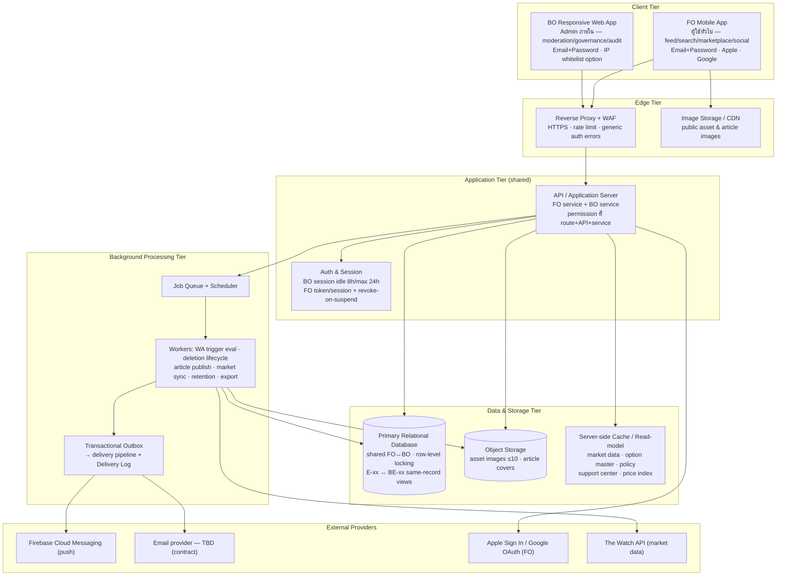
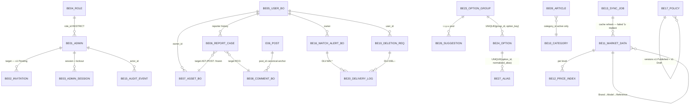

# System Architecture — TukDaeng Back Office

| รายการ | ข้อมูล |
|---|---|
| Version | 0.1 (draft) |
| Date | 2026-11-17 · Asia/Bangkok |
| Status | **DRAFT — รอ review** |
| Canonical source | `BackOffice/` module specs `00`–`17` + `BO_MASTER_BASELINE.md` + `docs/data-model-erd.md` + `docs/data-dictionary.md` (entity E-01..E-25, BE-01..BE-27) + `docs/business-process-flows.md` + `docs/pdpa-*.md` |
| หมายเหตุสถานะ | TukDaeng อยู่ระยะ spec/prototype — BO เป็น locked HTML prototype + module specs; เอกสารนี้อธิบาย **production target architecture** ที่สอดคล้องกับ contract ใน spec ไม่ใช่ infrastructure ที่ deploy อยู่จริง; ส่วนที่ยังไม่ตัดสินอยู่ใน Open Decisions ท้ายแต่ละ section |

---

## 1. [มิติที่ 1] โครงสร้างสถาปัตยกรรมระบบและแผนภาพ Topology (Architecture Complexity)
> อธิบายรูปแบบสถาปัตยกรรมระบบ ขอบเขตการทำงานของแต่ละคอมโพเนนต์ และการเชื่อมต่อระหว่างกัน พร้อมแผนภาพ Mermaid แสดงการไหลของข้อมูลตั้งแต่ไคลเอนต์จนถึงฐานข้อมูล

**รูปแบบสถาปัตยกรรม:** TukDaeng ใช้สถาปัตยกรรม **modular monolith + background workers** — application tier เดียวให้บริการทั้ง FO และ BO ผ่านชุด API/service ร่วมกัน บนฐานข้อมูล relational เดียวกัน (shared database) พร้อม background worker tier แยกสำหรับงาน asynchronous — ไม่ใช่ microservices ใน Phase 1 เพราะขอบเขต domain ยังกะทัดรัดและต้องการ atomic transaction ข้าม entity บ่อย (เช่น deletion intake, invitation activation)

**Client Tier — 2 clients แยกชัดเจน:**

- **FO Mobile App** — แอปผู้ใช้ทั่วไป (member/guest) ครอบ feed, search, marketplace, social, chat, watch alert, board, settings; auth = Email/Password + Apple Sign In / Google OAuth (`FO-16 §5/§7`)
- **BO Responsive Web App** — internal web system สำหรับทีม Admin เท่านั้น; แยกจาก FO ชัดเจน "Admin ไม่ใช่ admin access ใน FO mobile app" (`BO_MASTER_BASELINE §1`); auth = Email + Password เท่านั้น ไม่มี OTP/MFA/2FA ใน current phase (`BO-01 §7`) พร้อม IP whitelist option สำหรับ production (`BO-16 §10`)

**Edge Tier:**

- **Reverse Proxy + WAF + HTTPS** — entry point เดียวสำหรับทั้ง 2 clients; TLS บังคับทุก call (`FO-16 §8`); rate limit/abuse control ที่ security layer (ไม่เปิดเผย threshold ต่อผู้ใช้ — `BO-01 §10.1`)
- **Image Storage / CDN** — serve รูป asset (สูงสุด 10 รูป/asset) และรูปบทความ; private asset data ต้องตรวจสิทธิ์ก่อนส่งผ่าน CDN (`FO-16 §8`)

**Application Tier (shared FO↔BO):**

- **API / Application Server** — BO service + FO service บน runtime เดียวกัน; permission enforcement ที่ route + API + service layer เสมอ ("UI hiding ไม่ใช่ authorization" — `BO-01 §12`, `data-dictionary §9.3`)
- **Auth & Session** — แยก session domain: BO admin session (idle 8 ชม./max 24 ชม., lockout 5 ครั้ง → 15 นาที) vs FO user session/token — suspend/ban/deletion ต้อง revoke/block ใน request ถัดไป (security sync, `BO-00G §12` DEC-49)

**Data & Storage Tier:**

- **Primary Relational Database (shared)** — database เดียวเก็บ entity ทั้งสองฝั่ง; canonical schema เขียนเป็น PostgreSQL-style DDL (`BIGSERIAL`, `TIMESTAMPTZ`, `JSONB`) ใน `BO-17 §17`; FO entity E-xx กับ BO entity BE-xx หลายชุดเป็น "record เดียวกัน สอง representation" (continuation link ใน `docs/data-model-erd.md §1`)
- **Object Storage** — origin ของ image CDN (asset images, article cover images)
- **Server-side Cache / Read-model** — FO อ่าน reference data (market data, option master, policy, support center, price index) ผ่าน cached read-model เท่านั้น ไม่ block user flow (`BO-00G §12`, `BO-06 §14`)

**Background Processing Tier:**

- **Job Queue + Scheduler** — แยกงาน event-driven (real-time-ish) ออกจากงาน scheduled/batch
- **Workers** — watch alert trigger evaluation & notification delivery, account deletion lifecycle (grace reminder + auto-delete), scheduled article publishing, market data provider sync, retention cleanup, large export
- **Transactional Outbox** — core mutation commit พร้อม audit + outbox ใน transaction เดียว; provider call เกิดหลัง commit (`BO-01 §10.1` Audit/Delivery/Transaction Boundary)

**External Providers (`FO-16 §5/§6`, `pdpa-data-processing-register §2`):** Firebase Cloud Messaging (push), Email provider (TBD — contract), Apple Sign In / Google OAuth (FO only), The Watch API (`thewatchapi` — market data/price index); Payment Gateway = Phase 2, out of scope

**ขอบเขตคอมโพเนนต์ (component boundaries):**

- BO เป็นเจ้าของ lifecycle/moderation/master-data record; FO เป็นเจ้าของ intake/read model — เช่น report: FO เป็น action model ไม่เก็บ record, BO เก็บ `BE-06 Report Case` (X-02); watch alert: FO owns criteria, BO read-only view + trigger history (X-06); article/policy/support center/market data: BO owns record, FO อ่าน read model (`data-model-erd §1`)
- ขอบเขตข้อมูลแยกตาม app: Admin entity (`BE-01..04`) แยกจาก user entity (`E-01`/`BE-05`); sensitive data mask เป็น default ทั้งสองฝั่ง (`BO-00G §14`)
- Moderation overlay อยู่ฝั่ง BO เท่านั้น — ไม่แก้ owner status/ต้นฉบับของ entity (`data-model-erd §7`)

**Open Decisions:**

- โครงสร้าง deploy unit — monolith เดียวหรือแยก service BO/FO ตอน scale (ตอนนี้ contract คือ shared backend เดียว)
- กลไก FO sync (push vs pull, cache invalidation/API timing) — spec กำหนดแค่ product contract timing, implementation ตัดสินตอนออกแบบ backend (`BO-00G §12`)
- Analytics provider — TBD, opt-in เท่านั้น (`pdpa-data-processing-register §2`)

---

## 2. [มิติที่ 3] สถาปัตยกรรมข้อมูล ความลึก ERD และการรองรับข้อมูลขนาดใหญ่ (Data & ERD Complexity)

Canonical data model อยู่ใน `docs/data-model-erd.md` (5 erDiagrams + relationship mapping กลุ่ม A/B/C) และ `docs/data-dictionary.md` — inventory **E-01..E-25 (FO)** + **BE-01..BE-27 (BO)**, cross-side continuation links X-01..X-11

**โครงสร้างตารางหลักและคีย์อ้างอิง:**

- **ID/Ref patterns (BO-owned)** — `ADM-xxx` admin, `INV-xxxxx` invitation (immutable ห้าม reuse), `ROL-xxx` role, `U-xxxx` user, `AST-`/`POST-` asset/post refs, `RPU-`/`RPO-`/`RCO-` report case ตาม target type, `DEL-xxx` deletion request, `AUD-xxxxx` audit event, `WAL-XXXX` watch alert, `DLV-*` delivery (attempt seq ห้าม reuse), `POL-TOU`/`POL-PP` policy, `ART-` article, `JOB-*` sync job, `OG-xxx`/`OPT-xxx` option master (`data-dictionary §9.1`); report `target_ref` = **frozen identifier ณ intake** detail join current state เสมอ (`BO-00G §11`)
- **Primary Key / surrogate** — `spec_option_*` ใช้ `BIGSERIAL` PK ตาม DDL contract (`BO-17 §17.1–17.2`); entity อื่นใช้ stable business ref เป็น PK ตาม dictionary
- **Foreign Key** — `admin.role_id` **RESTRICT** (ไม่เก็บ permission payload ซ้ำ — B-01); `watch_assets.*_id` → `spec_options.id` nullable ทั้งหมด + `asset_delivery_items.option_id` required จำกัดเฉพาะ group `delivery` (CHECK constraint `chk_delivery_group` — `BO-17 §17.4/§17.5`); `watch_references.model_id` **nullable** (brand-scoped provider data ห้าม assume relation — `BO-06 §14`); comment anchor canonical = `post_id`, `asset_id` derived ผ่าน `post.assetId` (FE-01 DECIDED)
- **Unique constraints** — `UNIQUE(group_id, option_key)`, `UNIQUE(option_id, normalized_alias)`, `UNIQUE(group_id, normalized_text)` สำหรับ suggestion dedup, **unique partial บน `Pending`** จำกัด invitation ≤1 ต่อ account (`BO-17 §23`, `BO-01 §10.1`)
- **ข้อมูลเมตา JSONB** — `spec_option_audit.before_value/after_value` เป็น `JSONB` ตาม DDL (`BO-17 §17.3`); audit event `before_value`/`after_value` เก็บ JSON snapshot/diff พร้อม mask sensitive (`BO-08 §5`); `criteria_snapshot` ใน trigger record; embedded structures (E-09 `specGroups`, E-16 `msgs`/`cfg`, E-19 session state, trigger/status history sub-records) เป็น composition ใน parent — production อาจเป็น JSONB column/sub-document ไม่ใช่ตาราง (`data-model-erd §0/§7`)
- **ตารางประวัติ Audit Trail** — `BE-15 Audit Event` (actor `Admin`/`System`/`ProviderJob`, polymorphic `reference` ตาม prefix `U-/AST-/DEL-/ADM-/ART-/POL-/RPU-/RPO-/RCO-`, `correlation_id` เชื่อม workflow, immutable ห้ามแก้ผ่าน UI, audit write ต้องสำเร็จพร้อม mutation — `BO-08 §5/§7/§8`), `BE-25 spec_option_audit` (เฉพาะ Option Master, sync เข้า audit กลาง), `BE-20 Delivery Log`, `BE-13 Provider Sync Job`, `account_status_history[]` บน user record

**Core BO ERD (excerpt — full canonical ใน `docs/data-model-erd.md`):**

**การออกแบบคิวรีรองรับข้อมูลปริมาณสูง (High-Scale 1M+ Rows Ready):**

- **Zero N+1 Queries** — list/detail ต้องดึงข้อมูลแบบ batch ด้วย parameterized array (เช่น join `reporter history`, `matched assets`, `dependency summary` ใน query เดียว/ชุดเดียว ไม่ใช่ query ต่อ row); write path แบบ bulk: `ระบุเอง` free-text → bulk upsert `spec_option_suggestions` ด้วย `UNIQUE(group_id, normalized_text)` + `usage_count + 1` ใน operation เดียว (`BO-17 §23.3`); backfill relation id หลัง promote/map alias ทำเป็น batch update ไม่ใช่ทีละ record (`BO-17 §23.4`)
- **Chunking** — export ขนาดใหญ่เป็น background job ที่ process เป็น chunk และ file มี expiry (`BO-00G §16`, `BO-08 §12`); sync job แบ่ง scope ตาม endpoint/parent (`JOB-BRAND-LIST`, `JOB-MODEL-<brand>`) เพื่อไม่ให้ job เดียวรับผิดชอบ dataset ทั้งหมดและ failed ไม่ replace cache (`BO-06 §12–13`); retention purge แบ่ง chunk ต่อ data type
- **Column Projection** — list query เลือกเฉพาะ field ที่ตารางต้องแสดง + masked field เท่าที่ permission อนุญาต; reference drawer/detail โหลดเฉพาะ entity ที่เลือก (`BO-06 §21`); audit detail drawer โหลด payload เฉพาะ event ที่เปิด
- **Composite / Partial Indexes** — `idx_spec_options_group_active (group_id, is_active, sort_order)` รองรับ FO selector ที่ hit บ่อยสุด; audit indexes `(option_id, created_at DESC)`, `(action_type, created_at DESC)` (`BO-17 §17.5`); unique partial index บน invitation `Pending`; list หลักทุกหน้าใช้ **server-side pagination/sort/filter** (10 รายการ/หน้า ตาม standard) พร้อม index บน sort column (เช่น `created_at`, `requested_at`, `grace_end`) และ filter column ที่ใช้บ่อย (status, channel, target_type)
- **Aggregate read-model** — Dashboard metrics, Demand Overview KPI, Search Insights เป็น aggregate-only อ่านจาก pre-aggregated/rollup path (ไม่ scan raw rows ทุกครั้ง) และไม่มี user-identifying data (`BO-11 §6.1/§15`, `pdpa-compliance-map §2.2`)

**Open Decisions:**

- DB engine/build target — canonical DDL ใน spec เป็น PostgreSQL-style (`BIGSERIAL`/`TIMESTAMPTZ`/`JSONB`) แต่ยังไม่มี ADR ล็อก engine/hosting
- Embedded structures (chat `msgs`, trigger history, session state) จะเป็น JSONB column หรือแยกตาราง — inventory ระบุเป็น composition, production ตัดสินตอน schema design (`data-model-erd §0`)
- ตาราง viewer-level N—M (like/save/wishlist/follow/mute/block/ni) เป็น join table — ทิศทาง contract ชัดแต่ยังไม่มี DDL (`data-model-erd §7`)

---

## 3. [มิติที่ 5] การประมวลผลเบื้องหลัง คิวงาน และการควบคุม Concurrency (Async & Concurrency)

- **สถาปัตยกรรมคิวและระบบ Worker:**
  - **คิวงานด่วน (event-driven / near-real-time):**
    - **Watch Alert trigger evaluation** — async job เมื่อ asset เข้า/เปลี่ยนเป็น `Sale` หรือหลัง backfill; match pool = `Sale` + visibility + block rules เท่านั้น; **ไม่ผูก sync timing SLA กับ user action** (`BO-00G §12` DEC-49, `BO-11 §10`)
    - **Notification delivery pipeline** — transactional outbox → provider attempt → Delivery Log; watch alert delivery `DLV-WA-*` (push FCM, destination = Watch Alert Result List `BO-11 §12`), account-status/lifecycle email `DLV-ACCT-*`/`DLV-DEL-*` (email provider)
    - **Report auto-hide** — unique reporters ≥5 บน asset `Sale`/`Show` → `Auto Hidden` พร้อม audit (event ตอน report intake — `BO-04 §14`, B-13)
    - **Deletion intake cascade** — FO confirm → atomic: deactivate + revoke session + ซ่อน public profile/assets + ปิดรายงานอัตโนมัติ + สร้าง `DEL-` request (`BO-13 §4`)
  - **คิวงานประมวลผลรอบระยะเวลา (Scheduled/Batch Jobs):**
    - **Account deletion lifecycle** — reminder email เมื่อเหลือ 7/3 วัน (`DLV-DEL-<req>-GR7`/`GR3`); **auto-delete เมื่อครบ grace 30 วัน** = เก็บถาวร + ลบตัวตน ขั้นเดียว; อีเมล "ลบตัวตนแล้ว" ต้องส่ง**ก่อน** anonymize และ retry ก่อน anonymize เมื่อส่งไม่สำเร็จ (`BO-13 §14`, `BO-14 §9.3`)
    - **Scheduled article publishing** — `Scheduled` → `Published` เมื่อถึง publish date/time `Asia/Bangkok` (`BO-05 §9/§10`)
    - **Market data provider sync** — `JOB-*` sync brand/model/reference lists + price history ตาม scope; brand-first workflow; failed ไม่ replace cache; enrich reference→model (`BO-06 §12/§14/§18`)
    - **Retention cleanup** — system job ที่ audit ตัวเอง: audit log ≥1 ปี (security/sensitive 2 ปี), chat purge 1 ปีหลัง anonymize, session metadata 90 วัน, delivery logs 1 ปี, deletion archive 5 ปี, export files 7 วัน (`BO-08 §11`, `DEC-53` retention schedule R-01..R-08)
    - **Large export** — audit/data export ขนาดใหญ่เป็น background job + file expiry (`BO-00G §16`, `BO-08 §12`)
    - **Invitation/token sweeps** — derive `Expired` จาก `expires_at <= now`; `ADMIN_INVITATION_EXPIRE` audit เมื่อ observe/persist (`BO-01 §10.1`)
  - **การล็อกแถวข้อมูลป้องกัน Race Condition:**
    - Worker หลายชุด claim job เดียวกันต้องใช้ row-level lock (claim-and-mark ใน transaction) — ฐานข้อมูลต้องรองรับ row locking
    - **Optimistic concurrency** ผ่าน revision guards: `account_revision`, `role.revision` + `expected_revision`, `token_revision`, `expected_invitation_id/status` — stale → reject ไม่เกิด partial mutation (`BO-16 §9.11`, `BO-01 §10.1`)
    - **Atomic transaction boundaries** ที่ spec กำหนดชัด: invitation activation = compare-and-consume `Pending→Used` + `Invited→Active` + persist hash + audit/outbox **ใน transaction เดียว** rollback ทั้งชุดเมื่อ audit/outbox fail (concurrent submit มีผู้ชนะคนเดียว); deletion intake = deactivate+revoke+hide+close-reports atomic; issuance ใหม่ supersede `Pending→Superseded` ใน transaction เดียวก่อนเรียก provider; reset password supersede token atomic + revoke ทุก session (`BO-01 §10.1`, `BO-13 §4`)
    - **Unique/partial constraints** enforce invariants ที่ DB level: ≤1 `Pending` invitation/account, `UNIQUE(group_id, option_key)`, `UNIQUE(option_id, normalized_alias)`, dedup suggestion `UNIQUE(group_id, normalized_text)`
- **ระบบ Retry, Idempotency และการกู้คืนงาน:**
  - **Idempotency** — `issuance_idempotency_key` + **durable operation ledger** (unique ตาม operation scope + actor/target + key, เก็บ request fingerprint/result ref; key เดิม payload ต่าง → reject) — ห้ามอาศัย field ใน invitation record เพียงอย่างเดียว (`BO-01 §10.1`); WA trigger dedup ด้วย `(alert_id, asset_id)` ห้าม notify asset เดิมซ้ำ (`BO-11 §10`); system notification ต้องมี idempotency key (`BO-14 §13`); delivery attempt seq ห้าม reuse — provider retry ห้ามสร้าง account/invitation/FO notification ซ้ำ (`BO-16 §16.3`)
  - **Outbox pattern** — core state + audit + transactional outbox commit/rollback พร้อมกัน; provider call **หลัง commit**; provider failure เปลี่ยนเฉพาะ delivery state + retry schedule ไม่ rollback mutation (`BO-01 §10.1`)
  - **Retry policy** — temporary provider failure retry ตาม exponential/backoff; invalid token/device/destination/disabled type → mark failed/skipped ไม่ retry; immutable attempt/result trace ทุก attempt (`BO-14 §13`, `BO-16 §16.4`)
  - **Job failure recovery** — sync job failed → คง cache เดิม + เก็บ error code/retry count/rate-limit metadata (`BO-06 §13`); auto-delete job failed → คง status หรือ mark failed + audit รอบถัดไป (`BO-13 §18`); audit write fail → block action หรือเข้า reliable retry queue ตาม risk policy (`BO-08 §8`); ทุก workflow เชื่อมด้วย `correlation_id` ผ่าน mutation → audit → outbox → delivery

**Open Decisions:**

- เทคโนโลยี queue/broker และ scheduler (ยังไม่เลือก — contract ต้องการ durable queue, row-claim semantics, scheduled recurrence)
- Watch Alert match engine: event-driven ต่อ asset change หรือ periodic scan — spec กำหนด behavior (trigger/dedup/exclusion) ไม่กำหนดกลไก (`BO-11 §10`)
- Push provider delivery tracking ลึกแค่ไหน (`Opened` event) — delivery status contract มี แต่ callback/telemetry integration ยังไม่ล็อก

---

## 4. [มิติที่ 6 & 7] ความมั่นคงปลอดภัย การแคชหลายระดับ และระบบสำรองอัตโนมัติ (Security, Scalability & SLA)

- **การออกแบบระบบแคชหลายระดับ (Multi-Tier Caching):**
  - **Client tier** — BO เป็น authenticated admin app: route ที่มี secret (invitation link `#token=`) บังคับ `Cache-Control: no-store` + `Referrer-Policy: no-referrer` ห้ามเก็บ token ใน cookie/storage (`BO-01 §10.1`); static assets cacheable ปกติ; FO app อ่าน reference data ผ่าน cached read-model ไม่ block flow (`BO-00G §12`)
  - **Edge / CDN** — Image Storage/CDN serve รูป asset (≤10 รูป) + article covers เฉพาะ public asset; **private asset data ต้องตรวจสิทธิ์ก่อนส่งผ่าน CDN**; public surfaces ห้ามโหลดรูปของ asset ที่ viewer ไม่มีสิทธิ์ (`FO-16 §8/§Image Storage`)
  - **Server-side read-model** — market data, option master, price index, policy, support center = **cached read-model ที่ FO อ่านเท่านั้น** (propagation ≤24 ชม.); market data cache replace เฉพาะเมื่อ sync `Completed` — `Failed` ไม่ replace (`BO-06 §13/§14`); TTL contract: reference data ≤24h, session idle 8h, cached FO list ต้อง validate entity status ก่อน render เสมอ (`BO-00G §12`)
  - **Circuit Breaker / fallback chain** — provider unavailable/rate-limit → serve **last-good cache** + mark sync `Failed` พร้อม error code (`BO-06 §14`); Watch Price API down → Portfolio fallback `Purchase Price → No Valuation` ไม่ทำให้ feature ใช้ไม่ได้ (`FO-16 §Watch Price API`); FCM/email provider down → `Failed`/`Retry` ใน delivery state ไม่ rollback mutation (`BO-14 §13`); share link/public guest view ต้องไม่ bypass hide/remove/inactive status — validate ก่อน render เสมอ (`BO-00G §12`)
- **การป้องกันเชิงลึก (Defense-in-Depth Security):**
  - **AuthN** — BO: Email+Password เท่านั้น (ไม่มี OTP/MFA V1), session idle 8 ชม./max 24 ชม., failed login 5 ครั้ง → lock 15 นาที + audit, IP whitelist option สำหรับ production (`BO-01 §8/§9`, `BO-16 §10`); invitation = one-time link 72 ชม., เก็บ **keyed HMAC-SHA-256 hash** ของ CSPRNG token เท่านั้น ห้ามเก็บ raw token; reset token 30 นาที one-time supersede atomic; password ≥12 ตัว + 4 char classes + approved KDF (`BO-01 §8.1/§9.1/§10.1`); FO: email/password + Apple/Google SSO, revoke เมื่อ Suspended/Banned/Delete (`FO-16 §7/§8`)
  - **AuthZ** — Admin account type เดียว + Role (`BE-04`: 8 system baseline immutable + custom), permission catalog ~40 keys Phase 1, level `none/view/manage/approve/admin`; enforce ที่ **route + API + service + field-level + export + audit access** — API permission เป็นตัวตัดสิน (`BO-01 §12`); role change propagate ใน request/token refresh ถัดไป (`BO-01 §8`); safeguards: self/master/last-super-admin/last-role-manager/status/session-freshness (`BO-16 §9.7`)
  - **Input validation & safe errors** — validate ที่ service layer ทุก mutation; generic responses ไม่เปิดเผย account existence (Forgot Password, invalid invitation/reset token, unknown token → rate-limited security telemetry ไม่ใช่ audit enumeration channel — `BO-01 §10.1/§14`); reason required เมื่อ destructive/public-impact (`BO-00G §15`)
  - **Rate limiting / abuse control** — login lockout 5→15 นาที; resend cooldown 60s + ≤5 issuances/rolling 24h; Forgot quota 60s cooldown + ≤5/24h; change-password 5 ครั้ง → `RATE_LIMITED` + lock 15 นาที; hidden IP/device/velocity controls ที่ security layer ห้ามเปิดเผย quota (`BO-01 §9/§10.1`)
  - **Per-app data scoping** — แยก Admin (`BE-01..04`) จาก user (`E-01/BE-05`) สมบูรณ์; reporter anonymous display; per-viewer flags; BO read-only scope (Watch Alert ไม่มี admin action); FO public surface validate visibility ก่อน render (`BO-11 §13`, `BO-00G §12`)
  - **Secrets & sensitive data** — sensitive data mask default + reveal ต้องมี business reason + permission + audit (`BO-00G §14`); **ห้าม** plaintext password, hash, OTP, raw/hashed token, session token, provider credential ใน UI/audit/delivery/log (`BO-01 §9.1/§10.1`, `BO-14 §12.1`); secret อยู่ใน secure secret manager เท่านั้น (`BO-16 §15`)
- **SLA / timing contract (DEC-49):** security actions (suspend/ban/revoke) enforce ใน request ถัดไป — ไม่มี tolerated delay; moderation visibility ≤60 วินาที; reference data ≤24 ชม.; Dashboard load ≤3 วินาทีหลัง auth; delivery status coverage >95% (`BO-00G §12`, `BO_MASTER_BASELINE §9`, `BO-14 §12`)
- **ระบบสำรองอัตโนมัติ (Backup & Recovery baseline):** audit record immutable ห้าม hard delete ก่อน retention (`BO-08 §8/§11`); deletion archive (anonymized refs) เก็บ 5 ปี รองรับ dispute/compliance (`DEC-53` R-05); export file expiry 7 วัน; retention cleanup = system job ที่ audit ตัวเอง — ห้าม admin ลบ audit manual (`BO-16 §12`); PDPA obligations: DSR SOP (`docs/pdpa-dsr-sop.md` — manual intake ≤30 วัน), breach runbook (`docs/pdpa-breach-runbook.md` — แจ้ง PDPC ≤72 ชม. ตาม process, owner role set ยืนยันแล้ว DEC-55), processing register (`docs/pdpa-data-processing-register.md`)

**Open Decisions:**

- Backup/DR cadence — RPO/RTO, snapshot schedule, restore rehearsal (ยังไม่มี spec ตัวเลข)
- Cache store สำหรับ server-side read-model (in-process vs shared cache) และกลไก invalidate ≤60s ของ moderation — implementation detail ตอน backend design (`BO-00G §12`)
- Email provider — TBD ตาม register §2 (`contract`); ต้องรองรับ Apple private relay delivery (`FO-16 §7`)
- FX rate source สำหรับ USD→THB price index — `BO-MARKET-DEC-002` ยังเปิด (`BO-06 §26`)

---

## 5. [มิติที่ 8] โครงสร้างพื้นฐานและการปฏิบัติการระบบ (Operational & Infrastructure)

- **การจัดวางคอนเทนเนอร์และโปรเซส (Deployment & Process Topology):**
  - **App cluster** — API/application processes รันแบบคลัสเตอร์ stateless บน Docker หรือ cloud platform; session model เป็น server-side/token-based จึงไม่ต้องการ sticky session; horizontal scale ตาม load
  - **Worker containers แยกอิสระ** — queue consumers ทำงานแยกจาก web processes (WA trigger/delivery, deletion lifecycle, article scheduler, market sync, retention, export) เพื่อ scale/restart อิสระและไม่ block request path; scheduler process คุม recurring jobs
  - **Data layer** — primary relational DB (row-level locking), object storage + CDN origin, cache/read-model store, audit store (ตาราง `BE-15`/`BE-25` + delivery `BE-20`)
  - **จุดตรวจสอบสถานะการทำงาน** — `/health` (liveness: process พร้อมรับงาน) และ `/ready` (readiness: DB connectivity + queue reachable + migration state ตรง version); readiness fail → ออกจาก rotation โดยไม่ kill process
  - **Graceful Shutdown** — SIGTERM → หยุดรับ request ใหม่ → drain in-flight requests ภายใน timeout → worker ทำ job ปัจจุบันให้จบหรือ checkpoint (job ทุกชนิด idempotent ต่อ §3 จึง resume ได้ปลอดภัย) → ปิด connection pool; provider call ที่ค้างให้ mark attempt ตามจริงใน delivery/outbox
  - **Zero-Downtime Deploys** — rolling/blue-green deploy ทีละ instance; DB migration ใช้ expand/contract (backward-compatible) ไม่ lock schema นาน; deploy ต้องไม่ invalidate session (session store อยู่นอก process) — permission/role change resolve ใน request ถัดไปตาม contract (`BO-01 §8`); feature flags ควบคุม module availability ไม่ใช่ bypass business rule (`BO-16 §14`)
- **Observability & Ops surfaces ที่ spec กำหนด:**
  - Audit Log (`AUD-xxxxx`), Delivery Logs (`DLV-*`), Sync History (`JOB-*`) เป็น first-class ops UI ใน BO เอง — read-only, permission-gated (`BO-08`, `BO-16 §16`, `BO-06 §12`)
  - Correlation ID เชื่อม mutation → audit → outbox → delivery ทุก workflow (`BO-08 §5`, `BO-14 §12`)
  - Integration metadata/status แสดงใน Admin Settings (provider status, last synced, rate/error) — ไม่เปิดเผย secret (`BO-16 §15`)
  - Structured logging ห้ามมี secret/token/password material (`BO-01 §9.1/§10.1`)
- **Config & secrets** — provider API token (เช่น The Watch API) เก็บใน backend secret/config เท่านั้น; FO client ห้ามเรียก provider โดยตรง (`BO-06 §14`); secrets อยู่ใน secure secret manager ไม่ใช่ Admin Settings UI (`BO-16 §15`)
- **Performance baseline** — Dashboard ≤3 วินาทีหลัง auth; large tables server-side paginate; provider sync เป็น backend job ไม่ block UI (`BO_MASTER_BASELINE §9`, `BO-06 §21`)

**Open Decisions:**

- Cloud platform / hosting provider และ container orchestrator — ยังไม่เลือก (contract ต้องการเพียง process separation, health endpoints, rolling deploy)
- The Watch API production plan — quota, endpoint access, rate limit ต้องยืนยันก่อน launch (`BO-MARKET-DEC-004`, `BO-06 §26`)
- Monitoring/alerting stack และ log aggregation — ยังไม่มี spec; contract ระบุเพียง ops surfaces + correlation/no-secret rules
- Manual market data sync trigger — resolved เป็น "เปิดเฉพาะ operations permission + audit + rate-limit guard" (`BO-MARKET-DEC-001`); เพดาน rate-limit จริงใช้ค่าอนุรักษ์ใน spec — ตัวเลขรอ ops confirmation
