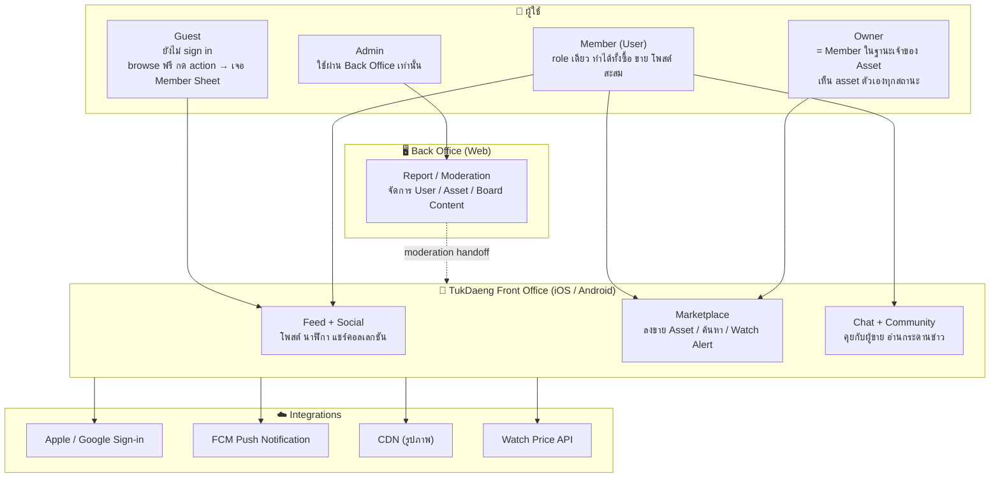
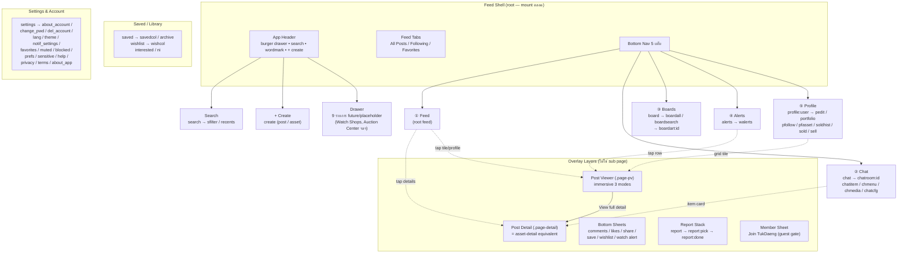
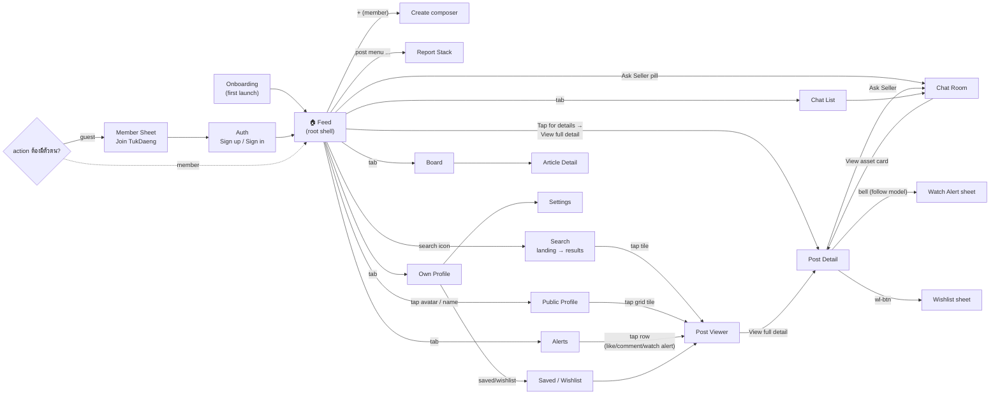
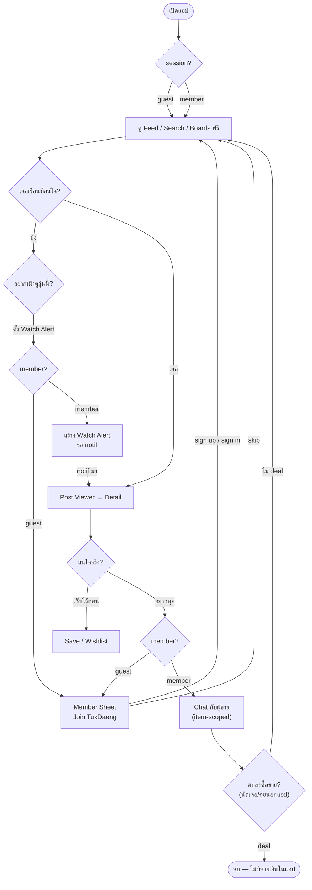
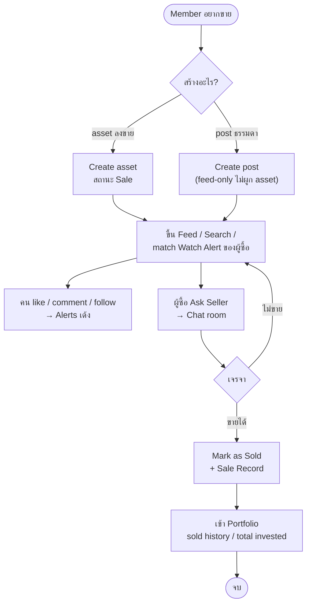
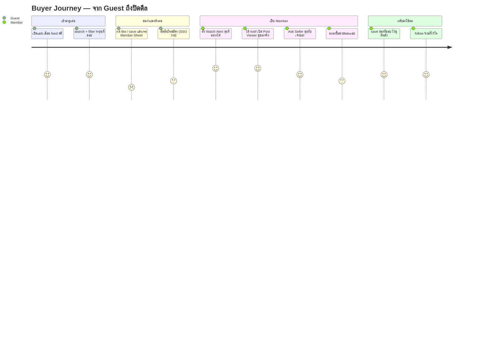
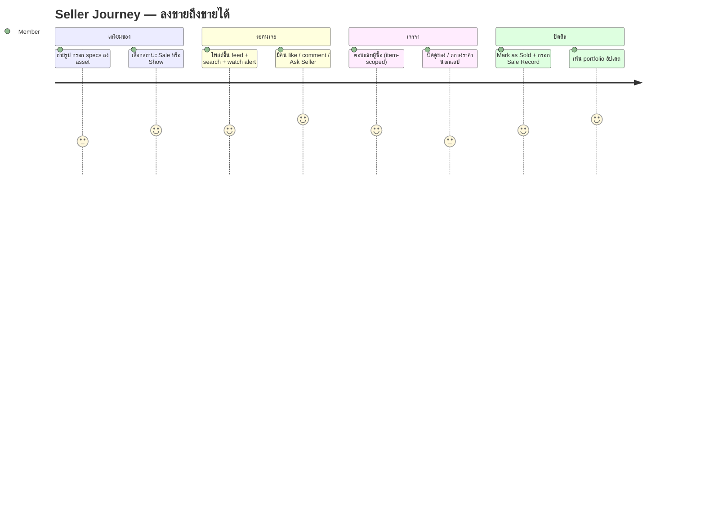

# FO-DIAG-001 — ชุด Diagram ภาพรวมแอปตึกแดง (Front Office)

> วัตถุประสงค์: ให้พี่คิงและผู้เกี่ยวข้องเห็นภาพแอป TukDaeng ฝั่ง Front Office แบบครบถ้วนใน 6 มุม
> Source of truth: `Prototypes/fo-flow/index.html` + FrontOffice docs baseline `FO-PRD-v1.9`
> รูปแบบ: Mermaid (render ได้ใน GitHub / VS Code / mermaid.live)
> วันที่: 2026-10-26

---

## ใบที่ 1 — Overview (Command 1: ภาพรวมของโครงการ ระบบ องค์กร)

**ใช้เล่า:** "TukDaeng คืออะไร ใครใช้ และมีชิ้นส่วนอะไรบ้าง" — ใบเปิดประเดิมก่อนลงรายละเอียด

**จุดที่อยากให้จำ:**
- เป็น Marketplace Community นาฬิกาหรู ไม่ใช่ social network ทั่วไป และไม่มีจ่ายเงินในแอป (V1)
- User มี role เดียว — คนเดียวกันซื้อ ขาย โพสต์ และสะสมได้หมด
- Guest เข้าดูได้เสรี แต่ action ที่ต้องมีตัวตนจะเจอ Member Sheet `Join TukDaeng`
- ไม่มี Auction / Live Selling / Watch Authentication ใน Phase 1

---

## ใบที่ 2 — Feature Map (Command 16: Features และ Sub-features ทั้งหมด)

**ใช้เล่า:** "แอปมีอะไรบ้าง" — ครบทุก feature ในใบเดียว จัดกลุ่มตาม module spec

```mermaid
flowchart LR
    ROOT["ตึกแดง FO"]

    ROOT --> A["🔐 Authentication<br/>สมัคร / Sign in / OTP<br/>SSO Apple+Google<br/>เปลี่ยนรหัส / ลบบัญชี<br/>(grace 30 วัน login-to-restore)"]

    ROOT --> B["📰 Feed<br/>Tabs: All / Following / Favorites<br/>Post card (Sale + โพสต์ธรรมดา)<br/>Create composer: post / asset<br/>post menu: archive, pin, edit,<br/>mark as sold, report"]

    ROOT --> C["🔍 Search & Filter<br/>Explore tiles / Recents / Suggest<br/>Filter: brand, model, price,<br/>delivery, strap, box&papers<br/>Post Viewer (IG-style)"]

    ROOT --> D["⌚ Asset Management<br/>สถานะ: Sale / Show / Hide / Sold<br/>Mark as Sold + Sale Record<br/>Gallery / drawer ใน Portfolio"]

    ROOT --> E["💬 Chat<br/>Chat list + room<br/>ผูก user+item (listing) เสมอ<br/>Ask Seller / View asset<br/>block / report entry"]

    ROOT --> F["❤️ Social<br/>Like / Comment (reply 1 ชั้น)<br/>Share (member-only)<br/>Saved + Wishlist collections<br/>Follow / Mute / Favorite seller<br/>Not-interested"]

    ROOT --> G["🔔 Watch Alert<br/>สร้างจาก search bell / model follow<br/>list จัดการใน Settings<br/>notif → Post Viewer ตรง"]

    ROOT --> H["📣 Alerts<br/>5 types: Like / Comment /<br/>Follow / Watch Alert / System<br/>badge 99+ / mark all read"]

    ROOT --> I["👤 Profile<br/>Own + Public profile<br/>grid tabs / followers / following<br/>QR / edit / message"]

    ROOT --> J["💼 Portfolio<br/>Total invested dashboard<br/>asset value detail<br/>sold history"]

    ROOT --> K["📖 Board<br/>นิตยสาร editorial<br/>hero / latest / categories<br/>article like / share"]

    ROOT --> L["⚙️ Settings<br/>account / language / theme<br/>legal / notif settings<br/>muted / blocked / sensitive<br/>help / delete account"]

    ROOT --> M["🛡️ Trust & Safety<br/>Report flow (user / post)<br/>Block (IG keep-page)<br/>moderation handoff → BO"]

    ROOT --> N["👻 Guest Mode<br/>browse ฟรี: feed, search,<br/>boards, profile, legal<br/>identity action → Member Sheet"]
```

---

## ใบที่ 3 — Sitemap (Command 17: โครงสร้างหน้าและเมนูของแอป)

**ใช้เล่า:** "แอปมีหน้าอะไรบ้าง อยู่ตรงไหน" — ถอดจาก route map จริงใน prototype (`§6.6 Sub-Page Route Map`)

---

## ใบที่ 4 — Screen Flow (Command 19: ความสัมพันธ์ระหว่างหน้าจอ)

**ใช้เล่า:** "หน้าจอไหลไปหากันยังไง" — flow จริงตาม entry point matrix (§7)

**กติกาสำคัญที่เห็นในภาพ:**
- Post Viewer เปิดได้เฉพาะจาก **grid tiles / notifications** — feed card กด media ได้แค่ carousel ในการ์ดเดิม
- Post Detail อยู่เหนือ viewer เสมอ (`detail-back` เผย viewer ข้างล่าง)
- ทุก gated action ของ guest ไหลไป Member Sheet ก่อนเสมอ
- Alerts back button กลับ Feed เสมอ ไม่ใช่ pop stack

---

## ใบที่ 5 — User Flow (Command 18: เส้นทางและการตัดสินใจของผู้ใช้)

**ใช้เล่า:** "ผู้ใช้เดินผ่านแอปยังไง ตัดสินใจตรงไหน" — 2 เส้นทางหลัก ผู้ซื้อ และผู้ขาย

### 5A — เส้นทางผู้ซื้อ (Buyer Flow)

### 5B — เส้นทางผู้ขาย (Seller Flow)

---

## ใบที่ 6 — Journey (Command 3: ประสบการณ์ของผู้ใช้ตลอดเส้นทาง)

**ใช้เล่า:** "รู้สึกยังไงในแต่ละช่วง" — journey ของ Guest→Member ฝั่งผู้ซื้อ (คะแนน 1–5)

---

## วิธีใช้ชุดนี้กับพี่คิง

| ลำดับเล่า | ใบ | ประโยคเปิด |
| --- | --- | --- |
| 1 | Overview | "แอปตึกแดงคือ marketplace community นาฬิกาหรู มี FO mobile + BO web" |
| 2 | Feature Map | "ทำได้ทั้งหมดนี้ จัดเป็น 14 กลุ่ม" |
| 3 | Sitemap | "โครงสร้างหน้าจริงใน prototype เป็นแบบนี้ 5 แท็บ + overlays" |
| 4 | Screen Flow | "หน้าจอไหลกันแบบ IG — viewer เหนือ feed, detail เหนือ viewer" |
| 5 | User Flow | "เส้นทางจริงของผู้ซื้อ/ผู้ขาย รวมจุดที่ guest ชน gate" |
| 6 | Journey | "ฟีลลิ่งผู้ใช้ในแต่ละช่วง จุดแข็ง-จุดเสี่ยง" |
