# Business Process Flows — TukDaeng

| รายการ | ข้อมูล |
|---|---|
| Version | 0.2 (Part A FO + Part B BO/cross-side draft) |
| Date | 2026-11-05 · Asia/Bangkok |
| Task | BAC-001 [`ca5afced`] + BAC-002 [`f5745b61`] — Mission `0e19c244` Objective 1 (Business Process Flows) / Feature: Core Journey Flows |
| Status | **DRAFT — รอ review** (Part A FO journeys + Part B BO/Admin + cross-side เสร็จ — รอพี่มาเต็มตรวจทั้งสอง part) |
| Source of truth | `FrontOffice/` module specs (00 pair + 01–15) + `BackOffice/` module specs (00 pair + 01–17) — ทุกจุดในเอกสารนี้อ้าง spec section |

## 0. วิธีอ่านเอกสารนี้

- รูปแบบอ้างอิง: `01 §8` = `FrontOffice/01_AUTHENTICATION_MODULE.md` section 8 (User Flow); `00G` = `00_GLOBAL_RULES_MODULE.md`; `00NAV` = `00_NAVIGATION_AND_CROSS_MODULE_FLOW.md` — ฝั่ง BO ใช้ prefix `BO-`: `BO-04 §14` = `BackOffice/04_ASSET_MANAGEMENT_MODULE.md` section 14; `BO-00G` = `BackOffice/00_GLOBAL_RULES_MODULE.md`
- ป้าย `(contract)` = spec contract สำหรับ production ที่ prototype ไม่ครอบ — spec เจ้าของ mark ไว้เอง เอกสารนี้สะท้อนตามนั้น
- เอกสารนี้อธิบาย journey ฝั่งผู้ใช้ (FO app) เท่านั้น — admin/BO moderation เป็นเพียงจุดต่อท้าย (hand-off) รายละเอียดอยู่ Part B
- Journey ทุกตัวสืบจาก spec จริง — ถ้าพบจุดที่ spec ขัดกันเองหรือขัด prototype ให้ดู §16 Findings (บันทึกเท่านั้น ไม่แก้ spec)

## 1. Journey Inventory (FO)

| ID | Journey | Actor หลัก | Spec sources | Detail |
|---|---|---|---|---|
| J-01 | Account Lifecycle: onboarding → สมัคร (email/SSO) → sign in → guest gate → sign out → ลบบัญชี (grace → restore/hard delete) | Guest/Member | 01 §7-8, 13 §8-9, 00G §7-8/§12 | §4 |
| J-02 | Discovery: feed → tabs → card interactions → post viewer → post detail | Guest/Member | 02 §8-9, 03 §8-9, 05 §8-9 | §5 |
| J-03 | Search & Filter: landing → typing/suggest/recents → results → filter → tile → viewer | Guest/Member | 03 §8-9 | §6 |
| J-04 | Listing → Sold: create post/asset → visibility → edit/status → mark as sold → sold history | Owner | 02 §8-9, 04 §8-9, 14 §10-13, 00G §9-10/§12 | §7 |
| J-05 | Chat: Ask Seller → room → manage threads → block/report | Member | 07 §8-9, 00NAV §7 | §8 |
| J-06 | Watch Alert: create (search/detail) → manage → match → notification → post | Member | 10 §8-9, 03 §8, 05 §8, 09 §8 | §9 |
| J-07 | Report & Block: report post/user/comment/chat → report:done steps → block/unblock | Member | 15 §8-11, 06 §8, 07 §8, 11 §15 | §10 |
| J-08 | Social: like / comment / share / save / follow / favorites / mute / not-interested | Member | 11 §9-15, 02 §8, 06 §8 | §11 |
| J-09 | Notification consumption: alerts feed → read → destination | Member | 09 §8-9, 00NAV §8 | §12 |
| J-10 | Library: saved / collections / wishlist / archive | Member | 11 §12-13, 02 §8 Archive, 05 §8 | §13 |
| J-11 | Profile: view public profile → follow lists → QR share → edit profile | Member/Viewer | 06 §8-9 | §14 |
| J-12 | Settings & account management: language/theme/legal/prefs/lists/change password/log out | Member | 13 §8-9 | §15 |
| J-13 | Board: browse articles → category/search → article detail → like/share | Guest/Member | 12 §15 | §15 |

Journey รองที่อยู่ใน journey หลัก (ไม่แยก section): Edit Info (`02 §8`), Pin/Archive (`02 §8`), Comment moderation ของเจ้าของคอมเมนต์ (`11 §10`), Coach marks (`00G §7`), Re-consent (`01 §8`, `00G §8`), Delete post (`02 §8`, `04 §8`)

## 2. Session & Gate Model (context ร่วมทุก journey)

ทุก journey วิ่งบน session 3 สถานะ (`00G §7`) — guest ทำได้เฉพาะ browse read-only ตาม Guest Capabilities (`00G §11`); action ที่ต้องมีตัวตนถูก intercept ด้วย Member Sheet `Join TukDaeng` gate ทุกครั้ง (ไม่จำ choice):

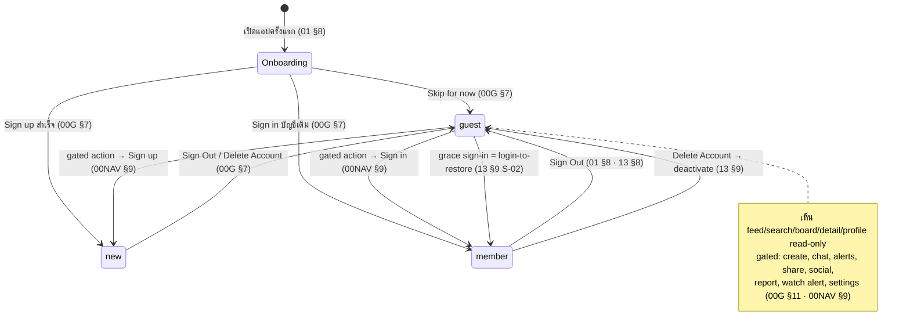

Re-consent (policy version bump) ทับได้ทุก session — `Accept & continue` หรือ `Decline` → sign out/exit เท่านั้น (`01 §8`, `00G §8`)

## 3. Cross-cutting: ปลายทางที่พบซ้ำทุก journey

- **Member Sheet gate** — ทุก gated entry รวม bottom-nav Chat/Alerts/Profile, `+`, share ทุก surface, social actions, report/block, watch alert, settings (`00NAV §9`, `00G §11`)
- **Unavailable fallback** — deep link/entry ไปของที่หายไป (deleted/sold/hide/blocked/article) → unavailable state + CTA `Go back` (มี history → หน้าก่อน; ไม่มี → Feed) (`00NAV §10`)
- **Blocked profile** — IG keep-page: profile เปิดได้ แต่ grid ว่าง + ปุ่ม Unblock (`00NAV §10`, `06 §7`)
- **Post Detail เป็น overlay layer** เหนือ viewer/sub — `.detail-back` เผย surface เดิม (`05 §9`)
- **Back behavior** — `.sub-back` pop ตาม stack; report `X` ปิดทั้งกอง (`00NAV §6.7`)

## 4. J-01 Account Lifecycle — ลงทะเบียน → ใช้งาน → ลบบัญชี

### 4.1 Onboarding + Registration + Sign In

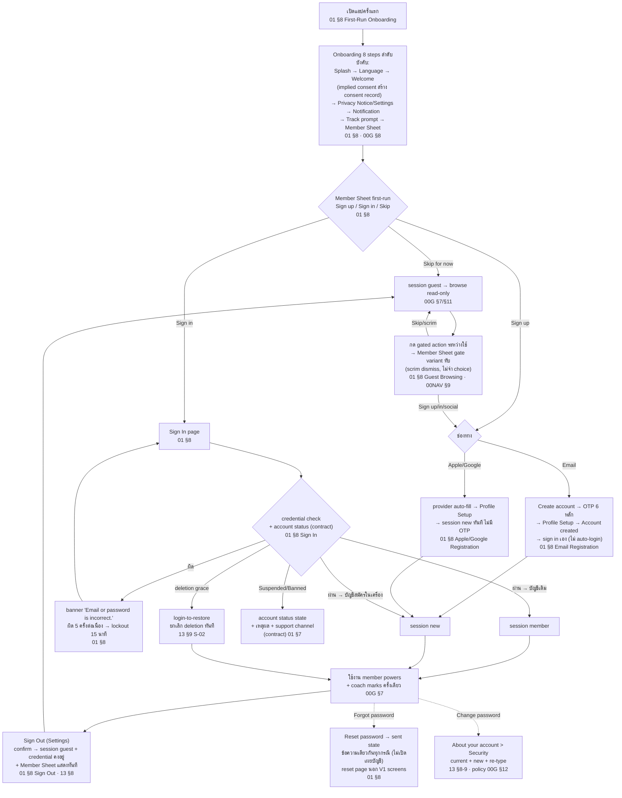

หมายเหตุ journey:

- Email sign-up ไม่ auto-login — Account created → `Sign in` (prefill email, password ว่าง) (`01 §8`, `00G §7`)
- Lockout: counter ต่ออีเมล, countdown ทุกวินาที, server lockout 15 นาที (contract) (`01 §8`)
- Suspended/Banned = revoke session + account status state — contract เท่านั้น, prototype เช็กแค่ credential (`01 §7`, `00G §12`)

### 4.2 Delete Account → Grace Period → Restore / Hard Delete

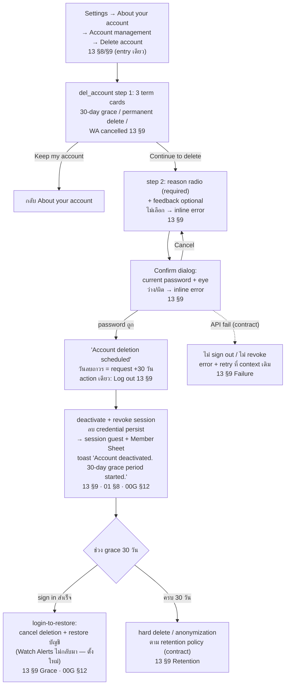

## 5. J-02 Discovery — Feed → Post Viewer → Post Detail

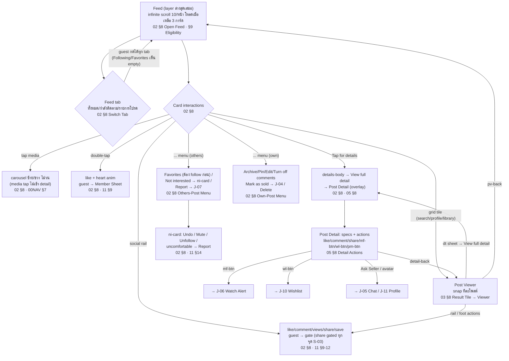

กฎข้าม journey: โพสต์ที่ owner archive → หลุด feed+grid ทันที + เคลียร์ pin (`02 §8`); โพสต์ที่ถูกลบ → หายทุก surface + tile ที่ค้าง → unavailable (`02 §8`, `11 §12`)

## 6. J-03 Search & Filter

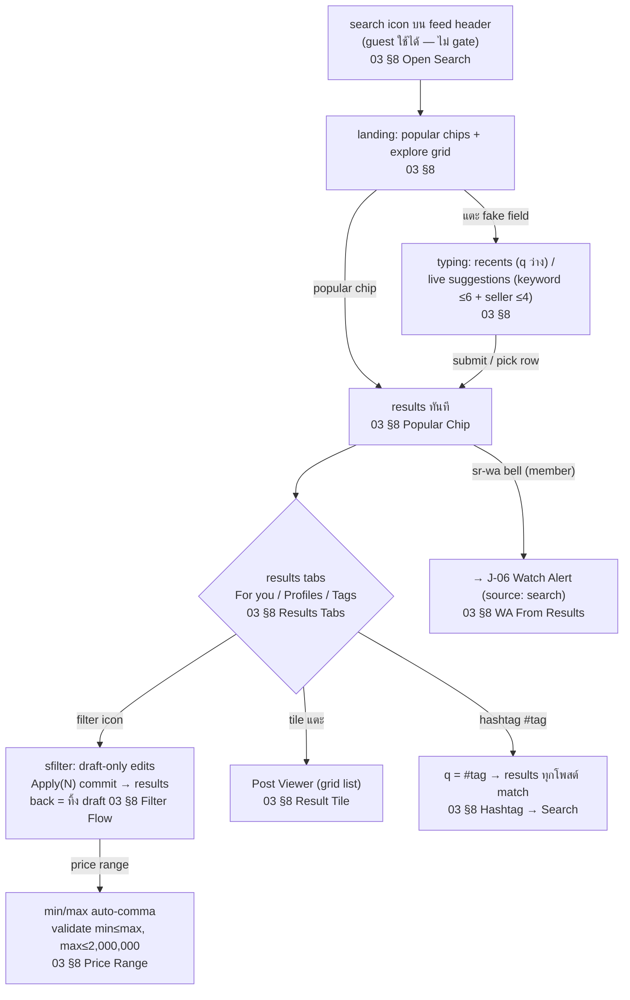

- Recents persist ข้ามเปิดแอป + ล้างเมื่อ sign out (`03 §8`, `00G §7`)
- Results eligibility = asset surfaces: match เฉพาะ status `Sale` (`00G §10`) — For you tab มี Accounts (seller name match) + Posts grid (`03 §9`)

## 7. J-04 Listing → Sold — ลงประกาศ → ขายได้

```mermaid
flowchart TD
    S{"Entry (member)"} -->|"Feed `+` header"| P1["composer `create` mode post:<br/>step1 media ≥1 → step2 fields<br/>02 §8 Create Post Flow"]
    S -->|"Own profile `+` / Add asset"| A1["composer mode asset:<br/>caption + Visibility pick<br/>02 §8 · 04 §8 Add Asset Flow"]
    P1 --> P2{"Share + `Also save to<br/>My Assets` toggle"}
    P2 -->|"OFF"| PF["feed post `pfkind:post`<br/>(feed-only ไม่ผูก asset)<br/>02 §9 Publish Rule"]
    P2 -->|"ON"| PA["feed post `pfkind:sale`<br/>+ drawer record `sale` + link<br/>04 §8 Post → Drawer Save"]
    A1 --> V{"Visibility pick<br/>04 §8"}
    V -->|"Show (default)"| SH["drawer-only `pfkind:show`<br/>โชว์บน profile — ไม่เข้า feed/search/WA<br/>00G §10"]
    V -->|"Hide"| HD["drawer-only `pfkind:hide`<br/>owner-only"]
    V -->|"Post to feed"| PA
    PA --> WAM{"WA match?<br/>10 §8"} 
    WAM -->|"มี hit"| WT["`watch` row เข้า alerts feed<br/>ของ watcher — publisher ไม่เห็น<br/>10 §8 (2026-11-05)"]
    SH --> E["Edit info: composer step2 prefilled<br/>status pick ขาย/โชว์/ซ่อน → pfkind sync<br/>02 §8 · 04 §8 Status Change"]
    HD --> E
    PA --> E
    E --> MS{"Mark as sold entries<br/>04 §8 · 14 §13"}
    MS -->|"own-post menu<br/>(sale/show/hide)"| MAT["materialize drawer record<br/>ถ้ายังไม่ link 04 §8"]
    MS -->|"pfasset `Mark as sold`"| MAT
    MAT --> SF["`sell:{id}` Sale Record form:<br/>sale price (prefill asking) + sale date<br/>(≤ วันนี้) — ไม่มี buyer/payment fields<br/>14 §13"]
    SF --> SOLD["`markAssetSold`:<br/>PF_ASSETS → PF_SOLD<br/>linked posts → `pfkind:sold`<br/>หลุด feed/search/WA ทันที<br/>14 §13 · 04 §9 · 00G §12"]
    SOLD --> SR["push `sold:{id}` (ghost slide)<br/>toast 'Sale recorded · moved to Sold history'<br/>14 §13"]
    SR --> HIST["`soldhist` ประวัติการขาย<br/>+ `sold:{id}` detail (realized G/L, holding)<br/>14 §12"]
    SOLD --> VSR["own-post menu บนโพสต์ sold<br/>→ `View sale record` → `sold:{id}`<br/>04 §8 · 05 §8"]
```

หมายเหตุ journey:

- "ขายได้" ใน V1 = owner บันทึกการขายเอง (self-reported) — ไม่มี payment/buyer/transaction flow (`14 §13` D3); ช่องทางเจรจาจริง = J-05 Chat
- `sold` = terminal — ไม่มี revert (`14 §13`); sold ไม่นับมูลค่าพอร์ต (`14 §12`)
- ลบโพสต์ที่ผูก asset: drawer record ไม่ถูกลบตาม — documented deviation (`04 §8`, findings F-02)

## 8. J-05 Chat — คุยกับผู้ขาย

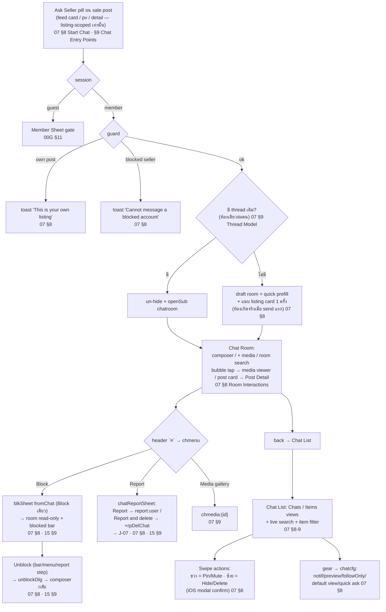

- Chat คงอยู่แม้ asset ถูกลบ/ขาย (`00NAV §7`, `00G §11 Deleted Asset`); block ไม่ลบ thread — อ่านย้อนได้ read-only (`15 §9`)
- Entry อื่นที่เข้าห้องเดียวกัน: profile Chat button, followers row `แชท` (`06 §8`), share-to-friend เปิดห้องพร้อม post card (`11 §11` DEC-20)

## 9. J-06 Watch Alert — สร้าง → match → แจ้งเตือน

```mermaid
flowchart TD
    A{"Create entry (member)"} -->|"results head bell `sr-wa`| S1["snapshot keyword + filters + price<br/>source:'search' matchMode:'all'<br/>03 §8 · 10 §8"]
    A -->|"detail bell `mf-btn`<br/>'Follow this model'"| D1["modelKey = brand|model|ref<br/>criteria จาก post specs<br/>05 §8 · 10 §8"]
    D1 -->|"criteria ว่าง"| T["toast 'No details on this post to watch'<br/>(ไม่เปิด sheet) 05 §8"]
    S1 --> SG{"`waSig` ตรง alert เดิม?<br/>10 §9 Dedupe"}
    D1 --> SG
    SG -->|"ตรง (on/off ก็ได้)"| ED["sheet edit mode:<br/>criteria/name เดิม<br/>03 §8 · 10 §8"]
    SG -->|"ไม่ตรง"| CR["waSheet: name auto (แก้ได้)<br/>+ match modes + `N now` count<br/>→ Create alert 10 §9 Sheet Rule"]
    CR --> ON["alert ON → toast 'Watch alert on'<br/>bell `on` sync ทุกจุด modelKey ตรง<br/>10 §9 Bell Sync"]
    ED --> MNG["Manage จาก `walerts` list:<br/>Edit (sheet) / Pause-Resume toggle /<br/>Delete (confirm) 10 §8"]
    ON --> MM["โพสต์ใหม่ publish<br/>→ `insertNewPost` คำนวณ `alertMatch`<br/>10 §8 · §9 Match Pool/Criterion"]
    MM -->|"มี hit"| NT["`watch` row เข้า alerts feed ของ watcher<br/>(unread + badge) — publisher ไม่เห็น feedback<br/>10 §8 (2026-11-05)"]
    NT --> TAP["แตะ watch row → Post Viewer<br/>โพสต์นั้นตรง ๆ (ไม่มี result list คั่น)<br/>โพสต์หาย → unavailable state<br/>09 §8 · 00NAV §8/§10"]
```

- Alerts list เข้าจาก: feed header `.feed-wa`, Settings > Watch Alerts, search bell, detail bell (`00NAV §6.6/§7`)
- Match เฉพาะ status `Sale` + ไม่นับ blocked/muted/ni (`00G §10`, `10 §9`); prototype = simulation on publish, production contract = `watch` notification row (`10 §8`)

## 10. J-07 Report & Block — ส่ง report

```mermaid
flowchart TD
    E{"Report entries<br/>15 §8 Entry Point Matrix<br/>(ทุกจุด guest-gated)"} -->|"post `...` → Report /<br/>ni uncomfortable card"| P["`report` page (X only)<br/>'Why are you reporting this post?'<br/>+ PM_REASONS 9 ข้อ 15 §10 · §6"]
    E -->|"profile `...` → Report"| U["`report:pick:{u}`:<br/>'A specific post' → report:posts → report:post<br/>/ 'Something about this account' → report:user<br/>15 §10 · 06 §8"]
    E -->|"long-press comment → Report"| CM["`report:comment` (X only)<br/>15 §10 · 11 §10"]
    E -->|"chat `≡` → Report"| CH["chatReportSheet:<br/>Report / Report and delete<br/>→ `report:user` (ข้าม pick)<br/>15 §9-10 · 07 §8"]
    E -->|"blkSheet → 'Block and report'"| U
    P --> RSN["แตะเหตุผล = submit ทันที"]
    U --> RSN
    CM --> RSN
    CH --> RSN
    RSN --> DONE["`report:done:{u}`:<br/>'Thanks for your feedback'<br/>+ optional steps: Block/Unblock,<br/>Unfollow, Mute/Unmute (instant + green check)<br/>15 §10 · §9"]
    DONE -->|"Done / X"| END["rpClose + toast<br/>'Report submitted · thanks for letting us know'<br/>— content ยังแสดงปกติ รอ BO moderation<br/>15 §11 · 00G §13"]
    DONE -->|"rpDelChat (Report and delete)"| CD["thread hidden + ออกจาก list<br/>+ strip stack → กลับ Chat List<br/>07 §8 · 15 §10"]
```

### Block / Unblock (sub-flow ของ J-07)

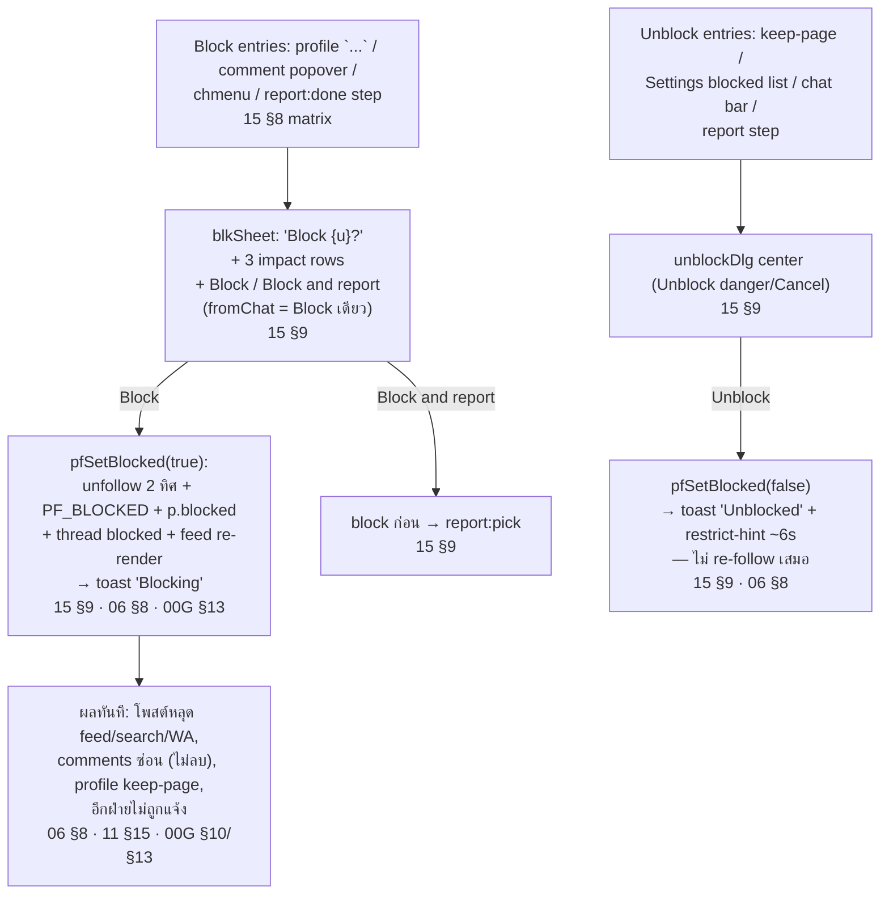

## 11. J-08 Social Interactions

Flow ย่อยทั้งหมด guest-gated (`00G §11`); canonical อยู่ `11_SOCIAL` + surfaces ใน `02/03/05/06/09`

| Sub-flow | Steps | Refs |
|---|---|---|
| Like | `.like-btn` toggle → sync ทุก surface ของ pid เดียวกัน; double-tap media = like (ไม่ untoggle); liked posts → Settings > Interested | `11 §9`, `02 §8` |
| Comment | `.comment-btn` → shared sheet (rows + emoji row + input); reply prefill `@{user}`; emoji quick-react = own comment; owner long-press → Delete (confirm), others → Block/Report | `11 §10`, `02 §8`, `03 §8` |
| Share | `.share-btn` → sheet (friends grid + app row + copy); friend → post card เข้าห้องแชท + เปิดห้อง (DEC-20); gated ทุก surface (S-03) | `11 §11`, `02 §8` |
| Follow | account-level (`setFollowing`); surface semantics ต่างกันโดยเจตนา — feed confirm sheet, PV/lists instant, profile `Following⌄` → mfSheet; unfollow ล้าง favorite+mute | `06 §8`, `11 §14` |
| Favorites | seller-level feed filter (ต้อง follow ก่อน); entries: `...` menu / mfSheet / Settings favorites page | `11 §14`, `02 §8` |
| Mute | muteDlg confirm → โพสต์หลุด feed แต่ยัง follow; unmute ผ่าน Settings / profile | `11 §14`, `15 §9` |
| Not interested | `...` → ni-card → Undo / Mute / Unfollow / 'made me uncomfortable' → Report; re-render แล้วหลุด feed — restore ที่ Settings > Not interested | `02 §8`, `11 §14` |

## 12. J-09 Notification Consumption

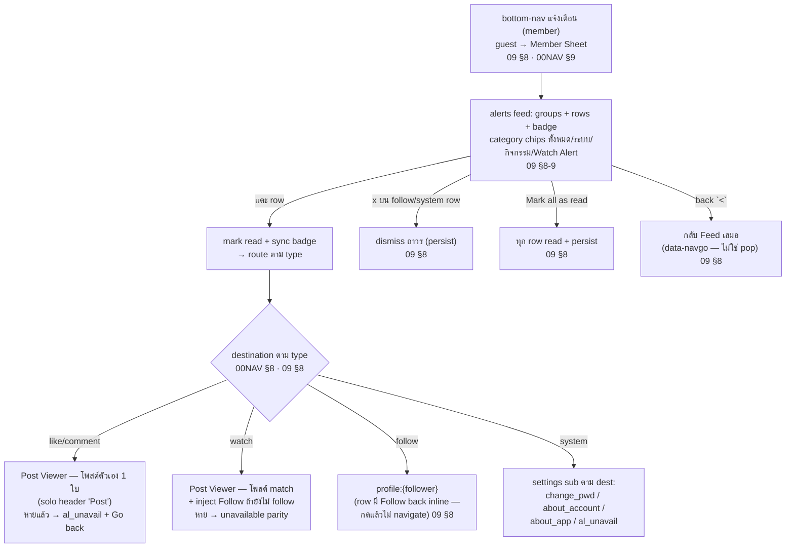

## 13. J-10 Library — Saved / Wishlist / Archive

| Sub-flow | Steps | Refs |
|---|---|---|
| Save | `save-btn` → set saved + เปิด `sv` sheet เสมอ → pick collections (multi); `Saved` row ซ้ำ = unsave; `New collection` → nc sheet | `11 §12`, `02 §8` |
| Saved hub | `saved` route: tabs All/Collections/Posts + search + Manage (select → Unsave/Add/Move); tile → viewer feed mode | `11 §12` |
| Collection | `savedcol`: Add/Edit(cover+rename)/Select/Delete collection (posts ยัง saved); move→new = ล้าง memberships เดิม | `11 §12` |
| Wishlist | `wl-btn` เฉพาะ Post Detail → wlSheet เหมือน save แต่แยกระบบ (`wlCols`, WISHLISTS); hub `wishlist`/`wishcol` | `11 §13`, `05 §8` |
| Archive | own-post `Archive` → หลุด feed+grid + เคลียร์ pin; เปิดดูที่ Settings > Your library > Archive (owner-only); `Unarchive` คืนตาม eligibility | `02 §8`, `13 §8` |

Cross-cut: private library surfaces ตาม `libVisible` — post sold ยังอยู่, hide/archive/block/delete ทำ tile หาย, ni/muted ไม่กระทบ (`11 §12` lock 2026-10-29)

## 14. J-11 Profile — view / follow lists / QR / edit

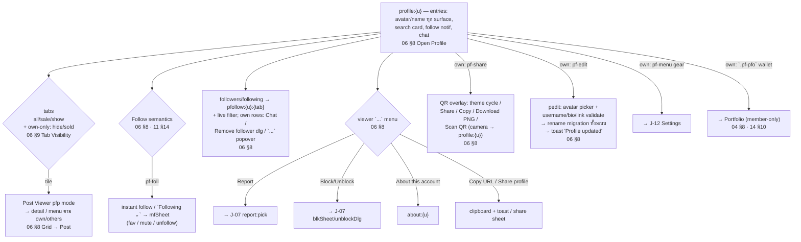

## 15. J-12 Settings & J-13 Board (supporting journeys)

### J-12 Settings & account management

| Sub-flow | Steps | Refs |
|---|---|---|
| Open Settings | own profile → `pf-menu` gear → `settings` (entry เดียวของระบบ) | `13 §8`, `00NAV §6.6` |
| Language / Theme | pick → apply ทันทีทั้งแอป + persist `fo_lang`/`fo_theme` + toast | `13 §8` |
| Legal | Terms / Privacy → in-app legal viewer (version + effective date) | `13 §8`, `00G §8` |
| Content preferences | Sensitive (Less/Standard) / Interested (liked + Remove) / Not interested (Restore) / Snooze 30 วัน / Reset suggested content (confirm) | `13 §8-9` |
| Favorites / Muted / Blocked | manage lists: search/Remove/Remove all/Add · Unmute · Unblock dlg; แตะ row → profile | `13 §8` |
| Change password | About your account > Security → 3 fields + eye + inline validation + `Forgot your password?` → reset dialog | `13 §8-9`, `01 §8` |
| Log out / Delete account | → J-01 (§4) | `13 §8`, `01 §8` |
| Watch alerts list | `walerts` → J-06 manage | `10 §8` |
| Your library | Saved / Wishlist / Archive rows → J-10 | `13 §8`, `11 §12` |

### J-13 Board — อ่าน content (guest ได้ read-only)

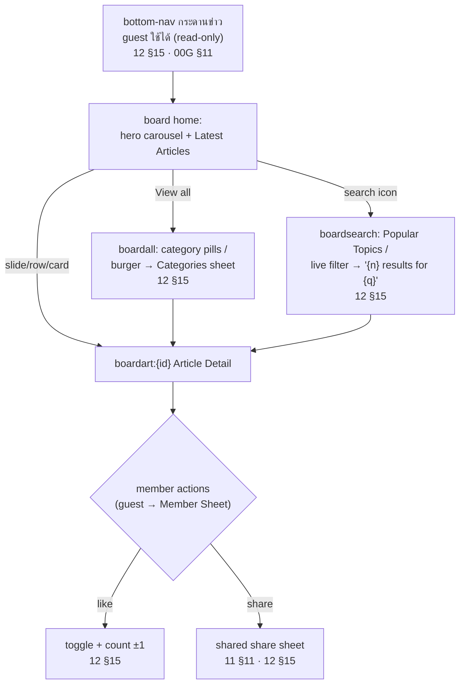

## 16. Findings — จุดที่พบระหว่าง inventory (บันทึกเท่านั้น ไม่แก้ spec/prototype)

ข้อห้ามงาน: เจอ spec ขัดแย้ง → บันทึก finding รออนุมัติเท่านั้น รายการด้านล่างคือสิ่งที่พบระหว่างทำ inventory — ตารางรวมทั้ง finding ที่ **แก้ prototype แล้วตามทิศทางพี่มาเต็ม (2026-11-05)** และจุดที่ spec ยังไม่ตรงกับทิศทางใหม่ (รออนุมัติแก้ spec ไม่ได้แตะเอง):

| ID | Finding | สถานะ | Refs |
|---|---|---|---|
| F-01 | ไม่มีไฟล์ `08_*_MODULE.md` (module ข้ามเลข 08 — น่าจะ Offer ที่ถูกถอด) — inventory ครอบไฟล์ที่มีจริง | ไม่แก้ — เลขเล่มคือ stable ID ถูกอ้างด้วยชื่อไฟล์/"canonical NN"/AC ID หลายร้อยจุด การรันเลขใหม่เสี่ยงพัง cross-ref มากกว่าประโยชน์ | `FrontOffice/` dir |
| F-02 | **แก้ prototype แล้ว** (`Prototypes/fo-flow/index.html`): (a) `salePosts()`/results/#tags/explore/tagRows เลิกนับ Hide/Sold/archived และครอบ `post` kind — results = ทุกโพสต์ที่เห็นบน feed; (b) public profile (`pfTabPosts`) viewer เห็น post+sale+show ไม่รั่ว hide/sold; (c) ลบโพสต์แล้วลบ PF_MINE + linked `PF_ASSETS` record ตาม (PF_SOLD คงไว้เป็นประวัติ); (d) sign-up password = canonical `≥8 + ≥1 ตัวเลข/สัญลักษณ์` เท่ากับ change-pwd (S-21); (e) `lk-follow` — เช็กแล้วโค้ดเรียก `pfSetFollow` จริงอยู่แล้ว (spec note เก่า stale — แก้ spec เล่ม 11 แล้ว); (f) กวาด dead code: legacy delete dialog, `chsettings:{id}` route + `chatRoomSettingsHTML` | **RESOLVED in prototype** — แต่ดู F-06 เรื่อง spec ยังไม่ตาม | `03 §9`, `06 §9`, `04 §8`, `00G §10/§12`, `11 §9` |
| F-03 | Contract-only ที่ prototype ไม่ครอบ (E2E flow อิง contract): feed error+retry, offline cached read, suspended/banned check ที่ sign in, delete account failure path, reset-password pages (นอก V1), cookie preferences page | documented — ไม่แก้ (เป็น contract ไม่ใช่ defect) | `00G §11`, `01 §7/§8`, `13 §9/§12` |
| F-04 | "ขายได้" = owner self-report เท่านั้น — ไม่มี buyer/payment/transaction entity ใน V1 (D3: sale record มีแค่ price+date+cost carry); การเจรจาเกิดใน Chat แต่ไม่มี state machine เชื่อม chat→sold | scope note — ไม่ใช่ขัดแย้ง | `14 §13`, `07 §9` |
| F-05 | **แก้ prototype แล้ว**: ลบ owner-facing toast `Watch alert matched` ทั้ง 3 จุด (fo_newpost carry / asset Post-to-feed / composer share) — match ตอน publish เปลี่ยนเป็น push `watch` row เข้า alerts feed ของ session member (ฝั่ง watcher) ตาม contract แทน | **RESOLVED in prototype** — spec `10 §8` ยังเขียน toast เป็น simulation mechanism อยู่ → รวมใน F-06 | `10 §8`, `09 §8` |
| F-06 | **Spec gaps — อนุมัติและแก้ spec แล้ว (2026-11-05)**: (a) `03 §9` Results Eligibility → results/explore/tags = `discoverablePosts()` ทุก query mode; (b) `00G §10` matrix (แถว `post`: Public Profile + Search = แสดง) + `06 §9` Tab Visibility → public profile = post+sale+show; (c) `10 §8/§3/§14/AC-WA-021` + mentions ใน `02/03/04/05` + `QA checklist` + `master definition` → match = `watch` row ใน alerts feed ของ watcher, ถอด publisher toast ออกแล้ว | **RESOLVED — spec + prototype ตรงกันแล้ว** | `03 §9`, `00G §10`, `06 §9`, `10 §8` |
| F-07 | **Cross-side conflict — grace-period restore path**: FO spec + DECISION_LOG S-02 (`active`) บอก user sign in ระหว่าง grace = cancel deletion + restore เอง (login-to-restore) แต่ BO spec บอก "ไม่มี user self-service" + "ระหว่าง grace period user login ไม่ได้ หรือเห็น account-deleted support state" + restore = admin-only ผ่านช่องทาง support ภายนอก (DEL-DEC-001 เดิม) — สองฝั่งขัดกันโดยตรงทั้งเรื่อง sign-in ได้/ไม่ได้ และใครเป็นคน restore | **RESOLVED — approved 2026-11-05:** login-to-restore เป็น default (ตรง IG/Meta pattern + FO locked copy สัญญาไว้แล้ว); admin restore = support path; **ปฏิเสธคืนบัญชี = block self-restore** (sign-in → support state) — spec `FO 13 §9`, `BO-13 §3/§4/§9/§10/§12/§14/§15/§17` + DEL-DEC-001 amended + เพิ่ม audit `ACCOUNT_DELETION_SELF_RESTORE` | `13 §9 S-02`, `00G §12`, `DECISION_LOG S-02`, `BO-13 §10.2`, DEL-DEC-001 |
| F-08 | FO spec ยืนยัน "Report ไม่เปลี่ยน visibility อะไรเลย" (D5) แต่ไม่มีจุดใดบอกว่า unique reporters ≥5 บน asset `Sale`/`Show` → ระบบ `Auto Hidden` จากฝั่ง BO — จากมุม FO user โพสต์หายเองโดยไม่มีเอกสารฝั่ง FO อธิบาย threshold นี้ (doc gap; แอปใหญ่อย่าง IG ไม่ auto-hide ตาม count แต่ของเราเก็บไว้เพราะ scam-risk marketplace + ทีม mod เล็ก) | **RESOLVED — approved 2026-11-05:** เก็บ auto-hide; `FO 15 §11` เพิ่ม rule + FO display states ให้ตรง BO visibility matrix (owner เห็น `ถูกซ่อนชั่วคราว`, คนอื่นหาย/unavailable); brigading guard เป็น future refinement | `15 §11`, `BO-04 §9/§14` |
| F-09 | Phase scope ของ Watch Alert delivery log ไม่ตรงกัน: `BO-14 §12` เขียนว่า Phase 1 ครอบเฉพาะอีเมล Admin invitation / Forgot-Reset / Account Deletion lifecycle / account-status (system trigger = Phase 2) แต่ `BO-11 §12` + `BO-16 §16.1` + prototype `DLV-WA-1050` รวม WA ใน Phase 1 แล้ว | **RESOLVED — approved 2026-11-05:** `BO-14 §12` enumeration เพิ่ม WA delivery (`DLV-WA-*`); system trigger อื่น (like/comment/follow) ยัง Phase 2 — prototype ไม่ต้องแก้ (แสดงถูกแล้ว) | `BO-14 §12`, `BO-11 §12`, `BO-16 §16.1` |
| F-10 | `BO-00G §6` nav baseline เขียนเฉพาะ 6 module ล็อกชุดแรก (Dashboard/User/Asset/Content/Market Data/Option Master) แต่ nav จริงเพิ่ม Market Demand, Account Deletion และ Settings (6 submenus) แล้ว — ไม่ขัดกฎเพราะ clause เดียวกันอนุญาต "โมดูลเพิ่มต่อท้ายได้" แต่ข้อความ baseline ไม่ได้อัปเดตตามของจริง | **RESOLVED — approved 2026-11-05:** `BO-00G §6` nav baseline อัปเดตเป็น 3 sections × รายการปัจจุบัน (รวม `Market Overview` canonical label) แล้ว | `BO-00G §6`, `navGroups` ใน prototype |
| F-11 | Submenu ฝั่ง User Management ชื่อ canonical คือ `User Accounts` (`BO-03 §4`, `BO-00G §6`, `docs/bo-canonical-label-table.md`) แต่ AGENTS.md protected list เรียก `User List` — naming drift ภายในเอกสาร ไม่กระทบหน้าจอ | **RESOLVED — approved 2026-11-05:** AGENTS.md ปรับเป็น `User Accounts` ตาม canonical (SoT = label table + spec) แล้ว | `BO-03 §4`, `docs/bo-canonical-label-table.md` |

## 17. Part B — BO/Admin journeys + cross-side flows

> BAC-002 [`f5745b61`] — เติม 2026-11-05: inventory + end-to-end flow ฝั่ง admin/moderator และ cross-side FO↔BO อ้าง `BackOffice/` specs ทุกจุด; ข้อห้ามเดิม — findings บันทึกเท่านั้น ไม่แก้ spec/prototype

### 17.1 วิธีอ่าน Part B

- Actor ใน Part B: `Admin` (account type เดียว — สิทธิ์ตาม Role assignment `BO-01 §4`, `BO-16 §9`), `System`/`ProviderJob` (background actor ของ lifecycle/job — actor type ตาม `BO-08 §5`) และ `Member/User` ฝั่ง FO เมื่อ flow ข้ามฝั่ง
- ป้าย Phase: `(Phase 1)` = implement/protected ใน prototype; `(Phase 2/future)` = spec contract แต่เลื่อน scope; `(postponed)` = ห้ามเปิดจนกว่า Product อนุมัติ
- Cross-side journey อ้าง FO journey ของ Part A ด้วยรหัส `J-xx` และ FO spec ref เดิม (`13 §9` = `FrontOffice/13_SETTINGS_MODULE.md`)

### 17.2 Journey Inventory (BO/Admin)

| ID | Journey | Actor หลัก | Spec sources | Detail |
|---|---|---|---|---|
| B-01 | Admin Identity Lifecycle: invite → activation link → set password → login → session → lockout → self-service (My Account) → suspend/unlock/archive | Admin + System | `BO-01 §6-11`, `BO-16 §7-8`, `BO-08 §7` | §17.4 |
| B-02 | Triage: login → Dashboard KPI → Work Queue → Recent Activity/Panels → drill-in module | Admin | `BO-02 §4`, `BO-02 §8-12` | §17.5 |
| B-03 | User Management: User Accounts list → User Detail → account actions (password reset / suspend / ban / unsuspend / unban) + account-status email | Admin | `BO-03 §7-10` | §17.6 |
| B-04 | Reported Users: queue → User Report Detail → Close Report / Manage Account Status | Admin | `BO-03 §11-12`, `BO-00G §11` | §17.7 |
| B-05 | Reported Assets: queue → Asset Report Detail → ซ่อนชั่วคราว / ยกเลิกซ่อน / ซ่อนถาวร / ปิดรายงาน | Admin + System | `BO-04 §9-15` | §17.7 |
| B-06 | Reported Comments: queue → Comment Report Detail → Hide / Restore / Remove / Close no violation | Admin | `BO-04 §16-21` | §17.7 |
| B-07 | Account Deletion Review: request list → request detail (timeline / dependency / plan) → คืนบัญชี / ปฏิเสธคืนบัญชี → lifecycle emails → auto-delete | Admin + System | `BO-13 §4-16` | §17.8 |
| B-08 | Content Publishing: article draft → editor → FO preview → publish/schedule → archive/restore; category activate/deactivate | Admin | `BO-05 §7-15` | §17.9 |
| B-09 | Market Data: provider sync → sync history → catalog browse (read-only Phase 1) | Admin + ProviderJob | `BO-06 §7-18` | §17.10 |
| B-10 | Market Demand: Demand Overview → Search Insights → Watch Alert List → Alert Detail (read-only ทั้งหมด) | Admin | `BO-11 §3-15` | §17.11 |
| B-11 | Policy & Support: policy draft TH/EN → preview → publish → version history/restore; support center edit → FO preview → save | Admin | `BO-12 §4-15` | §17.12 |
| B-12 | Admin Accounts & Roles: invite / change role / suspend / reactivate / unlock / archive + Custom Role lifecycle | Admin | `BO-16 §8-9` | §17.13 |
| B-13 | Option Master: group/option add/edit/deactivate/reactivate/reorder/delete + spec suggestion curation → backfill | Admin | `BO-17 §6-15`, `BO-17 §22-23` | §17.14 |
| B-14 | Observability: Delivery Logs (read-only + retry status) + Audit Log (read-only, detail drawer, ref jumps) | Admin | `BO-16 §16`, `BO-08 §5-15`, `BO-14 §12-13` | §17.15 |

Deferred/postponed — ไม่เขียน flow (ไม่ใช่ journey Phase 1): Reports & Analytics (`BO-15` — Phase 2), Directory (`BO-07` — postponed), Broadcast/template/trigger config (`BO-14 §8-11` — Phase 2), Chat moderation module (Phase 2 — `BO-08 §7` action group), Offer Management (ถูกถอดตาม FO ตัด Offer), Reported Articles (ถูกถอดตาม FO-BO-001 e4)

### 17.3 Admin Session & Permission Model (context ร่วมทุก journey)

BO session แยกจาก FO ทั้งระบบ — admin account status + session rules:

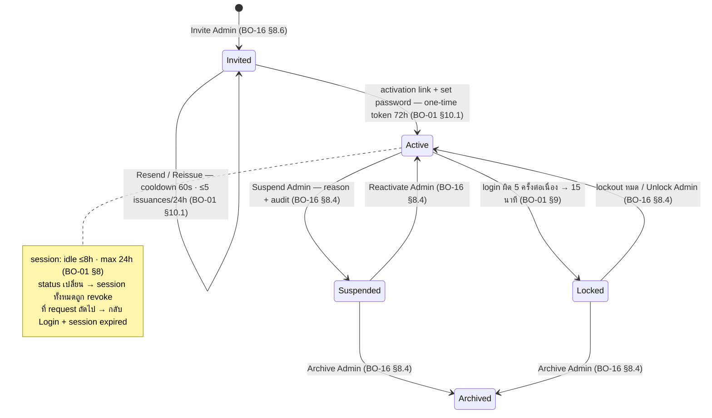

Contract ร่วมที่ทุก journey ต้องผ่าน (`BO-00G §13-15`, `BO-01 §12`):

- **Permission enforcement** — ตรวจที่ route / navigation rendering / API-action / field-level sensitive data / export; action ที่ไม่ได้รับสิทธิ์ **ไม่แสดงใน DOM** (ไม่ใช่แค่ซ่อน) — direct call ตอบ forbidden
- **Write action contract** — permission check → confirmation modal → reason (required เมื่อกระทบ FO/user) → impact note → before/after audit → result state/toast; sensitive data mask เป็น default และ reveal ต้อง audit
- **Safeguard ระดับระบบ** — ห้าม suspend / archive / change-role ตัวเอง, master admin (ADM-010) หรือ admin คนสุดท้าย (`BO-16 §8.7/§9.7`)

### 17.4 B-01 Admin Identity Lifecycle — Invite → Activate → Login → Offboard

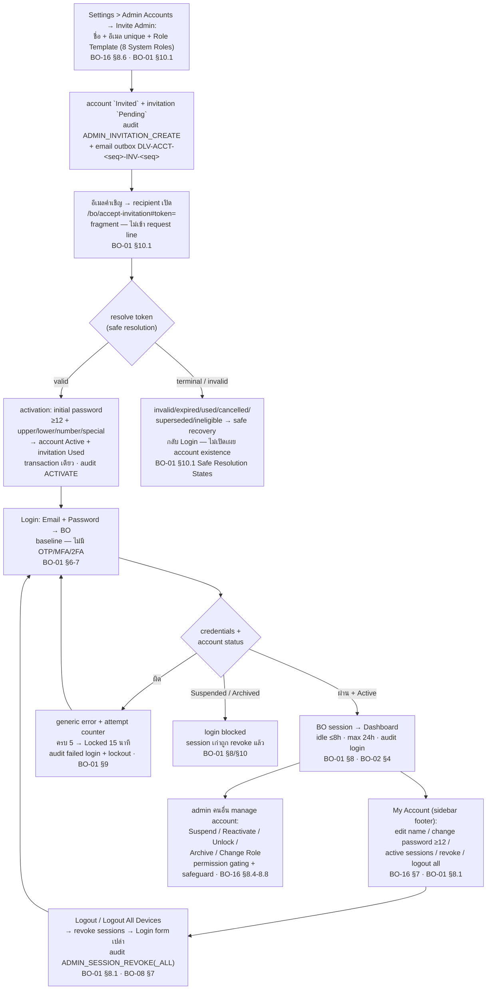

หมายเหตุ journey:

- Invitation admin-side actions: Resend (cooldown 60s · quota ≤5 issuances/rolling 24h), Cancel (`Pending → Cancelled`), Reissue (revision ใหม่) — issuance ใหม่ supersede `Pending` เดิมใน transaction เดียว; provider failure ไม่ rollback account/invitation (`BO-01 §10.1`, `BO-16 §8.9`)
- Forgot/Reset Password: public route + generic response เสมอ (ไม่เปิดเผย account existence); eligible เฉพาะ `Active`/`Locked` จาก failed login; token 30 นาทีใช้ครั้งเดียว → revoke ทุก session (`BO-01 §9.1`)
- Change Password (self): current ผิด 5 ครั้งติด → lock action 15 นาที production (prototype 60s) + audit `ADMIN_PASSWORD_CHANGE` result `Failed`/`RATE_LIMITED` event เดียว — ไม่ audit รายครั้ง (`BO-01 §8.1`, `BO-08 §7`)

### 17.5 B-02 Dashboard Triage — จุดเริ่มงานของ Admin

Entry หลัง login ทุกครั้ง (`BO-02 §4`): 6 KPI cards → Work Queue → Recent Activity (filter ทั้งหมด/Report/Content/System) → Panels (Asset Status / Latest Articles / Top Searched Brands) — ทุกจุด drill-in ตรงไป module ปลายทางและตรวจสิทธิ์ซ้ำที่ route/API/service (`BO-02 §8-12`)

Work Queue เรียงตามผลกระทบผู้ใช้ — **ไม่มี SLA/deadline tracking ทั้งระบบ** (FO-BO-001 GAP-03; ยกเว้น grace countdown ของ Account Deletion ซึ่งเป็น system lifecycle):

| Queue row (priority) | ปลายทาง | → Journey |
|---|---|---|
| รายงานสินทรัพย์ (High) | Asset Management / Reported Assets | B-05 |
| รายงานผู้ใช้ (High) | User Management / Reported Users | B-04 |
| คำขอลบบัญชี (Medium) | Account Deletion / Requests | B-07 |
| บทความรอเผยแพร่ | Content Management / Articles | B-08 |
| ข้อมูลตลาดรอตรวจ | Market Data / Sync History | B-09 |
| แจ้งเตือนส่งไม่สำเร็จ | Settings / Delivery Logs | B-14 |

### 17.6 B-03 User Account Actions — จาก User Detail

User Accounts list → User Detail → action ตาม status (`BO-03 §9-10`):

| Action | เงื่อนไข | ผลลัพธ์ + cross-side |
|---|---|---|
| Send Password Reset | auth = Email/Password + status `Active` เท่านั้น | reset link → registered email; ไม่เปลี่ยนสถานะ |
| Suspend | `Active` + reason | → `Suspended`: revoke session + login blocked + FO account status state (J-01 §4.1 contract) + **email primary channel** (`BO-00G §12`) |
| Ban | `Active`/`Suspended` + reason | → `Banned`: login blocked + email |
| Unsuspend / Unban | `Suspended`/`Banned` + reason | → `Active`: login กลับมาได้ + audit |

กฎ: report user ไม่เปลี่ยนสถานะบัญชีอัตโนมัติ (`BO-03 §9`); `Deleted`/`Deletion Requested` เป็น historical review ไม่มี action ลบจาก list — deletion ผ่าน B-07 เท่านั้น (`BO-03 §9`, `BO-13 §16`); `Suspended`/`Banned` block app access ทั้งระบบ ไม่ใช่ปล่อยเข้าแล้ว block ราย action (`BO-00G §12`)

### 17.7 B-04/05/06 Moderation Queues — Report → Review → Action → Close

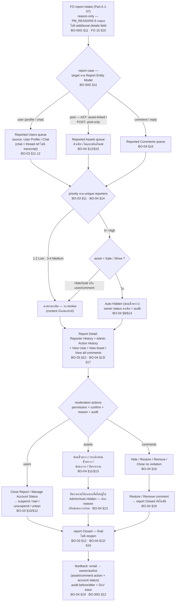

หมายเหตุ:

- Report ไม่ทำให้ content หายเอง — content เปลี่ยน visibility เมื่อ admin action หรือ auto-hide threshold เท่านั้น (`15 D5` · `BO-04 §14` · ดู F-08)
- `Closed` = final ทุกคิว — ไม่มี reopen (`BO-03 §12`, `BO-04 §12/§16`)
- Report ที่ target เป็น `Deletion Requested` — ต้อง review รายงานก่อนและห้ามลบ/archive จากคิว; deletion จัดการใน B-07 (`BO-03 §12`, `BO-13 §16`)
- Comment moderation ส่งอีเมลแจ้ง author ทุก action **ยกเว้น** Close no violation (`BO-04 §19`); moderation/account messaging ใช้ registered email เป็นช่องทางหลัก ไม่เข้า FO Notification Center (`BO-14 §4`)

### 17.8 B-07 Account Deletion Review — คำขอลบบัญชี

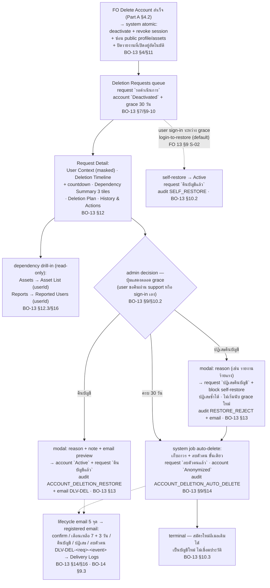

หมายเหตุ:

- การลบจริงเป็น **system job** เมื่อครบ grace — ไม่ใช่ปุ่มของ admin; `คืนบัญชี`/`ปฏิเสธคืนบัญชี` คือ admin actions เดียวใน flow (`BO-13 §9/§14`)
- อีเมลลบตัวตนต้องส่ง **ก่อน** anonymize personal fields (`BO-13 §16`, `BO-14 §13`)
- ทุก audit event ที่มีอีเมลต้อง reference `notification_email_delivery_id` กลับ `DLV-DEL-<req>-<event>` และแสดงลิงก์ใน History & Actions (`BO-13 §16-17`)
- Restore path ตาม reconciled contract (F-07 resolved): **sign-in = login-to-restore เป็น default** (FO S-02); admin restore ผ่าน support channel; **ปฏิเสธคืนบัญชี = block self-restore** — sign-in เจอ support state (`BO-13 §10.2`, `FO 13 §9 S-02`)

### 17.9 B-08 Content Publishing — Articles & Categories

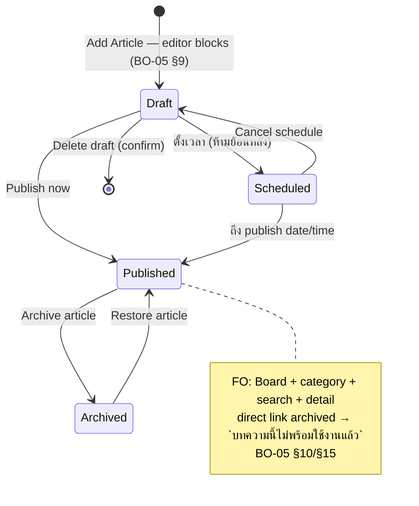

- Editor: metadata + block builder + image upload + category + publish scheduling controls; `Preview as FO` อ่านค่า form ปัจจุบันก่อน save (`BO-05 §9/§11`)
- Category: active ↔ inactive — deactivate ถูก **block** เมื่อมี linked articles (ต้อง move/archive ก่อน); delete เฉพาะ category ที่ไม่มี link (`BO-05 §12`); category name ตรง FO `cat` tag — magazine model ไม่ใช่ fixed taxonomy 7-section เดิม (`BO-05 §12` FO Category Contract, GAP-02)

### 17.10 B-09 Market Data — Provider Sync (read-only Phase 1)

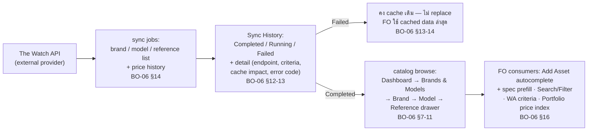

- Phase 1 = read-only ทั้ง module: ไม่มี add/edit/delete/import/export/override — action ที่ไม่อนุญาตแสดง `Read-only in Phase 1` (`BO-06` AC-015/016)
- Provider price USD ต้องมี conversion metadata (`source_currency`/`fx_rate`/…) ก่อนใช้เป็น THB บน FO; reference จาก brand-scoped endpoint `model_id` nullable ได้ (`BO-06 §14`)
- Data quality warnings (duplicate / alias collision / missing fields) ไม่ block แต่ต้องแสดงชัดก่อนข้อมูลเข้า FO surfaces (`BO-06 §17`); ค่าที่ Owner กรอกเองต้องไม่ถูก provider sync overwrite (`BO-06 §16`)

### 17.11 B-10 Market Demand — Monitoring (read-only ทั้งหมด)

| Sub-flow | Steps | Refs |
|---|---|---|
| Demand Overview | aggregate KPI (Active Alerts / Alerts with Matches / Unmet Demand / Notification Success Rate) + trigger trend chart + frequently triggered list | `BO-11 §3/§6.1` |
| Search Insights | popular keyword / popular filter selection+combination / no-result search / search trend / search funnel / avg results per search / Popular Filter tag — **aggregate only ไม่มี user-identifying data** | `BO-11 §6.1/§15` |
| Watch Alert List | filter bar (Status / Source / Notification / Trigger history / Match status / Last Triggered) + sort + 10/page → row click Alert Detail — ไม่มี action menu ไม่มี admin action | `BO-11 §7` |
| Watch Alert Detail | 6 sections: Alert Summary / Owner Summary (read-only) / Criteria (+ inactive dependency warning) / Matched Assets (link → Asset Detail) / Trigger & Notification History (delivery status) / User Action History | `BO-11 §7.1` |

- ไม่มี admin action ใด ๆ — admin ไม่จัดการ alert ของ user (`BO-11 §5/§13`)
- **inactive market data ≠ no current listing**: `is_active=false` → dependency warning + หยุด trigger ใหม่แต่เก็บ history; `count=0` แต่ active → unmet demand ปกติ ไม่มี warning (`BO-11 §10.1`)

### 17.12 B-11 Policy & Support Center

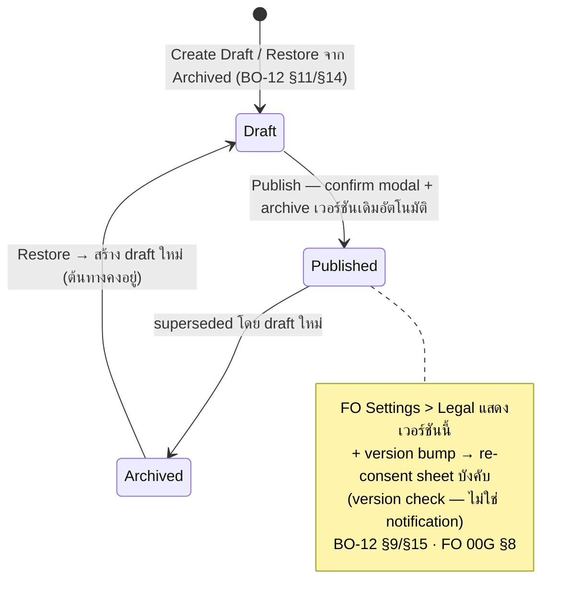

- Policy: fixed types Phase 1 (Terms of Use / Privacy Policy), content TH+EN บังคับครบ + change summary ก่อน publish; Version History = view (read-only) / restore → draft ใหม่ (`BO-12 §7-12/§14`)
- Support Center: 5 channel types fixed (LINE / Phone / Email / Facebook / Website) + Active toggle + value + description TH/EN + business hours + availability → Preview modal (phone frame, live form data) → Save → **FO Help render dynamic rows เฉพาะ channel ที่ Active** — ไม่ fix 3 ช่องทาง (`BO-12 §4/§13` FO Help Dynamic Contract, GAP-04)

### 17.13 B-12 Admin Accounts & Roles Management

| Sub-flow | Steps | Refs |
|---|---|---|
| Admin Accounts | list 7 cols (status pill Active/Invited/Locked/Suspended/Archived + master pill) → detail (Role & Permissions matrix + History & Actions + audit ref jumps) → actions ตาม permission | `BO-16 §8.1-8.3` |
| Invite / lifecycle | → B-01 (§17.4) — Invite modal + invitation contract | `BO-16 §8.6/§8.9`, `BO-01 §10.1` |
| Change Role | role ปัจจุบัน disabled → role ใหม่ + reason + permission diff → confirm → audit `ADMIN_ACCOUNT_ROLE_CHANGE`; safeguard §9.7 ก่อนเปิดยืนยัน | `BO-16 §8.5` |
| Suspend / Reactivate / Unlock / Archive | modal: reason selector (required) + note + impact + confirm tone → result state; gating `canSuspend/canReactivate/canUnlock/canArchive` + master/self/last-admin ไม่แสดงใน DOM | `BO-16 §8.4/§8.7-8.8` |
| Custom Role lifecycle | Create (from_scratch เท่านั้น · Role Key lock) / Edit (revision check + permission dependency + actor ceiling + no-op block) / Deactivate (block เมื่อมี assignment ที่ยัง active/invited/locked/suspended) / Reactivate — ทุก mutation optimistic concurrency + reason 1–512 + audit; System Role = read-only immutable | `BO-16 §9.12` |

### 17.14 B-13 Option Master — Reference Data + Curation

| Sub-flow | Steps | Refs |
|---|---|---|
| Option CRUD | Group List → Option Detail → Add/Edit Option (Option Key lock หลังสร้าง) → Reorder (drag-and-drop + up/down fallback) | `BO-17 §6-9/§12` |
| Option lifecycle | Deactivate (reason required + ต้องเหลือ ≥1 active — System Option Deactivate Policy) ↔ Reactivate; Delete = type-to-confirm + **ไม่มี asset ใช้** เท่านั้น | `BO-17 §10-11/§13` |
| Group lifecycle | Add/Edit (Group Key lock) / Reorder / Deactivate (ไม่มี asset ใช้ option ใน group) / Delete (inactive + unused + type-to-confirm 2 ครั้ง) | `BO-17 §13` |
| Suggestion curation | FO `ระบุเอง` free-text (4 groups: case_material / movement / dial_color / strap_bracelet_type) → `spec_option_suggestions` (usage_count) → admin **promote เป็น option / map alias / ignore** → backfill relation id ให้ asset เดิม → re-run WA match (dedup `alert_id`+`asset_id`) | `BO-17 §22-23`, `BO-11 §10` |

- FO impact: form/filter/WA criteria แสดงเฉพาะ `is_active=true`; existing assets เก็บ relation id + snapshot text — deactivate ไม่กระทบของเดิม (`BO-17 §14/§22`); free-text spec ไม่ match option criteria จนกว่า promote + backfill (keyword criteria ยังจับ snapshot text ได้) (`BO-17 §22.4`, `BO-11 §9`)

### 17.15 B-14 Observability — Delivery Logs + Audit Log

| Surface | Content | Rules | Refs |
|---|---|---|---|
| Settings > Delivery Logs | read-only list 7 cols + detail modal — `DLV-ACCT-<seq>-INV-<seq>` invitation · `DLV-ACCT-xxx` account-status · `DLV-DEL-<req>-<event>` deletion lifecycle · `DLV-WA-xxx` watch alert (ดู F-09) | Phase 1 read-only; status pill `Sent`/`Retry` (production enum กว้างกว่า — retryable failure map เป็น Retry); retry = provider/outbox state ไม่ใช่ UI action; target >95% มี delivery status | `BO-16 §16`, `BO-14 §12-13` |
| Settings > Audit Log | read-only list 8 cols (Event ID / Date-Time / Actor / Action / Module / Risk / Reference / Note) + detail drawer (before/after diff) — `AUD-xxxxx` | immutable — ห้ามแก้ผ่าน BO UI; actor type Admin/System/ProviderJob; ref jumps ADM- / DEL- / AST- / ART- / RCO- / U-; เก็บ UTC แสดง Asia/Bangkok | `BO-08 §5-12` |

### 17.16 Cross-Side Flows FO↔BO

#### X-01 FO Report → BO Moderation → Feedback

```mermaid
flowchart LR
    subgraph FO["Front Office (Part A)"]
        U["Member กด Report<br/>post / profile / comment / chat<br/>15 §8 Entry Matrix"] --> RS["reason-only submit<br/>PM_REASONS 9 เหตุผล<br/>→ report:done + toast<br/>— content ยังแสดงปกติ · 15 §10-11"]
    end
    subgraph SYS["System"]
        CASE["report case สร้าง/อัปเดต<br/>unique reporter count<br/>frozen ref AST- / POST-<br/>BO-00G §11"]
        THR{"unique reporters ≥5<br/>+ asset Sale/Show ?"}
        AH["Auto Hidden<br/>BO-04 §14"]
    end
    subgraph BO["Back Office"]
        Q2["queue:<br/>Reported Users / Assets / Comments"] --> REV["admin review:<br/>report detail + context"]
        REV --> ACT2["moderation action<br/>→ report Closed (final)"]
    end
    subgraph OUTC["ผลกลับ FO / User"]
        VIS["visibility change ≤60s:<br/>hidden / removed / unavailable<br/>BO-00G §12"]
        EM["email → owner/author<br/>registered email (primary)<br/>BO-04 §19 · BO-00G §12"]
    end
    RS --> CASE --> THR
    THR -->|"ใช่"| AH --> Q2
    THR -->|"ไม่"| Q2
    ACT2 --> VIS
    ACT2 --> EM
```

- Reporter ไม่ได้รับผลการตรวจ (ไม่มี report tracking ใน V1 — `15` out-of-scope); reported party ไม่เห็น reporter identity และไม่ถูกแจ้งเมื่อถูก report (`15 §9/§11`)
- Chat report → `report:user` + thread ref เท่านั้น (ไม่มี transcript — GAP-06 by-design) เข้า Reported Users (`BO-00G §11`, `BO-03 §12`)

#### X-02 FO Account Deletion → BO Review → Outcome

```mermaid
flowchart LR
    subgraph FO2["Front Office"]
        DEL["user confirm delete<br/>13 §9 (Part A §4.2)"]
        BLOCK["session revoked → guest<br/>profile/assets ซ่อนทันที<br/>BO-13 §15"]
        REIN["สมัครใหม่อีเมลเดิมได้<br/>(คนละบัญชี · ไม่เชื่อมประวัติ)<br/>BO-13 §10.3"]
    end
    subgraph SYS2["System (atomic + jobs)"]
        SA["deactivate + revoke +<br/>ซ่อน public + ปิดรายงาน auto<br/>audit ทุกขั้น · BO-13 §4/§11/§17"]
        GRACE["grace 30 วัน<br/>email เตือนเหลือ 7 + 3 วัน"]
        AUTO3["ครบ 30 วัน → auto-delete<br/>เก็บถาวร + ลบตัวตน ขั้นเดียว"]
    end
    subgraph BO2["Back Office"]
        Q3["Deletion Requests<br/>`รอดำเนินการ`"]
        REV2["Request Detail review<br/>+ dependency drill-in"]
        R1{"admin decision"}
        BACK["คืนบัญชี → `Active`<br/>+ email + audit"]
        WAIT["ปฏิเสธคืนบัญชี<br/>+ email + audit<br/>+ block self-restore<br/>→ รอครบ grace"]
        SREST["sign-in = self-restore<br/>login-to-restore (default)<br/>FO 13 §9 S-02"]
    end
    DEL --> SA --> Q3 --> REV2 --> R1
    SA --> BLOCK
    SA --> GRACE --> AUTO3
    R1 -->|"คืนบัญชี"| BACK
    R1 -->|"ปฏิเสธ"| WAIT --> AUTO3
    AUTO3 --> REIN
    BACK -.->|"user login ได้อีกครั้ง"| BLOCK
    GRACE -.->|"ยกเว้นถูกปฏิเสธ"| SREST
```

- Lifecycle email 5 จุด → registered email เป็นช่องทางหลัก (ไม่เข้า FO Notification Center) — `DLV-DEL-*` trace กลับ History & Actions ของ Request Detail (`BO-14 §9.3`, `BO-13 §16`)
- Restore path ตาม reconciled contract (F-07 resolved 2026-11-05): sign-in = self-restore default; admin restore = support path; reject = block self-restore

#### X-03 FO Watch Alert → BO Monitoring

```mermaid
flowchart LR
    subgraph FO3["Front Office"]
        WA2["สร้าง alert: search bell /<br/>model follow (J-06)<br/>FO 10 §8-9"]
        MATCH["publish post `Sale`<br/>→ match engine"]
        ROW["`watch` row → alerts feed<br/>ของ watcher (J-09)<br/>→ Post Viewer"]
    end
    subgraph BO3["Back Office (read-only)"]
        LIST["Watch Alert List<br/>filter / sort · BO-11 §7"]
        DTL["Alert Detail: criteria +<br/>matched assets +<br/>trigger & delivery history<br/>BO-11 §7.1"]
        DL["Settings > Delivery Logs<br/>DLV-WA-* status · BO-16 §16"]
        INACT["inactive market data /<br/>deactivated option →<br/>dependency warning +<br/>หยุด trigger ใหม่ · BO-11 §10.1"]
    end
    WA2 -.->|"criteria schema = Search —<br/>BO เก็บ source + criteria"| LIST
    WA2 --> MATCH --> ROW
    LIST --> DTL --> DL
    INACT -.->|"Market Data /<br/>Option Master change"| MATCH
    MATCH -.->|"trigger history +<br/>delivery status"| DTL
```

#### X-04–X-09 Cross-side อื่น

| ID | Flow | BO side | FO side | Sync contract |
|---|---|---|---|---|
| X-04 | BO suspend/ban user | B-03 account action + email | session revoke + login blocked + account status state (J-01 §4.1 contract) | **Security** = enforce ใน request ถัดไป ไม่มี tolerated delay |
| X-05 | BO publish/schedule/archive article | B-08 status action | Board / search / category / detail; direct link → canonical unavailable copy | Reference/content propagation |
| X-06 | BO publish policy version | B-11 `POLICY_PUBLISH` | legal viewer เวอร์ชันใหม่ + **re-consent sheet** บังคับ (version check ไม่ใช่ notification) | Reference ≤24h — re-consent ทับ session ปัจจุบัน |
| X-07 | BO support center save | B-11 | Help screen dynamic rows เฉพาะ Active channel | Reference ≤24h (cached read-model) |
| X-08 | BO market data sync / option master change | B-09 / B-13 | autocomplete / filter / WA criteria / Portfolio; inactive → หยุด WA trigger ใหม่ | Reference ≤24h ผ่าน scheduled sync |
| X-09 | BO asset/comment moderation | B-05 / B-06 | public surfaces สะท้อน visibility ใหม่; comment count เฉพาะสิทธิ์ที่เห็น | **Moderation** ≤60s + validate status ก่อน render เสมอ |

Sync timing contract (`BO-00G §12`, DEC-49 — owner approved 2026-11-04):

- **Security actions** (suspend / ban / deletion / session revoke) → enforce ใน request ถัดไปของ user — ไม่มี delay
- **Moderation actions** (hide / remove / restore content, comment moderation) → visible propagation ≤60 วินาที + cache invalidate บน mutation
- **Reference/master data** (option master, market data, directory, support center, policy) → propagation ≤24 ชม.ผ่าน scheduled sync — FO อ่านผ่าน cached read-model ไม่ block user flow
- **Watch Alert match/notification** → async job ไม่ผูก SLA กับ user action — trace ผ่าน Delivery Logs
