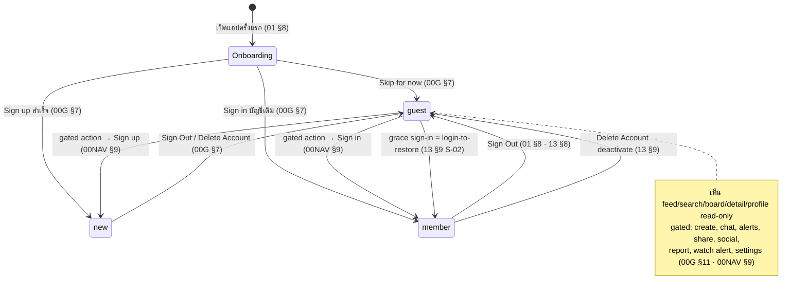
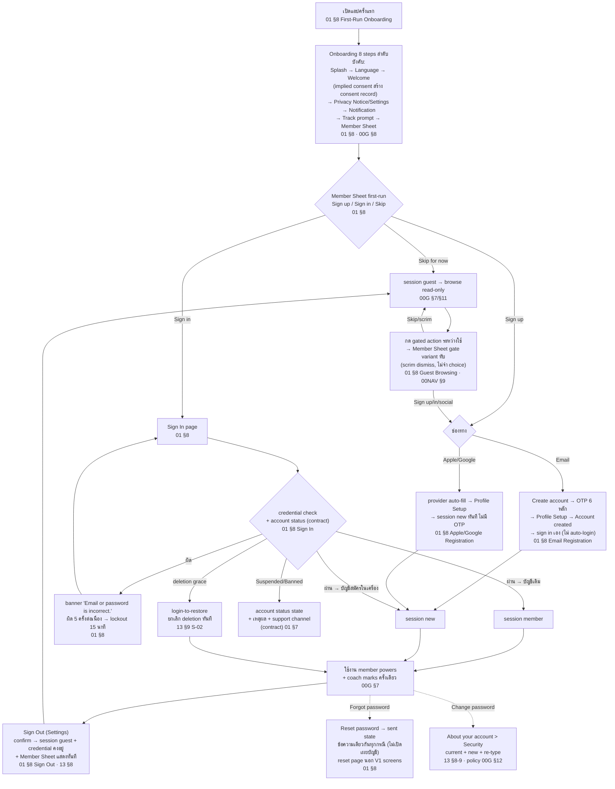
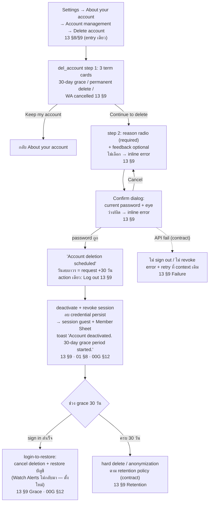
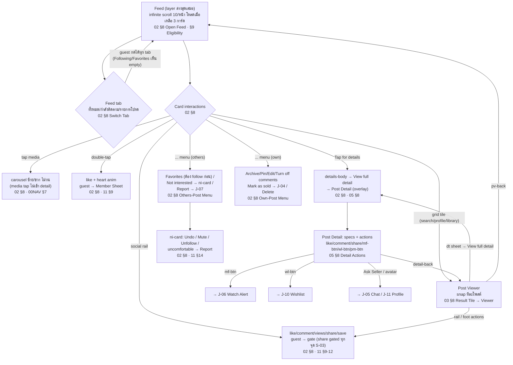
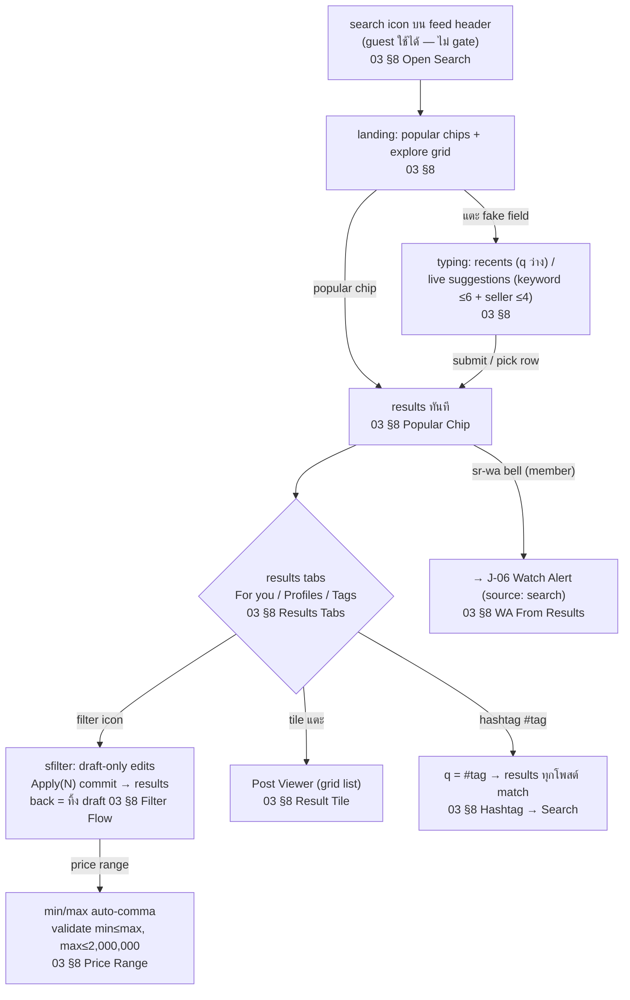
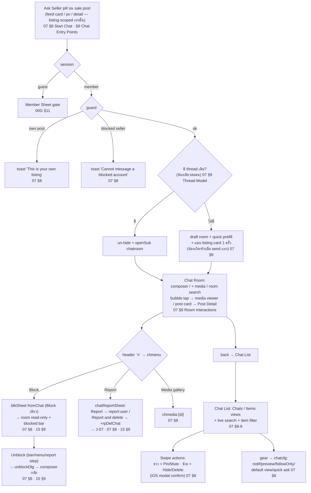
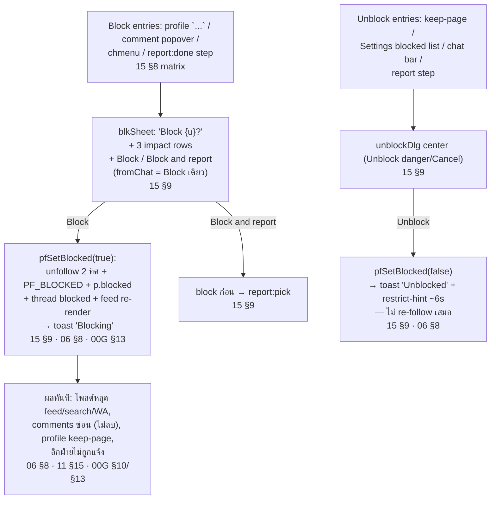
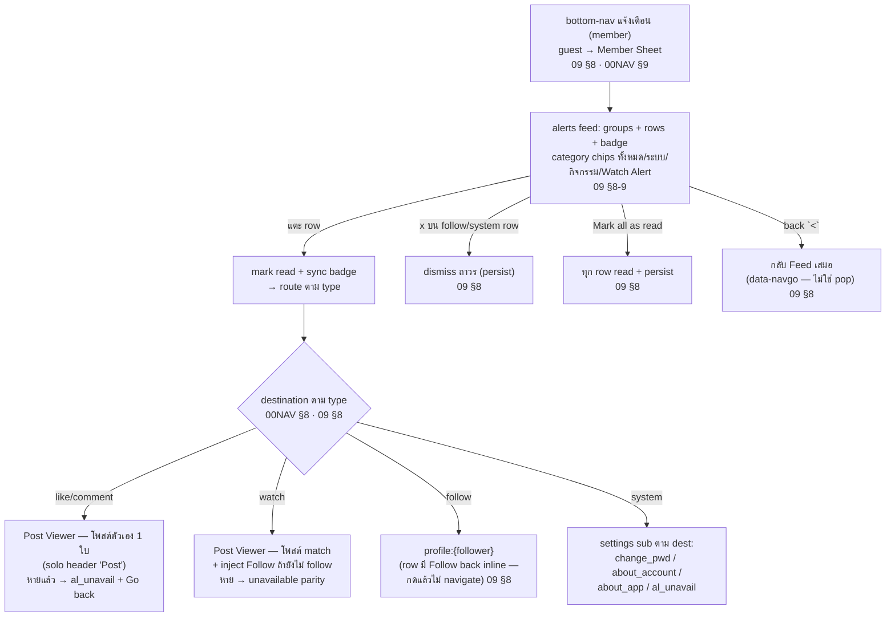
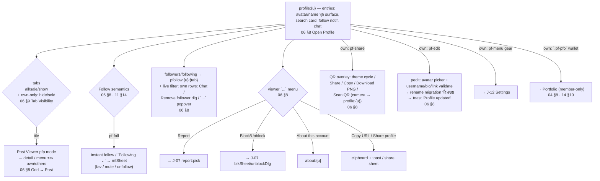
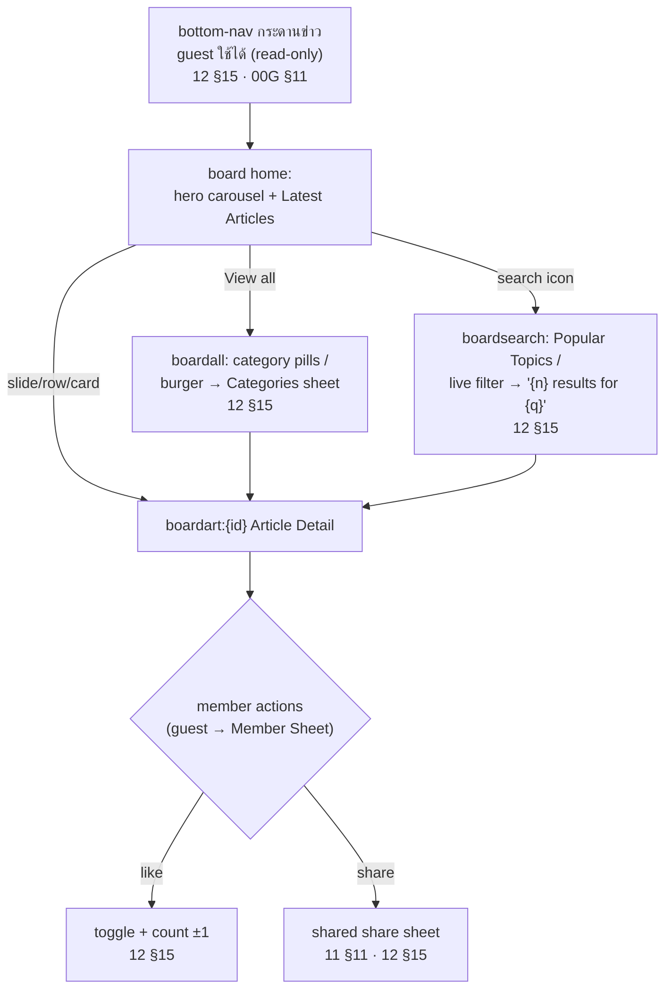

# Business Process Flows — TukDaeng

| รายการ | ข้อมูล |
|---|---|
| Version | 0.1 (Part A — FO draft) |
| Date | 2026-11-05 · Asia/Bangkok |
| Task | BAC-001 [`ca5afced`] — Mission `0e19c244` Objective 1 (Business Process Flows) / Feature: Core Journey Flows |
| Status | **DRAFT — รอ review** (Part A = FO user journeys เสร็จ; Part B = BO/Admin + cross-side รอ BAC-002) |
| Source of truth | `FrontOffice/` module specs (00 pair + 01–15) — ทุกจุดในเอกสารนี้อ้าง spec section |

## 0. วิธีอ่านเอกสารนี้

- รูปแบบอ้างอิง: `01 §8` = `FrontOffice/01_AUTHENTICATION_MODULE.md` section 8 (User Flow); `00G` = `00_GLOBAL_RULES_MODULE.md`; `00NAV` = `00_NAVIGATION_AND_CROSS_MODULE_FLOW.md`
- ป้าย `(contract)` = spec contract สำหรับ production ที่ prototype ไม่ครอบ — spec เจ้าของ mark ไว้เอง เอกสารนี้สะท้อนตามนั้น
- เอกสารนี้อธิบาย journey ฝั่งผู้ใช้ (FO app) เท่านั้น — admin/BO moderation เป็นเพียงจุดต่อท้าย (hand-off) รายละเอียดอยู่ Part B
- Journey ทุกตัวสืบจาก spec จริง — ถ้าพบจุดที่ spec ขัดกันเองหรือขัด prototype ให้ดู §16 Findings (บันทึกเท่านั้น ไม่แก้ spec)

## 1. Journey Inventory (FO)

| ID | Journey | Actor หลัก | Spec sources | Detail |
|---|---|---|---|---|
| J-01 | Account Lifecycle: onboarding → สมัคร (email/SSO) → sign in → guest gate → sign out → ลบบัญชี (grace → restore/hard delete) | Guest/Member | 01 §7-8, 13 §8-9, 00G §7-8/§12 | §4 |
| J-02 | Discovery: feed → tabs → card interactions → post viewer → post detail | Guest/Member | 02 §8-9, 03 §8-9, 05 §8-9 | §5 |
| J-03 | Search & Filter: landing → typing/suggest/recents → results → filter → tile → viewer | Guest/Member | 03 §8-9 | §6 |
| J-04 | Listing → Sold: create post/asset → visibility → edit/status → mark as sold → sold history | Owner | 02 §8-9, 04 §8-9, 14 §10-13, 00G §9-10/§12 | §7 |
| J-05 | Chat: Ask Seller → room → manage threads → block/report | Member | 07 §8-9, 00NAV §7 | §8 |
| J-06 | Watch Alert: create (search/detail) → manage → match → notification → post | Member | 10 §8-9, 03 §8, 05 §8, 09 §8 | §9 |
| J-07 | Report & Block: report post/user/comment/chat → report:done steps → block/unblock | Member | 15 §8-11, 06 §8, 07 §8, 11 §15 | §10 |
| J-08 | Social: like / comment / share / save / follow / favorites / mute / not-interested | Member | 11 §9-15, 02 §8, 06 §8 | §11 |
| J-09 | Notification consumption: alerts feed → read → destination | Member | 09 §8-9, 00NAV §8 | §12 |
| J-10 | Library: saved / collections / wishlist / archive | Member | 11 §12-13, 02 §8 Archive, 05 §8 | §13 |
| J-11 | Profile: view public profile → follow lists → QR share → edit profile | Member/Viewer | 06 §8-9 | §14 |
| J-12 | Settings & account management: language/theme/legal/prefs/lists/change password/log out | Member | 13 §8-9 | §15 |
| J-13 | Board: browse articles → category/search → article detail → like/share | Guest/Member | 12 §15 | §15 |

Journey รองที่อยู่ใน journey หลัก (ไม่แยก section): Edit Info (`02 §8`), Pin/Archive (`02 §8`), Comment moderation ของเจ้าของคอมเมนต์ (`11 §10`), Coach marks (`00G §7`), Re-consent (`01 §8`, `00G §8`), Delete post (`02 §8`, `04 §8`)

## 2. Session & Gate Model (context ร่วมทุก journey)

ทุก journey วิ่งบน session 3 สถานะ (`00G §7`) — guest ทำได้เฉพาะ browse read-only ตาม Guest Capabilities (`00G §11`); action ที่ต้องมีตัวตนถูก intercept ด้วย Member Sheet `Join TukDaeng` gate ทุกครั้ง (ไม่จำ choice):



Re-consent (policy version bump) ทับได้ทุก session — `Accept & continue` หรือ `Decline` → sign out/exit เท่านั้น (`01 §8`, `00G §8`)

## 3. Cross-cutting: ปลายทางที่พบซ้ำทุก journey

- **Member Sheet gate** — ทุก gated entry รวม bottom-nav Chat/Alerts/Profile, `+`, share ทุก surface, social actions, report/block, watch alert, settings (`00NAV §9`, `00G §11`)
- **Unavailable fallback** — deep link/entry ไปของที่หายไป (deleted/sold/hide/blocked/article) → unavailable state + CTA `Go back` (มี history → หน้าก่อน; ไม่มี → Feed) (`00NAV §10`)
- **Blocked profile** — IG keep-page: profile เปิดได้ แต่ grid ว่าง + ปุ่ม Unblock (`00NAV §10`, `06 §7`)
- **Post Detail เป็น overlay layer** เหนือ viewer/sub — `.detail-back` เผย surface เดิม (`05 §9`)
- **Back behavior** — `.sub-back` pop ตาม stack; report `X` ปิดทั้งกอง (`00NAV §6.7`)

## 4. J-01 Account Lifecycle — ลงทะเบียน → ใช้งาน → ลบบัญชี

### 4.1 Onboarding + Registration + Sign In



หมายเหตุ journey:

- Email sign-up ไม่ auto-login — Account created → `Sign in` (prefill email, password ว่าง) (`01 §8`, `00G §7`)
- Lockout: counter ต่ออีเมล, countdown ทุกวินาที, server lockout 15 นาที (contract) (`01 §8`)
- Suspended/Banned = revoke session + account status state — contract เท่านั้น, prototype เช็กแค่ credential (`01 §7`, `00G §12`)

### 4.2 Delete Account → Grace Period → Restore / Hard Delete



## 5. J-02 Discovery — Feed → Post Viewer → Post Detail



กฎข้าม journey: โพสต์ที่ owner archive → หลุด feed+grid ทันที + เคลียร์ pin (`02 §8`); โพสต์ที่ถูกลบ → หายทุก surface + tile ที่ค้าง → unavailable (`02 §8`, `11 §12`)

## 6. J-03 Search & Filter



- Recents persist ข้ามเปิดแอป + ล้างเมื่อ sign out (`03 §8`, `00G §7`)
- Results eligibility = asset surfaces: match เฉพาะ status `Sale` (`00G §10`) — For you tab มี Accounts (seller name match) + Posts grid (`03 §9`)

## 7. J-04 Listing → Sold — ลงประกาศ → ขายได้

```mermaid
flowchart TD
    S{"Entry (member)"} -->|"Feed `+` header"| P1["composer `create` mode post:<br/>step1 media ≥1 → step2 fields<br/>02 §8 Create Post Flow"]
    S -->|"Own profile `+` / Add asset"| A1["composer mode asset:<br/>caption + Visibility pick<br/>02 §8 · 04 §8 Add Asset Flow"]
    P1 --> P2{"Share + `Also save to<br/>My Assets` toggle"}
    P2 -->|"OFF"| PF["feed post `pfkind:post`<br/>(feed-only ไม่ผูก asset)<br/>02 §9 Publish Rule"]
    P2 -->|"ON"| PA["feed post `pfkind:sale`<br/>+ drawer record `sale` + link<br/>04 §8 Post → Drawer Save"]
    A1 --> V{"Visibility pick<br/>04 §8"}
    V -->|"Show (default)"| SH["drawer-only `pfkind:show`<br/>โชว์บน profile — ไม่เข้า feed/search/WA<br/>00G §10"]
    V -->|"Hide"| HD["drawer-only `pfkind:hide`<br/>owner-only"]
    V -->|"Post to feed"| PA
    PA --> WAM{"WA match?<br/>10 §8"} 
    WAM -->|"มี hit"| WT["`watch` row เข้า alerts feed<br/>ของ watcher — publisher ไม่เห็น<br/>10 §8 (2026-11-05)"]
    SH --> E["Edit info: composer step2 prefilled<br/>status pick ขาย/โชว์/ซ่อน → pfkind sync<br/>02 §8 · 04 §8 Status Change"]
    HD --> E
    PA --> E
    E --> MS{"Mark as sold entries<br/>04 §8 · 14 §13"}
    MS -->|"own-post menu<br/>(sale/show/hide)"| MAT["materialize drawer record<br/>ถ้ายังไม่ link 04 §8"]
    MS -->|"pfasset `Mark as sold`"| MAT
    MAT --> SF["`sell:{id}` Sale Record form:<br/>sale price (prefill asking) + sale date<br/>(≤ วันนี้) — ไม่มี buyer/payment fields<br/>14 §13"]
    SF --> SOLD["`markAssetSold`:<br/>PF_ASSETS → PF_SOLD<br/>linked posts → `pfkind:sold`<br/>หลุด feed/search/WA ทันที<br/>14 §13 · 04 §9 · 00G §12"]
    SOLD --> SR["push `sold:{id}` (ghost slide)<br/>toast 'Sale recorded · moved to Sold history'<br/>14 §13"]
    SR --> HIST["`soldhist` ประวัติการขาย<br/>+ `sold:{id}` detail (realized G/L, holding)<br/>14 §12"]
    SOLD --> VSR["own-post menu บนโพสต์ sold<br/>→ `View sale record` → `sold:{id}`<br/>04 §8 · 05 §8"]
```

หมายเหตุ journey:

- "ขายได้" ใน V1 = owner บันทึกการขายเอง (self-reported) — ไม่มี payment/buyer/transaction flow (`14 §13` D3); ช่องทางเจรจาจริง = J-05 Chat
- `sold` = terminal — ไม่มี revert (`14 §13`); sold ไม่นับมูลค่าพอร์ต (`14 §12`)
- ลบโพสต์ที่ผูก asset: drawer record ไม่ถูกลบตาม — documented deviation (`04 §8`, findings F-02)

## 8. J-05 Chat — คุยกับผู้ขาย



- Chat คงอยู่แม้ asset ถูกลบ/ขาย (`00NAV §7`, `00G §11 Deleted Asset`); block ไม่ลบ thread — อ่านย้อนได้ read-only (`15 §9`)
- Entry อื่นที่เข้าห้องเดียวกัน: profile Chat button, followers row `แชท` (`06 §8`), share-to-friend เปิดห้องพร้อม post card (`11 §11` DEC-20)

## 9. J-06 Watch Alert — สร้าง → match → แจ้งเตือน

```mermaid
flowchart TD
    A{"Create entry (member)"} -->|"results head bell `sr-wa`| S1["snapshot keyword + filters + price<br/>source:'search' matchMode:'all'<br/>03 §8 · 10 §8"]
    A -->|"detail bell `mf-btn`<br/>'Follow this model'"| D1["modelKey = brand|model|ref<br/>criteria จาก post specs<br/>05 §8 · 10 §8"]
    D1 -->|"criteria ว่าง"| T["toast 'No details on this post to watch'<br/>(ไม่เปิด sheet) 05 §8"]
    S1 --> SG{"`waSig` ตรง alert เดิม?<br/>10 §9 Dedupe"}
    D1 --> SG
    SG -->|"ตรง (on/off ก็ได้)"| ED["sheet edit mode:<br/>criteria/name เดิม<br/>03 §8 · 10 §8"]
    SG -->|"ไม่ตรง"| CR["waSheet: name auto (แก้ได้)<br/>+ match modes + `N now` count<br/>→ Create alert 10 §9 Sheet Rule"]
    CR --> ON["alert ON → toast 'Watch alert on'<br/>bell `on` sync ทุกจุด modelKey ตรง<br/>10 §9 Bell Sync"]
    ED --> MNG["Manage จาก `walerts` list:<br/>Edit (sheet) / Pause-Resume toggle /<br/>Delete (confirm) 10 §8"]
    ON --> MM["โพสต์ใหม่ publish<br/>→ `insertNewPost` คำนวณ `alertMatch`<br/>10 §8 · §9 Match Pool/Criterion"]
    MM -->|"มี hit"| NT["`watch` row เข้า alerts feed ของ watcher<br/>(unread + badge) — publisher ไม่เห็น feedback<br/>10 §8 (2026-11-05)"]
    NT --> TAP["แตะ watch row → Post Viewer<br/>โพสต์นั้นตรง ๆ (ไม่มี result list คั่น)<br/>โพสต์หาย → unavailable state<br/>09 §8 · 00NAV §8/§10"]
```

- Alerts list เข้าจาก: feed header `.feed-wa`, Settings > Watch Alerts, search bell, detail bell (`00NAV §6.6/§7`)
- Match เฉพาะ status `Sale` + ไม่นับ blocked/muted/ni (`00G §10`, `10 §9`); prototype = simulation on publish, production contract = `watch` notification row (`10 §8`)

## 10. J-07 Report & Block — ส่ง report

```mermaid
flowchart TD
    E{"Report entries<br/>15 §8 Entry Point Matrix<br/>(ทุกจุด guest-gated)"} -->|"post `...` → Report /<br/>ni uncomfortable card"| P["`report` page (X only)<br/>'Why are you reporting this post?'<br/>+ PM_REASONS 9 ข้อ 15 §10 · §6"]
    E -->|"profile `...` → Report"| U["`report:pick:{u}`:<br/>'A specific post' → report:posts → report:post<br/>/ 'Something about this account' → report:user<br/>15 §10 · 06 §8"]
    E -->|"long-press comment → Report"| CM["`report:comment` (X only)<br/>15 §10 · 11 §10"]
    E -->|"chat `≡` → Report"| CH["chatReportSheet:<br/>Report / Report and delete<br/>→ `report:user` (ข้าม pick)<br/>15 §9-10 · 07 §8"]
    E -->|"blkSheet → 'Block and report'"| U
    P --> RSN["แตะเหตุผล = submit ทันที"]
    U --> RSN
    CM --> RSN
    CH --> RSN
    RSN --> DONE["`report:done:{u}`:<br/>'Thanks for your feedback'<br/>+ optional steps: Block/Unblock,<br/>Unfollow, Mute/Unmute (instant + green check)<br/>15 §10 · §9"]
    DONE -->|"Done / X"| END["rpClose + toast<br/>'Report submitted · thanks for letting us know'<br/>— content ยังแสดงปกติ รอ BO moderation<br/>15 §11 · 00G §13"]
    DONE -->|"rpDelChat (Report and delete)"| CD["thread hidden + ออกจาก list<br/>+ strip stack → กลับ Chat List<br/>07 §8 · 15 §10"]
```

### Block / Unblock (sub-flow ของ J-07)



## 11. J-08 Social Interactions

Flow ย่อยทั้งหมด guest-gated (`00G §11`); canonical อยู่ `11_SOCIAL` + surfaces ใน `02/03/05/06/09`

| Sub-flow | Steps | Refs |
|---|---|---|
| Like | `.like-btn` toggle → sync ทุก surface ของ pid เดียวกัน; double-tap media = like (ไม่ untoggle); liked posts → Settings > Interested | `11 §9`, `02 §8` |
| Comment | `.comment-btn` → shared sheet (rows + emoji row + input); reply prefill `@{user}`; emoji quick-react = own comment; owner long-press → Delete (confirm), others → Block/Report | `11 §10`, `02 §8`, `03 §8` |
| Share | `.share-btn` → sheet (friends grid + app row + copy); friend → post card เข้าห้องแชท + เปิดห้อง (DEC-20); gated ทุก surface (S-03) | `11 §11`, `02 §8` |
| Follow | account-level (`setFollowing`); surface semantics ต่างกันโดยเจตนา — feed confirm sheet, PV/lists instant, profile `Following⌄` → mfSheet; unfollow ล้าง favorite+mute | `06 §8`, `11 §14` |
| Favorites | seller-level feed filter (ต้อง follow ก่อน); entries: `...` menu / mfSheet / Settings favorites page | `11 §14`, `02 §8` |
| Mute | muteDlg confirm → โพสต์หลุด feed แต่ยัง follow; unmute ผ่าน Settings / profile | `11 §14`, `15 §9` |
| Not interested | `...` → ni-card → Undo / Mute / Unfollow / 'made me uncomfortable' → Report; re-render แล้วหลุด feed — restore ที่ Settings > Not interested | `02 §8`, `11 §14` |

## 12. J-09 Notification Consumption



## 13. J-10 Library — Saved / Wishlist / Archive

| Sub-flow | Steps | Refs |
|---|---|---|
| Save | `save-btn` → set saved + เปิด `sv` sheet เสมอ → pick collections (multi); `Saved` row ซ้ำ = unsave; `New collection` → nc sheet | `11 §12`, `02 §8` |
| Saved hub | `saved` route: tabs All/Collections/Posts + search + Manage (select → Unsave/Add/Move); tile → viewer feed mode | `11 §12` |
| Collection | `savedcol`: Add/Edit(cover+rename)/Select/Delete collection (posts ยัง saved); move→new = ล้าง memberships เดิม | `11 §12` |
| Wishlist | `wl-btn` เฉพาะ Post Detail → wlSheet เหมือน save แต่แยกระบบ (`wlCols`, WISHLISTS); hub `wishlist`/`wishcol` | `11 §13`, `05 §8` |
| Archive | own-post `Archive` → หลุด feed+grid + เคลียร์ pin; เปิดดูที่ Settings > Your library > Archive (owner-only); `Unarchive` คืนตาม eligibility | `02 §8`, `13 §8` |

Cross-cut: private library surfaces ตาม `libVisible` — post sold ยังอยู่, hide/archive/block/delete ทำ tile หาย, ni/muted ไม่กระทบ (`11 §12` lock 2026-10-29)

## 14. J-11 Profile — view / follow lists / QR / edit



## 15. J-12 Settings & J-13 Board (supporting journeys)

### J-12 Settings & account management

| Sub-flow | Steps | Refs |
|---|---|---|
| Open Settings | own profile → `pf-menu` gear → `settings` (entry เดียวของระบบ) | `13 §8`, `00NAV §6.6` |
| Language / Theme | pick → apply ทันทีทั้งแอป + persist `fo_lang`/`fo_theme` + toast | `13 §8` |
| Legal | Terms / Privacy → in-app legal viewer (version + effective date) | `13 §8`, `00G §8` |
| Content preferences | Sensitive (Less/Standard) / Interested (liked + Remove) / Not interested (Restore) / Snooze 30 วัน / Reset suggested content (confirm) | `13 §8-9` |
| Favorites / Muted / Blocked | manage lists: search/Remove/Remove all/Add · Unmute · Unblock dlg; แตะ row → profile | `13 §8` |
| Change password | About your account > Security → 3 fields + eye + inline validation + `Forgot your password?` → reset dialog | `13 §8-9`, `01 §8` |
| Log out / Delete account | → J-01 (§4) | `13 §8`, `01 §8` |
| Watch alerts list | `walerts` → J-06 manage | `10 §8` |
| Your library | Saved / Wishlist / Archive rows → J-10 | `13 §8`, `11 §12` |

### J-13 Board — อ่าน content (guest ได้ read-only)



## 16. Findings — จุดที่พบระหว่าง inventory (บันทึกเท่านั้น ไม่แก้ spec/prototype)

ข้อห้ามงาน: เจอ spec ขัดแย้ง → บันทึก finding รออนุมัติเท่านั้น รายการด้านล่างคือสิ่งที่พบระหว่างทำ inventory — ตารางรวมทั้ง finding ที่ **แก้ prototype แล้วตามทิศทางพี่มาเต็ม (2026-11-05)** และจุดที่ spec ยังไม่ตรงกับทิศทางใหม่ (รออนุมัติแก้ spec ไม่ได้แตะเอง):

| ID | Finding | สถานะ | Refs |
|---|---|---|---|
| F-01 | ไม่มีไฟล์ `08_*_MODULE.md` (module ข้ามเลข 08 — น่าจะ Offer ที่ถูกถอด) — inventory ครอบไฟล์ที่มีจริง | ไม่แก้ — เลขเล่มคือ stable ID ถูกอ้างด้วยชื่อไฟล์/"canonical NN"/AC ID หลายร้อยจุด การรันเลขใหม่เสี่ยงพัง cross-ref มากกว่าประโยชน์ | `FrontOffice/` dir |
| F-02 | **แก้ prototype แล้ว** (`Prototypes/fo-flow/index.html`): (a) `salePosts()`/results/#tags/explore/tagRows เลิกนับ Hide/Sold/archived และครอบ `post` kind — results = ทุกโพสต์ที่เห็นบน feed; (b) public profile (`pfTabPosts`) viewer เห็น post+sale+show ไม่รั่ว hide/sold; (c) ลบโพสต์แล้วลบ PF_MINE + linked `PF_ASSETS` record ตาม (PF_SOLD คงไว้เป็นประวัติ); (d) sign-up password = canonical `≥8 + ≥1 ตัวเลข/สัญลักษณ์` เท่ากับ change-pwd (S-21); (e) `lk-follow` — เช็กแล้วโค้ดเรียก `pfSetFollow` จริงอยู่แล้ว (spec note เก่า stale — แก้ spec เล่ม 11 แล้ว); (f) กวาด dead code: legacy delete dialog, `chsettings:{id}` route + `chatRoomSettingsHTML` | **RESOLVED in prototype** — แต่ดู F-06 เรื่อง spec ยังไม่ตาม | `03 §9`, `06 §9`, `04 §8`, `00G §10/§12`, `11 §9` |
| F-03 | Contract-only ที่ prototype ไม่ครอบ (E2E flow อิง contract): feed error+retry, offline cached read, suspended/banned check ที่ sign in, delete account failure path, reset-password pages (นอก V1), cookie preferences page | documented — ไม่แก้ (เป็น contract ไม่ใช่ defect) | `00G §11`, `01 §7/§8`, `13 §9/§12` |
| F-04 | "ขายได้" = owner self-report เท่านั้น — ไม่มี buyer/payment/transaction entity ใน V1 (D3: sale record มีแค่ price+date+cost carry); การเจรจาเกิดใน Chat แต่ไม่มี state machine เชื่อม chat→sold | scope note — ไม่ใช่ขัดแย้ง | `14 §13`, `07 §9` |
| F-05 | **แก้ prototype แล้ว**: ลบ owner-facing toast `Watch alert matched` ทั้ง 3 จุด (fo_newpost carry / asset Post-to-feed / composer share) — match ตอน publish เปลี่ยนเป็น push `watch` row เข้า alerts feed ของ session member (ฝั่ง watcher) ตาม contract แทน | **RESOLVED in prototype** — spec `10 §8` ยังเขียน toast เป็น simulation mechanism อยู่ → รวมใน F-06 | `10 §8`, `09 §8` |
| F-06 | **Spec gaps — อนุมัติและแก้ spec แล้ว (2026-11-05)**: (a) `03 §9` Results Eligibility → results/explore/tags = `discoverablePosts()` ทุก query mode; (b) `00G §10` matrix (แถว `post`: Public Profile + Search = แสดง) + `06 §9` Tab Visibility → public profile = post+sale+show; (c) `10 §8/§3/§14/AC-WA-021` + mentions ใน `02/03/04/05` + `QA checklist` + `master definition` → match = `watch` row ใน alerts feed ของ watcher, ถอด publisher toast ออกแล้ว | **RESOLVED — spec + prototype ตรงกันแล้ว** | `03 §9`, `00G §10`, `06 §9`, `10 §8` |

## 17. Part B — BO/Admin journeys + cross-side flows

รอ BAC-002 [`f5745b61`]: admin lifecycle, moderation queues (reported users/assets/comments), market demand, account deletion handling, delivery logs/audit — และ cross-side flow (report FO → moderation BO → notification กลับ FO, delete account FO → deletion request BO, watch alert match, suspension → FO account status state)
