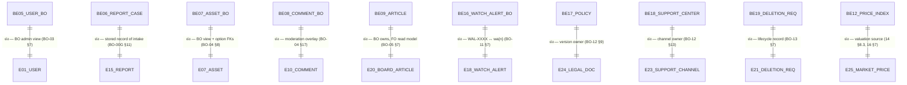
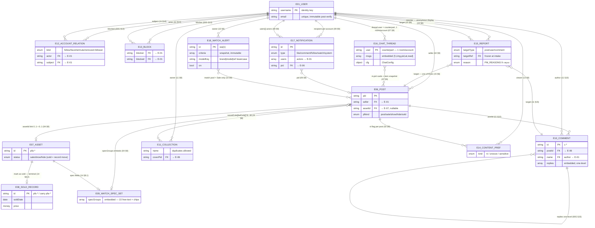
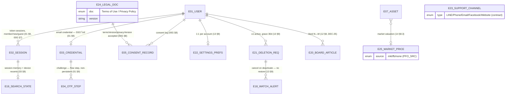
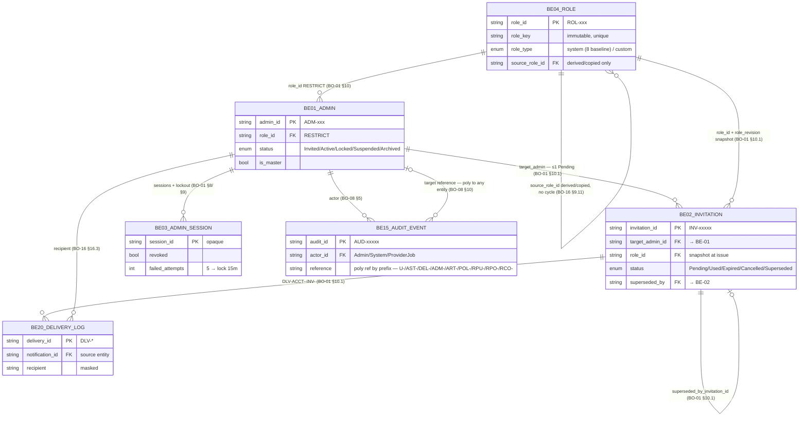

# ERD — TukDaeng (Entity Relationship Diagram + Relationship Mapping)

| รายการ | ข้อมูล |
|---|---|
| Version | 0.1 (draft) |
| Date | 2026-11-05 · Asia/Bangkok |
| Task | BAC-005 [`86f3c8d0`] — Mission `0e19c244` Objective: Data Dictionary & ERD / Feature: ERD |
| Status | **DRAFT — รอ review** (รอพี่มาเต็มตรวจ) |
| Source of truth | `docs/data-dictionary.md` v0.2 (§3 FO entities, §B10 BO entities, §5 + §11 relationships) — ทุก relationship อ้าง spec section ตาม convention `NN §X` / `BO-NN §X` |

## 0. วิธีอ่านเอกสารนี้

- **Notation** = Mermaid `erDiagram` — `||` exactly one, `|o`/`o|` zero-or-one, `}o`/`o{` zero-or-many, `}|`/`|{` one-or-many; label ท้ายเส้นคือ link field + spec ref
- **Naming** = `E0X_NAME` / `BEXX_NAME` map ตรงกับ entity id ใน data-dictionary (E-01..E-25, BE-01..BE-27) — เปลี่ยน `-` เป็น `_` เพราะ mermaid ไม่รับ hyphen ในชื่อ entity
- **Continuation edge (`ต่อ`)** = record เดียวกัน 2 views ข้ามฝั่ง FO↔BO (เช่น BE-05 = BO admin view ของ E-01) — ไม่ใช่ FK join ปกติ แต่เป็น identity mapping ของ record เดียว
- **Embedded structures** (E-09 specGroups, E-16 msgs/cfg, E-19 session state, trigger/status history sub-records) = compose อยู่ใน parent ไม่ใช่ entity อิสระ — แสดงเป็น relationship ตาม inventory แต่ production อาจเป็น sub-document/column ไม่ใช่ตาราง
- ป้าย `(contract)` / `(Phase 2)` / `(postponed)` / `(flow step)` ตาม data-dictionary §0 — contract = spec สำหรับ production, prototype ยังไม่ครอบ
- แบ่ง 5 diagrams ตาม domain เพื่อความอ่านได้: §1 cross-side overview → §2 FO social/content → §3 FO account/system → §4 BO admin/governance → §5 BO moderation/content/master-data; §6 = relationship mapping canonical ทั้งหมด

## 1. Cross-side Overview (FO ↔ BO continuation links)

เส้นทุกเส้นด้านล่างคือ **record เดียวกัน สอง representation** — FO เป็นเจ้าของ intake/read model, BO เป็นเจ้าของ stored/lifecycle/moderation record

Cross-side semantics: report intake (E-15) = action model ไม่มี record → BO owns record (BE-06); watch alert (E-18) FO owns criteria → BO read-only view + trigger history (BE-16); deletion (E-21) FO intake → BO lifecycle (BE-19)

## 2. FO ERD — Social & Content Core

## 3. FO ERD — Account, Session & System

หมายเหตุ: E-23 เป็น reference contract ที่ BO เป็นเจ้าของ (ต่อ BE-18) — render ลง FO Help ไม่มี FK จาก user; E-04 เป็น flow step ไม่ใช่ persistent entity (01 §9: ไม่มี expiry state); E-19 tie กับ session/device ไม่ใช่ account-level

## 4. BO ERD — Admin Identity & Governance

หมายเหตุ: BE-15 `reference` เป็น polymorphic ref แยกตาม prefix (U-/AST-/DEL-/ADM-/ART-/POL-/RPU-/RPO-/RCO-) — diagram แสดง edge ไป Admin เป็นตัวแทน; ทุก write action ในระบบผลิต audit event (BO-08 §7); BE-03 ครอบ session + sign-in lockout + reset token + pwd-change guard ไว้ entity เดียวตาม dictionary

## 5. BO ERD — Moderation, Content & Master Data

```mermaid
erDiagram
    BE05_USER_BO {
        string user_id PK "U-xxxx"
        enum status "6-state contract (BO-00G §10.1)"
    }
    BE06_REPORT_CASE {
        string report_id PK "RPU-/RPO-/RCO- per type (FB-03)"
        string target_ref FK "frozen at intake"
        int reporter_count "unique reporters"
        enum status "Pending/Closed final"
    }
    BE07_ASSET_BO {
        string asset_id PK "AST-"
        string owner_id FK "→ BE-05"
        enum owner_status "Sale/Show/Hide/Sold — admin เปลี่ยนไม่ได้"
        enum moderation_state "None/Admin/Auto/Permanently Hidden — overlay"
    }
    BE08_COMMENT_BO {
        string comment_id PK "RCO-"
        string post_id FK "→ E-06 post anchor — canonical (FE-01)"
        string asset_id FK "derived via post — null เมื่อ post-only (FE-01)"
        enum status "Visible/Hidden/Removed/User Deleted"
    }
    BE16_WATCH_ALERT_BO {
        string alert_id PK "WAL-XXXX"
        string owner FK "→ BE-05"
        array trigger_history "embedded sub-records"
    }
    BE19_DELETION_REQ {
        string request_id PK "DEL-xxx"
        string user_id FK "→ BE-05"
    }
    BE23_OPTION_GROUP {
        string group_id PK "OG-xxx"
        bool is_system "FB-02 resolved"
    }
    BE24_OPTION {
        string option_id PK "OPT-xxx"
        string group_id FK "→ BE-23"
    }
    BE11_MARKET_DATA {
        string id PK "brand/model/reference level"
        string parent_ref FK "self-hierarchy — model nullable on reference"
    }
    BE12_PRICE_INDEX {
        string price_index_id PK
        enum source_level "Brand/Model/Reference"
    }

    BE05_USER_BO ||--o{ BE07_ASSET_BO : "owner_id (BO-04 §8)"
    BE05_USER_BO ||--o{ BE19_DELETION_REQ : "user_id (BO-13 §7)"
    BE05_USER_BO ||--o{ BE06_REPORT_CASE : "reporter history (BO-03 §11)"
    BE05_USER_BO ||--o{ BE16_WATCH_ALERT_BO : "owner (BO-11 §7)"
    BE06_REPORT_CASE }o--|| BE05_USER_BO : "target RPU- frozen (BO-00G §11)"
    BE06_REPORT_CASE }o--|| BE07_ASSET_BO : "target AST-/POST- (BO-00G §11)"
    BE06_REPORT_CASE }o--|| BE08_COMMENT_BO : "target RCO- (BO-04 §16)"
    E06_POST ||--o{ BE08_COMMENT_BO : "post_id anchor — post-only supported (FE-01 DECIDED)"
    BE07_ASSET_BO ||--o{ BE08_COMMENT_BO : "asset_id derived join — null on post-only (BO-04 §17, FE-01)"
    BE19_DELETION_REQ ||--o{ BE06_REPORT_CASE : "auto close pending reports (BO-13)"
    BE19_DELETION_REQ ||--o{ BE20_DELIVERY_LOG : "DLV-DEL-<req>-<event> (BO-14 §9.3)"
    BE16_WATCH_ALERT_BO ||--o{ BE20_DELIVERY_LOG : "DLV-WA-* trigger delivery (BO-11 §12)"
    BE16_WATCH_ALERT_BO ||--o{ BE07_ASSET_BO : "matched assets (trigger history) (BO-11 §7)"
    BE16_WATCH_ALERT_BO }o--o{ BE24_OPTION : "criteria relation ids — contract (BO-06 §16)"
    BE16_WATCH_ALERT_BO }o--o{ BE11_MARKET_DATA : "criteria brand/model/ref (BO-06 §16)"
    BE07_ASSET_BO }o--o{ BE24_OPTION : "condition/case/movement/dial/strap/delivery FKs + snapshot (BO-17 §17.4)"
    BE23_OPTION_GROUP ||--o{ BE24_OPTION : "group_id — UNIQUE(group_id, option_key) (BO-17 §17.2)"
    BE24_OPTION ||--o{ BE27_ALIAS : "option_id — UNIQUE(option_id, normalized_alias) (BO-17 §23.2)"
    BE23_OPTION_GROUP ||--o{ BE26_SUGGESTION : "group_id — 4 กลุ่ม ระบุเอง (BO-17 §23.1)"
    BE26_SUGGESTION }o--o| BE24_OPTION : "resolved_option_id (BO-17 §23.1)"
    BE24_OPTION ||--o{ BE25_SPEC_AUDIT : "option_id (BO-17 §17.3)"
    BE23_OPTION_GROUP ||--o{ BE25_SPEC_AUDIT : "group_id (BO-17 §17.3)"
    BE26_SUGGESTION ||--o{ BE25_SPEC_AUDIT : "suggestion_id (BO-17 §17.3)"
    BE01_ADMIN ||--o{ BE25_SPEC_AUDIT : "actor_admin_id (BO-17 §17.3)"
    BE09_ARTICLE }o--|| BE10_CATEGORY : "category_id — active only (BO-05 §9)"
    BE09_ARTICLE }o--|| BE01_ADMIN : "author = current admin (BO-05 §9)"
    BE11_MARKET_DATA ||--o{ BE11_MARKET_DATA : "Brand 1—N Model 1—N Reference (model nullable) (BO-06 §15)"
    BE11_MARKET_DATA ||--o{ BE12_PRICE_INDEX : "price per level (BO-06 §15.4)"
    BE13_SYNC_JOB ||--o{ BE11_MARKET_DATA : "refresh cache — failed ไม่ replace (BO-06 §13)"
    BE13_SYNC_JOB ||--o{ BE12_PRICE_INDEX : "price sync (BO-06 §13)"
    BE17_POLICY ||--o{ BE17_POLICY : "versions — ≤1 Published + ≤1 Draft per type (BO-12 §9)"
    BE21_BROADCAST }o--o| BE22_TEMPLATE : "Phase 2 (BO-14 §8/§10)"

    BE14_DIRECTORY {
        string note "postponed Phase 1 — ห้ามเปิด route (BO-07)"
    }
    BE18_SUPPORT_CENTER {
        string note "single config record — ต่อ E-23 (BO-12 §13)"
    }
    BE20_DELIVERY_LOG {
        string delivery_id PK "DLV-*"
    }
```

## 6. Relationship Mapping (canonical)

กลุ่ม A — FO internal (source: dictionary §3/§5)

| # | Relationship | Cardinality | Link field | Spec refs | Notes |
|---|---|---|---|---|---|
| F-01 | User → Post | 1—N | `post.seller` | 02 §9 | owner identity = `isOwnPost()` |
| F-02 | Post ↔ Asset | 0..1—0..1 | `post.assetId` | 04 §9 | detach = null; post delete → orphan ตาม F-03 deviation (contract: ลบทั้งคู่) |
| F-03 | Asset → Sold Record | 1—0..1 | carry `pfa-*` → `pfs-*` key เดิม | 14 §8.2 | terminal — ไม่มี path กลับใน V1 |
| F-04 | Post/Asset ⊃ Watch Spec Set | 1—0..1 embedded | `specGroups[]` + `chips[]` | 04 §9, 02 §9 | structure ไม่ใช่ entity อิสระ; option relation ids = contract |
| F-05 | Post → Comment | 1—N | `comment.postId` (`COMMENTS[pid]`) | 11 §10 | |
| F-06 | Comment → Comment (reply) | 1—N self | `replies[]` | 00G §15 | one-level เท่านั้น (IG) |
| F-07 | User → Comment (author) | 1—N | `comment.name` | 11 §10 | block → filter ไม่ลบข้อมูล |
| F-08 | User → Collection | 1—N | owner scope | 11 §8 | Saved กับ Wish List แยกระบบสมบูรณ์ |
| F-09 | Post ↔ Collection | N—M | `post.savedCols[]` / `wlCols[]` | 11 §8 | multi-collection; ลบ collection → ลบชื่อออกทุก post |
| F-10 | User ↔ User — follow/favorite/mute/removed | N—M | `p.following`/`favorite`/`muted` + `PF_EXTRA_*` | 11 §14, 06 §9 | unfollow ล้าง favorite+muted; remove follower = own only |
| F-11 | User ↔ User — block | N—M | `PF_BLOCKED` + `p.blocked` + `th.blocked` | 00G §13, 06 §9 | two-way unfollow + removed-fol auto; unblock ไม่ re-follow |
| F-12 | User ↔ Post — viewer flags (E-14) | N—M | `p.ni`, snooze/sensitive settings | 02 §9, 13 §9 | per-viewer state; restore paths ที่ Settings |
| F-13 | User ↔ Post — like/save/wishlist | N—M | `p.liked`/`saved`/`wishlisted` | 11 §9/§12/§13 | 1 user = 1 like; collections ใน F-09 |
| F-14 | User → Report (reporter) | 1—N | intake only | 15 §6 | anonymous display — record อยู่ BE-06 |
| F-15 | Report → target (post/user/comment) | N—1 (one of) | `targetRef` frozen | 15 §6, 11 §15 | chat report = user-report ผ่าน chat context |
| F-16 | User ↔ User — chat thread | pair | `thread.user` = counterpart key | 07 §9 | 1 ห้องต่อ account (FO-TEST-12 lock) |
| F-17 | ChatThread → Post | N—M refs | `msgs[].pid` + `item.pid` snapshot | 07 §9 | snapshot นิ่ง — post เปลี่ยนไม่กระทบ card |
| F-18 | User → Notification | 1—N per-account | `ALERTS` rows | 09 §9 | read/dismiss persist (server-backed) |
| F-19 | Notification → User (actors) / Post | N—M / N—0..1 | `users[]`, `pid` | 09 §9 | watch rows = alert name + seller + price |
| F-20 | User → Watch Alert | 1—N | `WATCH_ALERTS` owner | 10 §9 | delete account → cancel ถาวร |
| F-21 | Watch Alert → Post (match) | N—M transient | match pool = `Sale` เท่านั้น | 10 §9 | match → `watch` notification → Post Viewer |
| F-22 | Watch Alert → Market Data / Option | N—M (contract) | `modelKey` `brand\|model\|ref` + criteria relation ids | 10 §9, BO-06 §16 | free-text → relation `null` |
| F-23 | User → Session | 1—N | token | 01 §9, 00G §7 | revoke เมื่อ Suspended/Banned/Delete |
| F-24 | User → Credential | 1—0..1 | email identity | 01 §9 | SSO ไม่มี password; guard = per-email lockout |
| F-25 | Credential → OTP step | 1—N flow | challenge | 01 §9 | non-persistent — ไม่ใช่ stored entity |
| F-26 | User → Consent Record | 1—N | consent log | 00G §8 | implied consent ณ action |
| F-27 | Consent Record → Legal Doc | N—1 value ref | `termsVersion`/`privacyVersion` | 00G §8 | version bump → re-consent บังคับ |
| F-28 | User → Settings Prefs | 1—1 | account/device | 13 §9 | device-persist fields แยก tier (§2.6) |
| F-29 | Session → Search State | 1—0..1 | session memory + device recents | 03 §9 | recents ล้างตอน sign out/session change |
| F-30 | User → Deletion Request | 1—N (≤1 active) | `DEL-` intake | 13 §9 | deactivate ทันที + grace 30d |
| F-31 | Deletion Request → Watch Alert | 1—N cancel | `watchAlertsCancelled` | 13 §9 | ไม่กลับหลัง restore |
| F-32 | User ↔ Board Article (liked) | N—M | `liked` per user | 12 §8 | 1 user = 1 like/article; ไม่ใช่ post like |
| F-33 | Asset → Market Price | N—0..1 | `asset.market` | 14 §8.3 | `null` = no valuation; source enum PFO_SRC |

กลุ่ม B — BO internal (source: dictionary §B10/§11)

| # | Relationship | Cardinality | Link field | Spec refs | Notes |
|---|---|---|---|---|---|
| B-01 | Role → Admin | 1—N | `admin.role_id` RESTRICT | BO-01 §10 | ไม่เก็บ permission payload ซ้ำ |
| B-02 | Role → Role (source) | 1—N self | `source_role_id` + `source_revision` | BO-16 §9.11 | derived/copied only; ห้าม cycle |
| B-03 | Admin → Invitation | 1—N | `target_admin_id` | BO-01 §10.1 | ≤1 Pending ต่อ account |
| B-04 | Invitation → Role | N—1 snapshot | `role_id` + `role_revision` | BO-01 §10.1 | activation revalidate |
| B-05 | Invitation → Invitation | 1—0..1 self | `superseded_by_invitation_id` | BO-01 §10.1 | reissue chain |
| B-06 | Admin → Admin Session | 1—N | session_id | BO-01 §8 | revoke individual/all; lockout+reset guard อยู่ใน entity เดียว |
| B-07 | Admin → Audit Event (actor) | 1—N | `actor_id` (+System/ProviderJob) | BO-08 §5 | ทุก write action ผลิต event |
| B-08 | Audit Event → any entity | N—0..1 poly | `reference` ตาม prefix | BO-08 §10 | jump link → entity detail หรือ Audit Log filtered |
| B-09 | Invitation/Admin → Delivery Log | 1—N | `DLV-ACCT-...` | BO-01 §10.1, BO-16 §16.3 | attempt seq ห้าม reuse |
| B-10 | User(BO) → Asset(BO) | 1—N | `asset.owner_id` | BO-04 §8 | owner_status admin เปลี่ยนไม่ได้ — overlay แยก |
| B-11 | Asset(BO) → Option | N—M | `condition_id`/`case_material_id`/`movement_id`/`dial_color_id`/`strap_bracelet_type_id` + `asset_delivery_items.option_id` | BO-17 §17.4 | deactivate ห้าม cascade; snapshot text คู่ relation id |
| B-12 | Report Case → target | N—1 frozen | `target_ref` prefix RPU-/RPO-/RCO- ↔ U-/AST-/POST-/RCO- | BO-00G §11 | frozen ณ intake; detail join current state |
| B-13 | Report Case → Asset (auto-hide) | N—1 effect | unique reporters ≥5 → `Auto Hidden` | BO-04 §14 | เฉพาะ Sale/Show; owner status คง |
| B-14 | Comment(BO) → Post / Asset | N—1 anchor + derived | `post_id` (canonical anchor → E-06); `asset_id` derived ผ่าน `post.assetId` | BO-04 §17, 11 §10 | **FE-01 DECIDED:** รองรับ post-only — `asset_id` null เมื่อ post ไม่ผูก asset; moderation overlay ไม่แก้ต้นฉบับ |
| B-15 | Comment(BO) → author User | N—1 | `author` | BO-04 §17 | |
| B-16 | Article → Category | N—1 | `category_id` active only | BO-05 §9 | deactivate block เมื่อมี linked articles |
| B-17 | Article → Admin (author) | N—1 | `author` = admin ปัจจุบัน | BO-05 §9 | |
| B-18 | Market Data self-hierarchy | 1—N | Brand→Model→Reference | BO-06 §15 | model ref nullable บน Reference |
| B-19 | Market Data → Price Index | 1—N | `source_level` + ref | BO-06 §15.4 | per level Brand/Model/Reference |
| B-20 | Sync Job → Market Data / Price Index | 1—N refresh | `cache_impact` | BO-06 §13 | Failed ไม่ replace cache |
| B-21 | Watch Alert(BO) → User | N—1 | `owner` | BO-11 §7 | read-only + account status |
| B-22 | Watch Alert(BO) → Option / Market Data | N—M | criteria relation ids | BO-06 §16 | `is_active=false` → หยุด trigger + warning |
| B-23 | Watch Alert(BO) → matched Asset | 1—N history | trigger records (sub-record) | BO-11 §7 | delivery `DLV-WA-*` ต่อ trigger |
| B-24 | Watch Alert(BO) → Delivery Log | 1—N | `DLV-WA-*` | BO-11 §12 | |
| B-25 | Deletion(BO) → User | N—1 | `user_id` | BO-13 §7 | |
| B-26 | Deletion(BO) → Report Case | 1—N effect | auto close pending reports | BO-13 | lifecycle side-effect |
| B-27 | Deletion(BO) → Delivery Log | 1—N | `DLV-DEL-<req>-<event>` | BO-14 §9.3 | 5 lifecycle emails + reminder 7/3 วัน |
| B-28 | Option Group → Option | 1—N | `group_id`, `UNIQUE(group_id, option_key)` | BO-17 §17.2 | snake_case ห้าม rename |
| B-29 | Option → Alias | 1—N | `option_id`, `UNIQUE(option_id, normalized_alias)` | BO-17 §23.2 | |
| B-30 | Option Group → Suggestion | 1—N | `group_id` | BO-17 §23.1 | เฉพาะ 4 กลุ่ม `ระบุเอง` |
| B-31 | Suggestion → Option | N—0..1 | `resolved_option_id` | BO-17 §23.1 | promote/map resolution |
| B-32 | Option/Group/Suggestion → Spec Audit | N—1 | `option_id`/`group_id`/`suggestion_id` | BO-17 §17.3 | option nullable เมื่อ group-level |
| B-33 | Admin → Spec Audit | 1—N | `actor_admin_id` | BO-17 §17.3 | |
| B-34 | Policy → Policy Version | 1—N self (ใน entity เดียว) | version rows | BO-12 §9 | ≤1 Published + ≤1 Draft per type |
| B-35 | Broadcast → Template | N—0..1 (Phase 2) | template ref | BO-14 §8/§10 | future scope |
| B-36 | Directory ↔ (none live) | — | — | BO-07 §6–8 | postponed Phase 1 — ห้ามเปิด route |

กลุ่ม C — Cross-side links (FO ↔ BO — record เดียวกัน / data flow)

| # | Link | ชนิด | Spec refs | Notes |
|---|---|---|---|---|
| X-01 | E-01 ↔ BE-05 | same record · BO admin view | BO-03 §7 | `U-xxxx` ↔ `username` |
| X-02 | E-15 → BE-06 | intake → stored record | 15 §6, BO-00G §11 | FO ไม่มี record — BO owns; prefix RPU-/RPO-/RCO- ตาม target type |
| X-03 | E-07 ↔ BE-07 | same record · BO view + option FKs | BO-04 §8 | moderation overlay อยู่ฝั่ง BO เท่านั้น |
| X-04 | E-10 ↔ BE-08 | same record · moderation overlay | BO-04 §17, 11 §10 | `RCO-` ↔ `c-*`; anchor ร่วม = `postId`/`post_id` (FE-01 DECIDED — post-only รองรับ, `asset_id` derived) |
| X-05 | E-20 ← BE-09 | BO owns record → FO read model | BO-05 §7, 12 §8 | `ART-` ↔ `b{n}`; author ฝั่ง FO = `Tuk Daeng` hardcode |
| X-06 | E-18 ↔ BE-16 | same record · `wa{n}` ↔ `WAL-XXXX` | 10 §9, BO-11 §7 | FO owns criteria; BO view read-only + trigger history |
| X-07 | E-24 ← BE-17 | BO owns versions → FO legal viewer + re-consent | 00G §8, BO-12 §9 | version bump → re-consent (E-05) |
| X-08 | E-23 ← BE-18 | BO owns channels → FO Help render | 13 §9, BO-12 §13 | contract — prototype ยังไม่ครอบ |
| X-09 | E-21 ↔ BE-19 | intake → lifecycle record | 13 §9, BO-13 §7 | grace/restore/reject/hard-delete lifecycle |
| X-10 | E-25 ← BE-11/BE-12 | market data + price index → asset valuation | 14 §8.3, 16 §7, BO-06 §14 | provider sync → internal cache → FO อ่าน cache |
| X-11 | BE-16 trigger → E-17 | trigger → `watch` notification row | BO-11 §12, 09 §9 | delivery `DLV-WA-*` → FO alert |

## 7. Notes & Caveats

- **Non-persistent / embedded**: E-04 (flow step), E-09 (embedded structure), E-16 msgs/cfg + E-19 (state objects), status_history/trigger/matched-asset/deletion-timeline sub-records — เป็น composition ใน parent ไม่ใช่ entity อิสระ (dictionary §8 sub-records note)
- **Polymorphic refs**: BE-15 `reference` และ BE-20 `source`/`notification_id` ชี้ได้หลาย entity ตาม prefix — diagram แสดงตัวแทนเท่านั้น; resolve ตาม §9.1 prefix table
- **Report target**: frozen ref ณ intake (`POST-` ไม่เปลี่ยนเป็น `AST-` ย้อนหลัง) — detail join current state เสมอ (BO-00G §11)
- **Moderation overlay ≠ owner status**: BE-07 `moderation_state`/`system_state` แยกจาก `owner_status` (BO-00G §10.2); BE-08 status เป็น overlay เหมือนกัน ไม่แก้ต้นฉบับ comment
- **Comment anchor (FE-01 DECIDED 2026-11-05)**: comment ทุกฝั่ง anchor ที่ **post** เป็น canonical — `post_id` = FK หลักของ BE-08, `asset_id` เป็น derived join ผ่าน `post.assetId` (null เมื่อ post-only kind `post`) — หลักเดียวกับ FB-06 exception ฝั่ง report; **spec อัปเดตแล้ว** (BO-04 §16 Required Fields + §17 Reported Comment Reference, 2026-11-05)
- **Notification traceability (FE-02 DECIDED 2026-11-05)**: production schema ของ notification `watch` rows ต้องเก็บ `alert_id` (ref กลับ `wa{n}`/`WAL-XXXX`) — notification เป็น delivery artifact ต้อง trace กลับ source ได้เหมือน subsystem อื่น (DLV-WA-*, AUD-*); V1 prototype UI ไม่เปลี่ยน — **spec อัปเดตแล้ว** (09 §9 Data Model Rule + 10 §9 contract item 6, 2026-11-05)
- **Deferred**: BE-14 (postponed), BE-21/BE-22 (Phase 2), Reported Article queue (ถอดตาม FO-BO-001 e4) — อยู่ใน dictionary inventory แต่ไม่มี live flow ใน V1
- **Viewer-level N—M** (like/save/wishlist/follow/mute/block/ni) ใน prototype เป็น flag บน post record + `PF_*` lists — production ควรเป็น join table ตาม §4 Flag Matrix; ERD นี้ model เป็น relation entities (E-12/E-13/E-14) ตาม dictionary kind

## 8. Findings (บันทึกเท่านั้น — ไม่แก้ spec)

| # | Finding | Spec refs | ผลกระทบ ERD |
|---|---|---|---|
| FE-01 | ~~BE-08 `asset_id` anchor comments ไว้ใต้ asset แต่ FO E-10 anchor ที่ `postId` — comment บน post-only (kind `post` ไม่มี asset) join ไม่ได้~~ **DECIDED 2026-11-05 ตามอนุมัติพี่มาเต็ม:** comment anchor ที่ post เป็น canonical — `post_id` = FK หลัก, `asset_id` derived ผ่าน `post.assetId` null เมื่อ post-only; หลักเดียวกับ FB-06 exception ฝั่ง report — **spec แก้แล้ว (BO-04 §16/§17)** | BO-04 §17 vs 11 §10 | B-14/X-04 + D5 อัปเดตแล้ว — post-only comment รองรับครบ |
| FE-02 | ~~E-17 `watch` notification ไม่มี alert id ref — เก็บแค่ `pid` + `name`/`price`~~ **DECIDED 2026-11-05 (recommended):** production schema ต้องเก็บ `alert_id` บน `watch` rows — notification = delivery artifact ต้อง trace กลับ source ได้เหมือน subsystem อื่น; ไม่เช่นนั้น moderation/support ตอบ "alert นี้ส่ง notif อะไรไปบ้าง" ไม่ได้ — **spec แก้แล้ว (09 §9 + 10 §9)** | 09 §9, 10 §9 | X-11 ยัง flow link ใน V1; `alert_id` เป็น contract field สำหรับ production schema |
